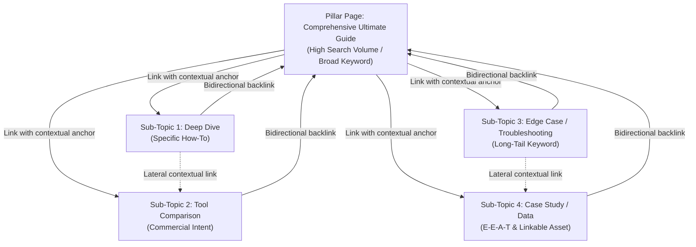

# Topical Authority & Semantic Cluster Builder

Dominate Google rankings by establishing **Semantic Topical Authority**. Modern search engines do not rank single isolated blog posts; they reward domains that provide **complete, exhaustive coverage of an entire entity domain** through structured topic clusters.

---

## 🏛️ The Hub-and-Spoke (Pillar-Cluster) Architecture

---

## 🚀 The 4-Step Cluster Construction Workflow

### Step 1: Broad Entity & Sub-Topic Mapping
Identify the overarching core entity (e.g., *"Email Marketing for SaaS"*).
Deconstruct the core entity into 4 intent buckets:
1. **Definitive / Foundational**: What it is, foundational mechanics, core terminology.
2. **Tactical / Execution**: Step-by-step how-to, setup guides, workflow implementation.
3. **Commercial / Evaluative**: Tool comparisons, cost breakdowns, software reviews.
4. **Strategic / Advanced**: Benchmarks, case studies, metric optimization, edge cases.

### Step 2: The Core Pillar Page (The Hub)
- **Target Keyword**: High-volume, competitive head term (e.g., *"SaaS Email Marketing"*).
- **Format**: Comprehensive 3,000–5,000 word ultimate guide covering the 30,000-foot view of all sub-topics.
- **Rule of Breadth over Depth**: The pillar introduces each sub-topic in 300 words, then links out to the dedicated spoke article for the deep dive.

### Step 3: Supporting Spoke Articles (The Cluster)
- **Target Keywords**: 8 to 15 long-tail, low-to-medium competition queries.
- **Depth**: 1,200 to 2,000 words focusing laser-sharp on one specific sub-question.
- **Mandatory Link Rule**: Every spoke article MUST link back to the pillar page within the first 20% of its content using exact or partial-match anchor text.

### Step 4: Lateral Internal Linking (The Authority Web)
Spokes within the same cluster must link to each other when contextually relevant.
- *Example*: In an article about *"SaaS Onboarding Emails"*, laterally link to *"SaaS Churn Reduction Email Templates"*.
- **Never cross-link unrelated clusters**: Do not link your Email Marketing cluster spokes randomly into your Database Architecture cluster, as this dilutes semantic topic focus.

---

## 🔗 Internal Linking Anchor Text Rules

1. **Descriptive & Contextual**: Never use generic anchor text like *"click here"*, *"read more"*, or *"link"*.
2. **Anchor Variation**: Use a 70/20/10 split across links:
   - 70% Natural partial-match phrase: *"learn how to [configure automated drip campaigns]"*
   - 20% Exact target keyword: *"our guide to [email sequence optimization]"*
   - 10% Branded / Topical phrase: *"the [Company] SaaS email marketing handbook"*
3. **High-PageRank Link Reclamation**: When a new spoke is published, immediately edit 2–3 existing high-traffic pages on your site to link directly to the new spoke.
