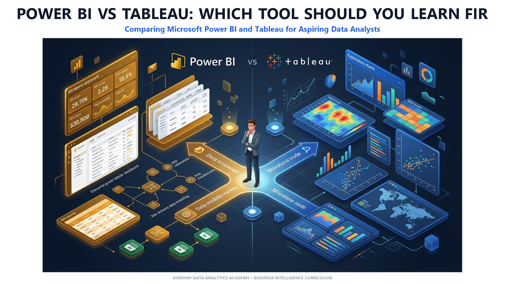
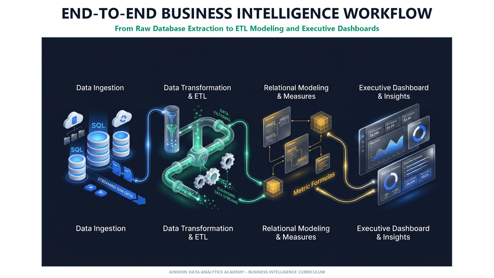

# Metadata Header
**Meta Title:** Power BI vs Tableau: Which BI Tool to Learn First?
**Meta Description:** Compare Power BI vs Tableau for beginners. Discover learning curves, costs, DAX vs VizQL, and job demand to choose your first business intelligence tool.
**Primary Keyword:** Power BI vs Tableau
**Secondary Keywords:** which BI tool to learn first, Power BI vs Tableau for beginners, business intelligence tools comparison, data analyst visualization skills
---

# Power BI vs Tableau: Which Tool Should You Learn First?

If you are beginning your analytics journey, Power BI is generally the best tool to learn first due to its smooth transition from Microsoft Excel, budget-friendly desktop accessibility, and extensive corporate adoption across business teams. Tableau remains the premier choice for professionals focused primarily on exploratory visual design, custom graphical storytelling, and large-scale enterprise deployments.

Both platforms transform raw business metrics into interactive dashboards, yet each addresses distinct analytical requirements. Understanding their core distinctions helps you establish clear career milestones across your broader [Data Analytics certification](https://aindhin.com/data-analytics) without wasting study time.

*Figure 1: Decision criteria comparing Microsoft Power BI and Tableau for aspiring data analysts.*

## Data Modeling and Data Preparation Workflows

The fundamental difference between these two business intelligence platforms lies in how they clean, shape, and structure incoming records. Power BI relies on Power Query for extract, transform, and load operations alongside the VertiPaq tabular database engine. Users build relational star schemas and write Data Analysis Expressions (DAX) to compute dynamic metrics. This setup feels immediately familiar to anyone who works with Excel formulas and pivot tables. 

Before building complex dashboard calculations in either platform, analysts must extract clean records using our [SQL foundations of data querying](https://aindhin.com/sql-foundations-of-data-querying-databases). In contrast, Tableau focuses heavily on direct visual exploration through its proprietary VizQL engine. While Tableau Prep handles data preparation, the software shines brightest when pointed at pre-cleaned database tables where users drag and drop dimensions and measures directly onto visual shelves.

| Evaluation Category | Microsoft Power BI | Salesforce Tableau |
| :--- | :--- | :--- |
| **Data Modeling** | Power Query ETL, tabular star schema, DAX formulas | Tableau Prep, visual relationships, physical joins |
| **Visual Customization** | Standard templates, custom AppSource visuals | Granular shelf control, custom dual-axis charts |
| **Learning Curve** | Shorter for Excel users; DAX requires dedicated practice | Intuitive drag-and-drop visuals; complex calculated fields |
| **Pricing & Access** | Free Power BI Desktop; affordable Pro cloud licensing | Free Tableau Public (public workbooks only); higher enterprise cost |
| **Ecosystem Fit** | Native Microsoft 365, Teams, and Azure integration | Robust standalone server, Salesforce CRM, multi-cloud |

*Figure 2: Architectural and practical comparison across modeling, cost, and visualization.*

## Cost, Community, and Job Market Demand

Licensing models substantially influence which tool businesses choose. Power BI Desktop is completely free for individual learning on Windows, allowing beginners to build complete dashboards locally without paying subscription fees. According to industry evaluations in the [Magic Quadrant for Analytics and BI Platforms](https://www.gartner.com/en/documents/magic-quadrant-analytics-bi-platforms), Microsoft leads the global market in enterprise adoption volume.

Tableau provides Tableau Public for free practice, but all saved workbooks are published to an open web portfolio rather than stored privately. While Tableau commands strong demand among dedicated data visualization specialists, Power BI job openings frequently outnumber Tableau roles in general corporate reporting.

If your career path targets fast business integration, start with Power BI to build instant utility with corporate stakeholders. If your passion centers on specialized visual journalism or complex exploratory analytics, Tableau offers unmatched creative freedom. At [Aindhin](https://aindhin.com/), India's industry-aligned online academy for job-ready certifications, learners master both tools through our structured [Tableau business intelligence training](https://aindhin.com/tableau-data-visualization-business-intelligence) and practical analytics modules, building the versatile skill set required for top analytical roles.

## Frequently Asked Questions

### Can I learn Power BI and Tableau at the same time?
Focus on one tool first to master core dashboard design principles before switching, preventing confusion between DAX formulas and Tableau calculated fields.

### Do I need to know coding before learning Power BI or Tableau?
Neither tool requires traditional coding, though basic SQL knowledge and standard spreadsheet formula logic help accelerate your dashboard development learning curve significantly.

### Which tool offers better free options for beginners?
Power BI Desktop is completely free for private offline practice, while Tableau Public is free but requires publishing workbooks to an open gallery.
