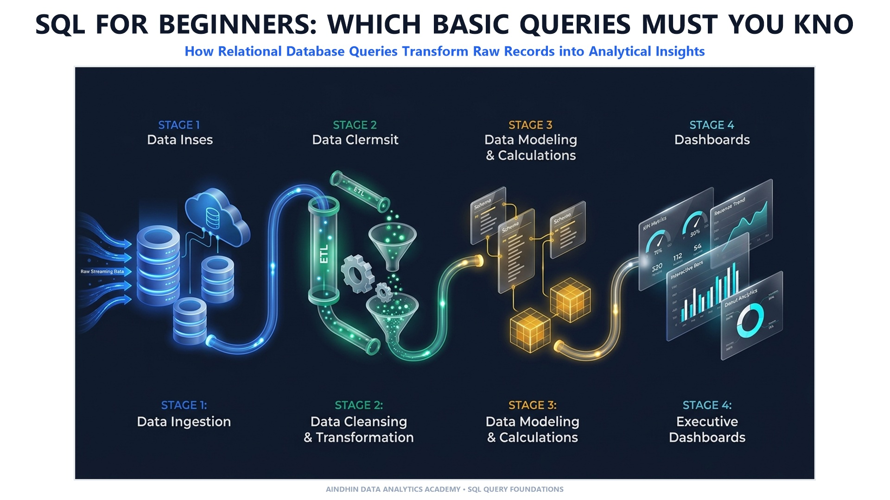
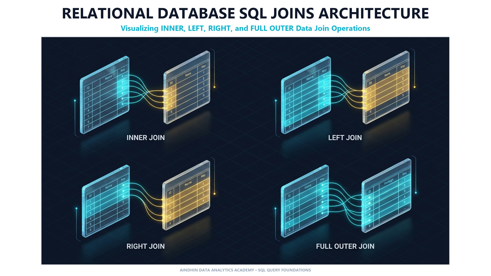

# Metadata Header
**Meta Title:** SQL for Beginners: Basic Queries Every Data Analyst Must Know
**Meta Description:** Learn SQL for beginners with essential queries every data analyst should know, covering SELECT, WHERE, GROUP BY, and JOIN syntax with real business examples.
**Primary Keyword:** SQL for beginners
**Secondary Keywords:** basic SQL queries for data analysts, SQL query examples, learn SQL for data analytics, Aindhin SQL course, SQL SELECT WHERE JOIN
---

# SQL for Beginners: Basic Queries Every Data Analyst Should Know

Every beginner data analyst must master core SQL queries including selecting columns, filtering rows with conditional logic, calculating grouped aggregate metrics, and merging relational tables using joins. Structured Query Language is the global foundation of data analysis, empowering analysts to extract actionable insights directly from enterprise databases.

Whether inspecting customer order volumes, evaluating marketing campaign conversions, or tracking product inventory, relational databases respond to standardized declarative statements. As detailed in our comprehensive [Data Analytics program](https://aindhin.com/data-analytics), learning SQL syntax provides the essential technical bridge between raw backend data tables and interactive business intelligence dashboards.

*Figure 1: SQL query execution flow and essential database syntax clauses.*
*Alt Text: Technical diagram illustrating SQL query execution order and core clauses.*

## 5 Essential SQL Queries for Aspiring Analysts

Mastering the [ANSI Structured Query Language standard](https://en.wikipedia.org/wiki/SQL) begins with understanding the logical execution flow of foundational database commands:

* **Selecting Columns and Specifying Tables:** The foundational command retrieves specific attributes from a dataset. For example, `SELECT customer_id, order_total FROM sales_orders;` extracts transaction details without loading unnecessary column bloat. In production environments, specifying column names reduces database memory load compared to generic wildcard selections.
* **Filtering Row Data with Conditions:** Using the `WHERE` clause isolates specific records based on logical criteria. Running `SELECT * FROM employees WHERE department = 'Analytics' AND salary >= 60000;` screens out irrelevant rows before calculations begin.
* **Aggregating and Grouping Business Data:** The `GROUP BY` clause works alongside mathematical functions like `SUM`, `AVG`, and `COUNT`. Querying `SELECT city, COUNT(customer_id) AS total_users FROM customers GROUP BY city;` generates regional customer distributions to identify high-performing geographic territories.
* **Filtering Grouped Results with Having:** Unlike `WHERE`, which filters individual rows before grouping, `HAVING` filters aggregated calculations. For example, `HAVING COUNT(order_id) > 5;` isolates high-frequency repeat purchasers from casual one-time buyers.
* **Combining Tables Through Joins:** Real-world analytics requires mastering query joins through our [foundations of data querying and databases](https://aindhin.com/sql-foundations-of-data-querying-databases). Executing an `INNER JOIN` connects sales transactions directly to customer demographic tables via matching primary keys, while a `LEFT JOIN` preserves all primary records even when corresponding purchase history is missing.

## Core SQL Clauses Reference Matrix

Understanding the sequence in which database engines process instructions prevents common syntax errors. Writing queries according to logical execution order ensures optimal database query speed and clean reporting.

| SQL Clause | Logical Execution Step | Primary Analytic Purpose | Syntax Code Example |
| :--- | :--- | :--- | :--- |
| **FROM** | First (Identifies Data Source) | Designates target database tables | `FROM ecommerce_orders` |
| **WHERE** | Second (Filters Records) | Restricts rows by specific criteria | `WHERE order_status = 'Completed'` |
| **GROUP BY** | Third (Aggregates Values) | Combines rows by categorical keys | `GROUP BY region, product_category` |
| **SELECT** | Fifth (Projects Columns) | Outputs chosen metrics & calculations | `SELECT region, SUM(revenue)` |

*Figure 2: Visual architecture of relational database SQL JOIN operations.*
*Alt Text: Venn diagram architecture illustrating INNER JOIN, LEFT JOIN, and RIGHT JOIN.*

## Launching Your Data Analytics Career with Aindhin

Learning SQL syntax from static documentation can feel abstract, but solving real business case studies builds practical confidence. Offered by [Aindhin](https://aindhin.com/), India's premier online learning academy dedicated to bridging the academic gap with job-ready industry skills, students master database querying alongside practical dashboard creation in our [Power BI business intelligence training](https://aindhin.com/power-bi-data-visualization-business-intelligence). Combining structured SQL problem sets with interactive projects in Power BI and Tableau, Aindhin equips aspiring analysts with portfolio-ready technical credentials. Practice these fundamental query clauses daily on public datasets to transform raw numbers into strategic organizational growth.

## Frequently Asked Questions

### Which SQL dialect should a beginner data analyst learn first?
Beginners should start with PostgreSQL or MySQL because their syntax strictly follows standard ANSI SQL, transferring seamlessly to enterprise databases.

### What is the difference between the WHERE and HAVING clauses?
The WHERE clause filters individual rows before data aggregation occurs, whereas the HAVING clause filters summarized values after GROUP BY processing.

### How long does it take for a beginner to learn SQL?
Most beginners acquire working proficiency in basic SQL queries, joins, and aggregations within four to six weeks of hands-on daily practice.
