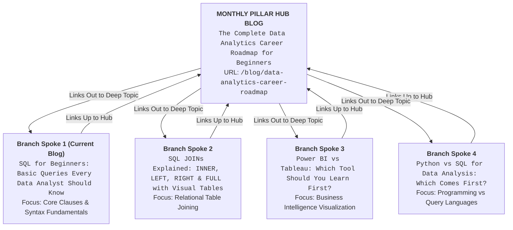

# Monthly Topic Cluster Architecture: Data Analytics & SQL (Aindhin)

## 1. Pillar Hub & Branch Spoke Hierarchy

---

## 2. Cluster Linking Plan
* Branch Spoke 1 links up to the Pillar Hub (`/blog/data-analytics-career-roadmap`) and links out to Branch Spoke 2 (`/blog/sql-joins-explained-data-analysts`).
* Course Connection: Links naturally to Aindhin's certified Data Analytics training program (`/courses/data-analytics`).

