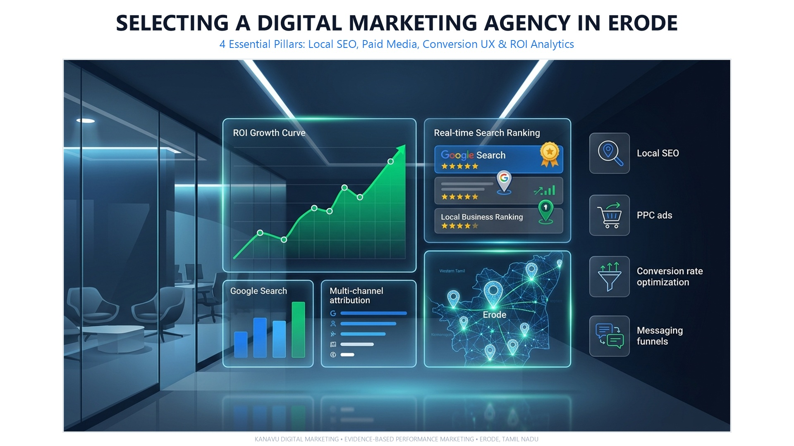
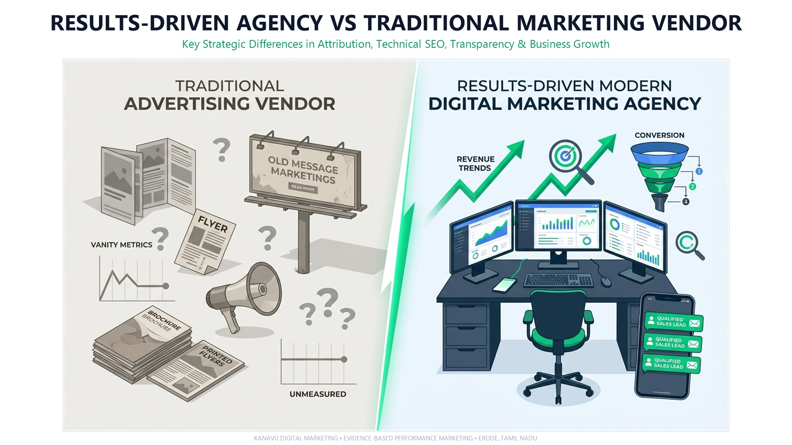

# Metadata Header
**Meta Title:** Best Digital Marketing Agency in Erode | Kanavu Digital
**Meta Description:** Discover how the best digital marketing agency in Erode drives measurable ROI with local SEO, performance ads, and transparent attribution for regional businesses.
**Primary Keyword:** Digital Marketing Agency in Erode
**Secondary Keywords:** Best Digital Marketing Agency in Erode, SEO Services in Erode, Social Media Marketing Erode, Local Business Growth Erode, Performance Marketing Agency Erode, Kanavu Digital Marketing Services, ROI-Driven Marketing Erode
---

# Best Digital Marketing Agency in Erode | Kanavu Digital

The best digital marketing agency in Erode combines localized search prominence, performance advertising, and conversion-focused web development to generate qualified commercial inquiries for regional enterprises. Rather than chasing vanity social impressions, growth-focused businesses require systematic lead pipelines tailored to Western Tamil Nadu's competitive industrial corridor. Modern digital marketing enables traditional enterprises to expand beyond regional geographic boundaries, attracting high-value commercial partnerships across domestic and international trade markets. From power loom textile manufacturers and turmeric wholesale exporters to multi-specialty healthcare centers and retail showrooms, local commercial success relies on capturing high-intent search queries. As documented across our [digital marketing knowledge hub](https://tech.kanavu.org/blogs/digital/), high-impact agency partnerships replace guesswork with transparent data analytics, ensuring every marketing investment directly supports long-term revenue growth.

*Figure 1: 4 core pillars for evaluating a digital marketing agency in Erode.*
*Alt Text: Infographic detailing 4 core digital marketing pillars for Erode businesses.*

## 4 Essential Pillars of Regional Marketing Growth

Sustainable digital expansion requires an integrated marketing architecture rather than isolated promotional campaigns. A capable agency builds sustainable brand visibility upon four technical disciplines:

* **Localized Technical SEO:** Optimizing Google Business Profiles, regional citations, and local schema markup ensures prominent visibility when prospective buyers search for nearby industrial suppliers or medical specialists. Businesses should implement proven [local SEO strategies for regional enterprises](https://tech.kanavu.org/blogs/digital/local-seo-strategies-erode-businesses) to capture high-intent regional traffic.
* **Intent-Driven Paid Acquisition:** Precision targeting across Google Search and Meta platforms focuses advertising budgets strictly on qualified decision-makers, significantly lowering customer acquisition costs.
* **Conversion-Optimized Architecture:** Developing high-speed mobile landing pages that comply with [Google Search Central guidelines](https://developers.google.com/search/docs/fundamentals/creating-helpful-content) turns casual web visitors into verified business consultations.
* **Multi-Touch Attribution Analytics:** Modern attribution models connect organic rankings, pay-per-click campaigns, and social media touchpoints into unified revenue dashboards. Transparent reporting metrics track organic keyword positions, inbound phone inquiries, and cost per lead, eliminating speculative marketing reports and ensuring full budget accountability.

## Results-Driven Agency vs Traditional Advertising Vendor

Traditional marketing vendors in regional hubs often focus exclusively on static print collateral or decorative social media posts that generate minimal commercial inquiries. In contrast, modern performance marketing aligns creative campaigns with measurable customer pipelines and verifiable return on investment.

| Evaluation Metric | Results-Driven Agency | Traditional Vendor |
| :--- | :--- | :--- |
| **Search Engine Strategy** | Technical SEO, local schema, organic authority | Keyword stuffing or unindexed web pages |
| **Performance Attribution** | Real-time lead tracking, ROAS analytics | Vanity impressions and broad reach estimates |
| **Campaign Customization** | Sector-specific funnels (textiles, health, retail) | Generic static social media templates |
| **Conversion Optimization** | Fast mobile pages, WhatsApp lead capture | Slow brochure websites without tracking |

*Figure 2: Performance agency vs traditional advertising vendor comparison matrix.*
*Alt Text: Comparison table showing differences between results-driven digital marketing and traditional vendors.*

## How to Choose the Right Partner in Erode

Selecting the right digital marketing partner in Erode requires auditing technical capability, reporting transparency, and regional industry familiarity. Business leaders should request live campaign case studies, verified local search rankings, and direct communication protocols before signing long-term contracts. Avoid agencies making unsubstantiated claims of overnight ranking guarantees or speculative lead projections.

At Kanavu Digital, we bridge modern digital performance with regional commercial realities. Our team specializes in comprehensive [Kanavu Digital Marketing services](https://tech.kanavu.org/services/digital-marketing), empowering Erode manufacturers, healthcare providers, and local retailers with clean technical SEO, disciplined ad management, and transparent attribution reporting. Contact our team today to schedule an initial digital audit and discover actionable opportunities for scalable business growth.

## Frequently Asked Questions

### How much does digital marketing cost for an Erode business?
Monthly agency retainers in Erode typically range from fifteen thousand to seventy-five thousand rupees, depending on scope, ad budgets, and technical requirements.

### How long does it take to see organic SEO results?
Most local businesses experience measurable increases in search impressions and inquiries within three to six months of consistent technical search engine optimization.

### Can digital marketing help traditional B2B textile manufacturers in Erode?
Yes, targeted search engine marketing, LinkedIn campaigns, and localized directory optimization regularly generate verified domestic wholesale inquiries and global textile export leads.
