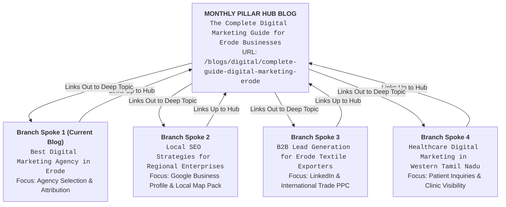

# Monthly Topic Cluster Architecture: Kanavu Digital Marketing

## 1. Pillar Hub & Branch Spoke Structure

---

## 2. Monthly Editorial Editorial Roadmap

| Month / Stage | Content Role | Working Blog Title | Primary Target Keyword | Interlinking Protocol |
| :--- | :--- | :--- | :--- | :--- |
| **Month 1 (Core Authority)** | **Pillar Hub** | *The Complete Digital Marketing Strategy Guide for Erode Businesses* | `Digital Marketing Strategy Erode` | Hub links out to all 4 monthly spokes; captures broad organic intent. |
| **Month 1 (Spoke 1)** | **Commercial Spoke** | *Best Digital Marketing Agency in Erode \| Kanavu Digital* | `Digital Marketing Agency in Erode` | Links to Pillar Hub (`/blogs/digital/`) & Local SEO Spoke (`/local-seo-strategies-erode-businesses`). |
| **Month 1 (Spoke 2)** | **Technical Spoke** | *Local SEO Strategies for Regional Enterprises in Tamil Nadu* | `Local SEO Services Erode` | Cross-links with Agency Spoke; establishes regional Google Maps dominance. |
| **Month 2 (Spoke 3)** | **Industry Vertical** | *B2B Digital Marketing for Textile & Garment Exporters in Erode* | `Textile Digital Marketing Erode` | Targeted lead generation for power loom and yarn manufacturing clusters. |
| **Month 2 (Spoke 4)** | **Industry Vertical** | *Healthcare Marketing: How Erode Hospitals Attract Nearby Patients* | `Hospital Marketing Agency Erode` | Captures high-trust medical queries and multi-specialty clinic footfall. |

