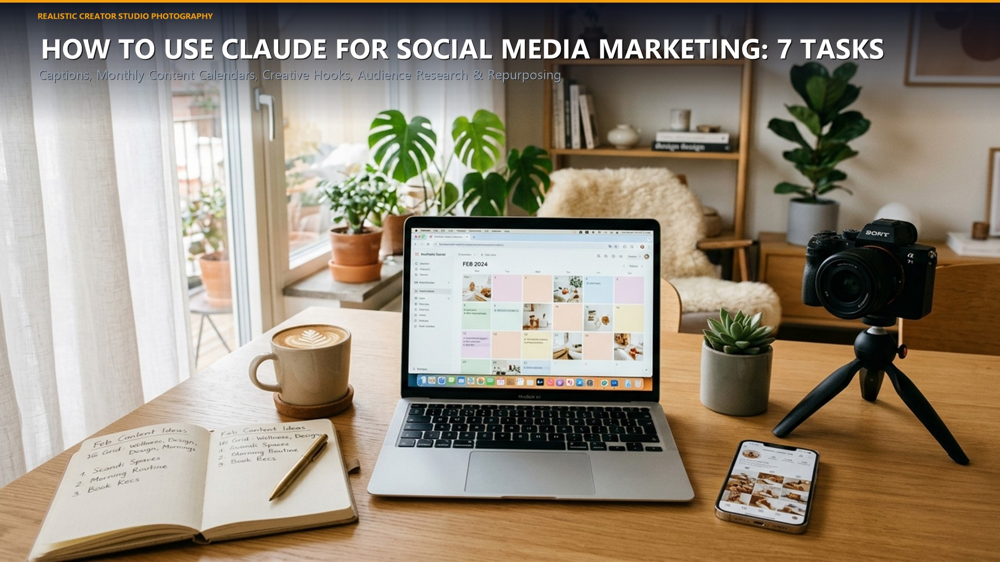
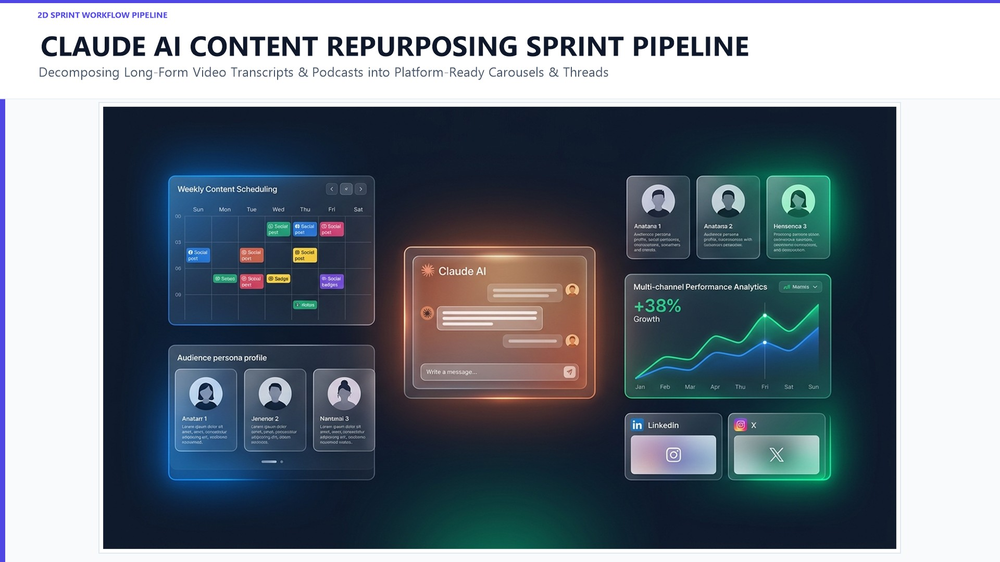

# Metadata Header

**Meta Title:** How to Use Claude for Social Media Marketing: 7 Tasks
**Meta Description:** A tactical practitioner playbook on using Claude AI for social media marketing: master audience research, content repurposing, and multi-platform publishing.
**Primary Keyword:** Claude for Social Media Marketing
**Secondary Keywords:** Claude AI social media captions, AI content calendar Claude, social media repurposing Claude, Claude AI marketing prompts, AI campaign ideas social

---

# How to Use Claude for Social Media Marketing: 7 Tasks You Can Simplify with AI

Using Claude for social media marketing enables digital marketers to draft high-converting Claude AI social media captions, build structured publishing calendars, conduct deep audience persona research, and brainstorm fresh AI campaign ideas social teams can launch with confidence. As an agile creative partner, Claude cuts administrative drafting time in half while preserving natural brand voice.

Achieving standout social performance requires feeding artificial intelligence clear brand constraints, verified messaging guidelines, and concrete customer personas rather than posting generic automated copy. Through our [digital marketing intelligence network](https://www.kanavu.org/digital/), we teach creative growth teams how to combine artificial intelligence workflows with authentic human storytelling to maintain high engagement across modern social feeds.

*Figure 1: Captions, Monthly Content Calendars, Creative Hooks, Audience Research & Repurposing.*
*Alt Text: Photograph illustrating how to use claude for social media marketing.*

## Overcoming the Weekly Content Production Bottleneck

Content marketing teams frequently lose fifteen to twenty hours every week to manual administrative chores. Deploying Claude within structured operational sprints eliminates this friction:

* **Sprint 1: Audience Sentiment Mining:** Claude analyzes customer review transcripts and support tickets to uncover emotional pain points, recurring objections, and authentic customer vocabulary.
* **Sprint 2: Editorial Scheduling:** Building a structured monthly AI content calendar Claude workflow keeps publishing on track by distributing educational insights, case studies, and community questions evenly across thirty-day grids.
* **Sprint 3: Platform-Native Tone Calibration:** Claude reformats core insights into concise conversational threads on X, insightful carousel slides on LinkedIn, and punchy visual captions for Instagram.
* **Sprint 4: Multi-Channel Repurposing:** Executing streamlined social media repurposing Claude sprints allows creators to decompose sixty-minute webinar transcripts into memorable soundbites, actionable takeaways, and quote cards in seconds.

> **Actionable Claude Prompt Recipe:** "Analyze customer review transcripts. Extract the top three customer objections and exact phrases buyers use. Draft three educational LinkedIn posts addressing each objection using a conversational tone with zero buzzwords and zero exclamation marks."

As detailed in our research on [agile web production and content workflows](https://www.kanavu.org/digital/how-modern-websites-are-built-inside-kanavu-startups-web-development-process/), integrating assistive AI tools into editorial workflows allows copywriters to spend eighty percent of their energy on creative direction and community interaction.

*Figure 2: Decomposing Long-Form Video Transcripts & Podcasts into Platform-Ready Carousels & Threads.*
*Alt Text: Conceptual diagram illustrating claude ai content repurposing sprint pipeline.*

## Quality Safeguards and Practical Prompt Architecture

To achieve reliable brand consistency, marketing teams assemble verified libraries of Claude AI marketing prompts with explicit negative constraints that forbid generic conversational filler and corporate buzzwords.

> **Practitioner Editorial Rule:** Treat artificial intelligence as an eager junior researcher rather than an autonomous publisher. Every generated hook, carousel slide, and caption requires human editorial review to confirm technical accuracy and preserve genuine brand voice.

## Scaling Social Growth with Kanavu Digital Marketing

Building a resilient, high-converting social media presence requires strategic clarity, creative agility, and systematic production workflows. At [Kanavu Digital Marketing](https://www.kanavu.org/), we guide manufacturing businesses in Erode, regional consumer brands, and fast-growing enterprises across Tamil Nadu in building scalable organic social engines. Through our specialized [social media and digital marketing masterclasses](https://www.kanavu.org/academy/), we assist marketing teams in developing structured prompt libraries, streamlining editorial workflows, and tracking multi-channel social conversions. We help your business turn social interactions into measurable brand loyalty and steady customer acquisition.

## Frequently Asked Questions

### Can Claude write captions that match our specific brand voice accurately?

Yes, providing Claude with your brand style guide, existing top-performing posts, and clear tone parameters produces remarkably consistent, authentic voice alignment.

### How does Claude handle repurposing long video transcripts into short posts?

Claude processes large transcripts rapidly, isolating key insights, memorable soundbites, and actionable takeaways to generate platform-ready carousels, threads, and short captions.

### Is AI-generated social media content penalized by platform ranking algorithms?

Social platforms evaluate audience engagement, dwell time, and interaction rather than production method, rewarding helpful, entertaining content regardless of assistive AI creation.
