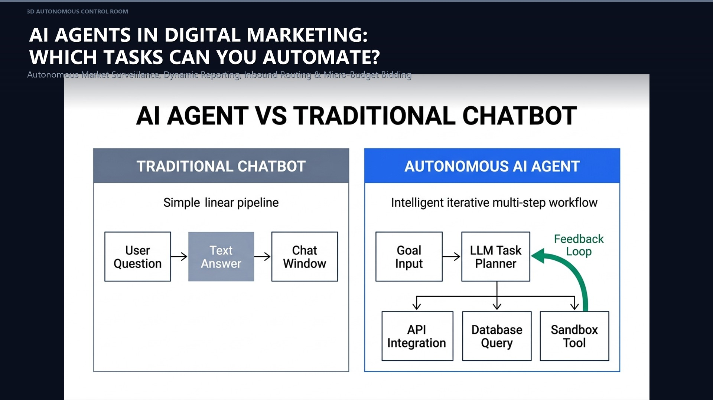
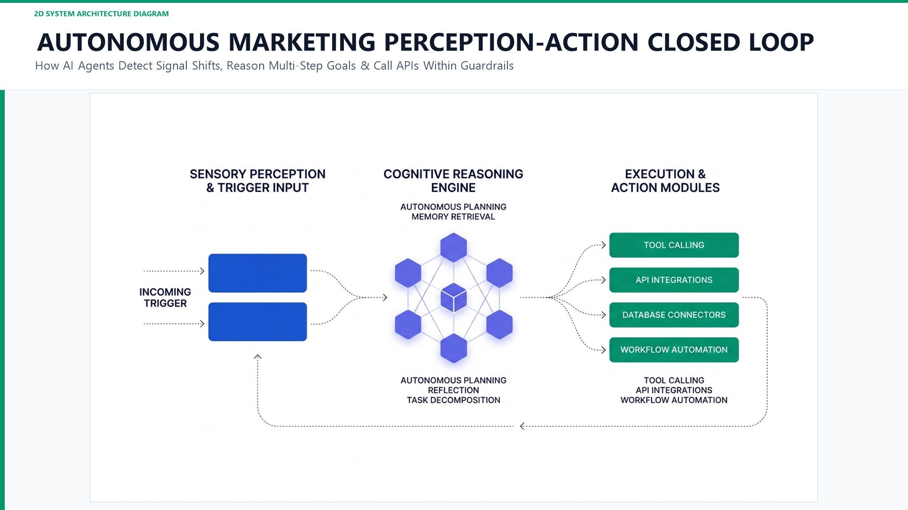

# Metadata Header

**Meta Title:** AI Agents in Digital Marketing: 5 Tasks to Automate
**Meta Description:** Explore how autonomous AI agents transform digital marketing operations: automate competitor surveillance, analytics reporting, and real-time lead routing.
**Primary Keyword:** AI Agents in Digital Marketing
**Secondary Keywords:** marketing AI agents automation, autonomous marketing agents, AI competitor tracking marketing, automated marketing reports, AI lead qualification

---

# AI Agents in Digital Marketing: 5 Tasks You Can Automate

AI agents in digital marketing autonomously monitor competitor advertising campaigns, compile cross-channel executive analytics reports, organize dynamic content planning, qualify inbound leads, and track multi-channel campaign performance in real time. Unlike static chatbots that merely answer text prompts, autonomous agents perceive live marketing signals, reason through complex goals, and trigger external software APIs independently.

Adopting marketing AI agents automation allows growth teams to eliminate repetitive manual administration while focusing human ingenuity on high-level market positioning and creative differentiation. Through our [digital marketing systems architecture](https://www.kanavu.org/digital/), we analyze how modern organizations construct resilient automated marketing stacks governed by strict security and budget guardrails.

*Figure 1: Autonomous Market Surveillance, Dynamic Reporting, Inbound Routing & Micro-Budget Bidding.*
*Alt Text: 3D illustration showing AI agents in digital marketing control room.*

## The 5 High-Impact Marketing Tasks Automated by AI Agents

Deploying autonomous marketing agents enables growth organizations to execute critical operational responsibilities around the clock:

1. **Competitor Intelligence Surveillance:** Conducting continuous AI competitor tracking marketing audits scans rival landing pages, search ranking movements, and ad libraries, notifying strategists whenever competitors alter pricing.
2. **Cross-Channel Performance Dashboards:** Compiling automated marketing reports across Google Analytics 4, Meta Ads, and CRM databases synthesizes executive dashboards without manual spreadsheet entry.
3. **Dynamic Publication Queueing:** Evaluating live search trends and social engagement metrics allows agents to re-prioritize publishing schedules to capitalize on emerging customer demand.
4. **Real-Time Pipeline Enrichment:** Activating instant AI lead qualification enriches inbound form inquiries with firmographic data, scores prospects, and routes high-value opportunities to sales representatives within sixty seconds.
5. **Algorithmic Ad Performance Safeguards:** Agents track live ROAS across campaigns, pausing underperforming ad sets and shifting micro-budgets toward winning variants within approved limits.

> **Engineering Safety Guardrails:** Autonomous marketing agents must operate under strict permission boundaries. High-performing growth teams enforce hard spending limits on ad budgets and require explicit human approval before modifying public landing pages or live campaign messaging.

As explored in our technical breakdown of [modern web development and digital asset workflows](https://www.kanavu.org/digital/how-modern-websites-are-built-inside-kanavu-startups-web-development-process/), establishing automated marketing pipelines frees commercial teams from tedious administrative overhead.

*Figure 2: How AI Agents Detect Signal Shifts, Reason Multi-Step Goals & Call APIs Within Guardrails.*
*Alt Text: Conceptual diagram illustrating autonomous marketing perception-action closed loop.*

## Systems Matrix: Legacy Automation Scripts vs Autonomous AI Agents

Deploying cognitive agents transforms marketing operations from reactive dashboard monitoring into an adaptive, self-healing system that continuously identifies high-yield acquisition opportunities:

| Operating Dimension | Legacy Automation Scripts (Zapier/Cron) | Autonomous Cognitive AI Agents |
| :--- | :--- | :--- |
| **Execution Logic** | Rigid, single-branch linear execution rules | Goal-directed reasoning adapting to unforeseen data |
| **Tool Calling** | Single pre-defined webhook per trigger | Dynamic multi-step API invocation across disparate platforms |
| **Error Recovery** | Fails silently when data formatting changes | Analyzes execution failure and attempts alternative pathways |

## Deploying Defensible Marketing Agents with Kanavu Digital Marketing

Integrating autonomous agents into your marketing infrastructure requires sound software architecture, clean data hygiene, and rigorous human supervision protocols. At [Kanavu Digital Marketing](https://www.kanavu.org/), we guide commercial enterprises in Erode, growing retail networks across Tamil Nadu, and digital startups in deploying reliable marketing automation. Through our specialized [digital marketing technology training](https://www.kanavu.org/academy/), we assist technical teams in configuring API webhooks, connecting first-party analytics, and establishing automated marketing workflows that scale business growth safely.

## Frequently Asked Questions

### What makes an AI agent different from a conventional marketing chatbot?

AI agents proactively perceive environment signals, reason through complex goals, call software tools, and execute actions autonomously rather than merely answering text prompts.

### Can AI agents manage advertising budgets safely without human supervision?

Agents operate within strictly defined human guardrails, requiring manual approvals for significant budget shifts while autonomously managing tactical micro-optimizations within approved limits.

### Which marketing task delivers the highest immediate ROI from AI automation?

Automated inbound lead qualification and real-time CRM enrichment deliver the fastest return by instantly connecting sales teams with high-intent prospects before interest cools.
