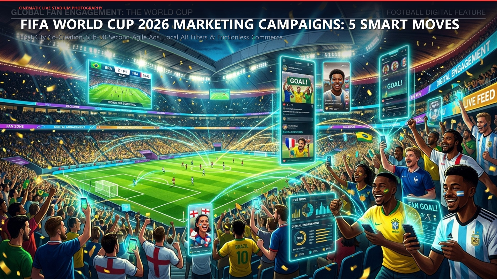
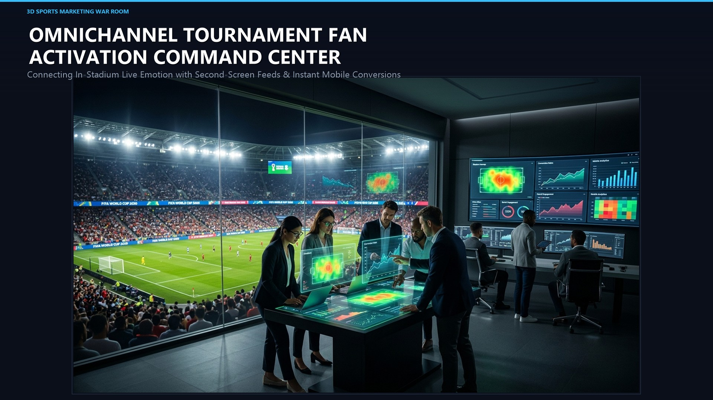

# Metadata Header

**Meta Title:** FIFA World Cup 2026 Marketing Campaigns: 5 Smart Moves
**Meta Description:** A sports marketing case study analyzing FIFA World Cup 2026 campaigns: discover how agile brands won fan attention through real-time second-screen storytelling.
**Primary Keyword:** FIFA World Cup 2026 Marketing Campaigns
**Secondary Keywords:** World Cup 2026 brand campaigns, sports marketing World Cup 2026, influencer marketing World Cup, real-time sports social campaigns, fan engagement World Cup 2026

---

# FIFA World Cup 2026 Marketing Campaigns: 5 Smart Moves Brands Made to Win Attention

During the FIFA World Cup 2026, leading consumer brands captured global attention by co-creating content with local host-city creators, deploying sub-90-second reactive social content, launching interactive augmented reality stadium filters, and orchestrating mobile flash commerce during halftime breaks. Instead of relying solely on expensive broadcast commercial slots, standout World Cup 2026 brand campaigns synchronized digital storytelling with live fan emotions.

Succeeding in sports marketing World Cup 2026 required agile execution, localized cultural relevance, and frictionless mobile purchasing pathways. Within our [digital marketing strategic resource center](https://www.kanavu.org/digital/), we examine how modern consumer brands turn fleeting viral moments into lasting customer relationships and measurable commercial expansion.

*Figure 1: 5 Strategic Moves: Host-City Co-Creation, 90-Second Agile Newsrooms, AR Filters & Flash Commerce.*
*Alt Text: Photograph illustrating FIFA World Cup 2026 marketing campaigns stadium atmosphere.*

## The $5 Billion Attention Arena: Beyond Traditional Sponsorships

With matches distributed across sixteen host cities in three nations, the tournament decentralized global fan attention. By actively participating in cultural conversations, agile brands generated massive reach through three tactical plays:

* **Play 1: Agile Social Newsrooms:** Deploying real-time sports social campaigns within ninety seconds of dramatic match events captured viral attention before consumer focus shifted.
* **Play 2: Host-City Collaborations:** Activating localized influencer marketing World Cup partnerships with regional food vloggers and cultural creators highlighted authentic community traditions, creating intimate brand affinity that global ads could never replicate.
* **Play 3: Halftime Flash Commerce:** Partnering with on-demand delivery apps enabled brands to drive surges in mobile transactions while viewers checked their smartphones between halves.

> **Real-Time Newsroom Playbook:** Viral sports moments have a ninety-second shelf life. Winning brands prepare approved modular visual templates and pre-cleared copy themes in advance, allowing creative war rooms to publish witty, contextual commentary while fan emotion is peaking.

As detailed in our research on [user experience and audience engagement](https://www.kanavu.org/digital/how-seo-and-digital-marketing-help-kanavu-startup-expand-its-online-reach/), removing friction during moments of heightened excitement elevates fan engagement World Cup 2026 spectators remember long after the final whistle.

*Figure 2: Connecting In-Stadium Live Emotion with Second-Screen Feeds & Instant Mobile Conversions.*
*Alt Text: Conceptual diagram illustrating omnichannel tournament fan activation command center.*

## Key Strategic Takeaways for Commercial Brands

Successful sports marketing demands treating tournaments as dynamic participatory festivals rather than passive broadcast stages. Aligning localized creator storytelling with frictionless digital checkout allows regional and global enterprises alike to achieve extraordinary audience resonance. Connecting physical event energy with real-time digital feeds and immediate mobile purchasing allows brands of all sizes to engage loyal fan communities effectively.

> **Tournament Commercial Takeaway:** Modern sports marketing is a participatory cultural festival, not a one-way television billboard. Regional enterprises can outmaneuver massive official sponsors by organizing themed local viewing events, conversational community polls, and timely mobile app promotions.

## Orchestrating High-Impact Campaigns with Kanavu Digital Marketing

Translating global marketing strategies into regional commercial success requires understanding audience psychology, agile digital execution, and omnichannel conversion funnels. At [Kanavu Digital Marketing](https://www.kanavu.org/), we help manufacturing brands in Erode, retail leaders across Tamil Nadu, and ambitious consumer companies build compelling marketing campaigns that command attention. Through our comprehensive [brand storytelling and advertising courses](https://www.kanavu.org/academy/), we equip marketing teams with the creative frameworks and analytics tools needed to execute memorable, high-converting digital campaigns.

## Frequently Asked Questions

### Why did micro-influencers outperform mega-celebrities during the World Cup?

Micro-influencers delivered higher engagement rates and authentic community credibility, providing local host-city perspective that resonated more genuinely than polished commercial celebrity endorsements.

### How fast must a brand respond to live sporting events on social media?

Standout viral engagement happens within ninety seconds to five minutes of a major live match event, after which audience attention rapidly dissipates.

### Can smaller regional businesses capitalize on global sporting events without official sponsorships?

Yes, local brands successfully engage regional fans through themed viewing events, conversational community commentary, and agile promotions that celebrate local athletic spirit legally.
