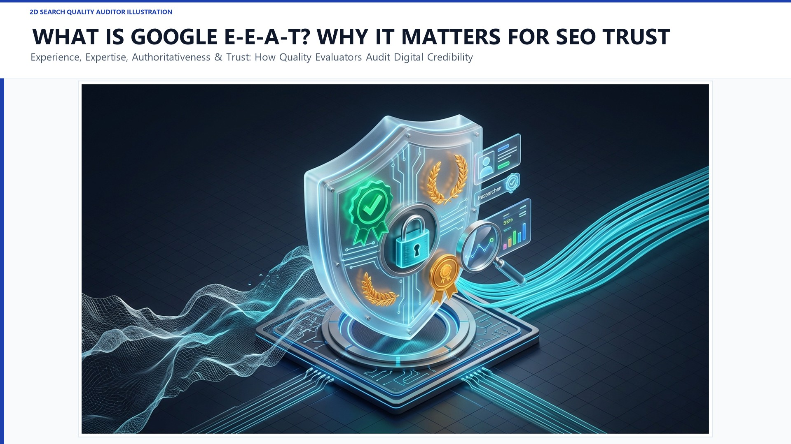
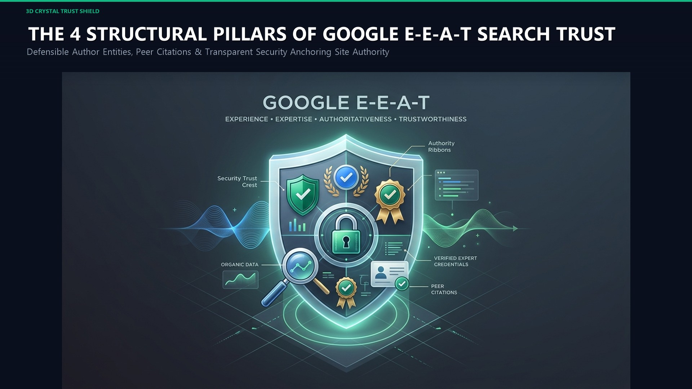

# Metadata Header

**Meta Title:** What Is Google E-E-A-T? Why It Matters for SEO Trust
**Meta Description:** A forensic audit of Google E-E-A-T: discover how Experience, Expertise, Authoritativeness, and Trustworthiness evaluate website credibility and protect rankings.
**Primary Keyword:** Google E-E-A-T
**Secondary Keywords:** experience expertise authoritativeness trustworthiness, Google E-E-A-T guidelines, E-E-A-T for SEO, demonstrate website trust Google, search quality rater guidelines

---

# What Is Google E-E-A-T? Why It Matters for SEO and Website Trust

Google E-E-A-T represents a foundational quality evaluation framework assessing experience expertise authoritativeness trustworthiness across every indexable page to determine real-world content value. While not a direct mathematical algorithmic factor, mastering E-E-A-T for SEO heavily influences the search systems that reward helpful, defensible information in search results.

Building sustainable organic visibility requires transforming shallow marketing copy into trustworthy expert knowledge that proves genuine first-hand involvement with your subject. Within our [search engine optimization resource database](https://www.kanavu.org/digital/), we demonstrate how establishing defensible author credentials and transparent editorial standards protects your website across major core algorithm updates.

*Figure 1: Experience, Expertise, Authoritativeness & Trust: How Quality Evaluators Audit Digital Credibility.*
*Alt Text: Illustration explaining what is Google E-E-A-T and why it matters for SEO trust.*

## Deconstructing the 4 Structural Trust Pillars

Documented extensively in Google's official search quality rater guidelines, the four components establish comprehensive content credibility:

1. **Experience (First-Hand Practitioner Proof):** Demonstrating authentic engagement with the product or process discussed through original photographs, personal experimentation, and honest lessons. Search raters prioritize genuine case studies over generic theoretical summaries.
2. **Expertise (Formal Knowledge Depth):** Showcasing verified professional credentials, industry certifications, and deep technical comprehension necessary to explain sophisticated concepts accurately.
3. **Authoritativeness (Ecosystem Endorsement):** Cultivating external industry validation through citations in reputable trade publications, digital PR features, and natural editorial backlinks from respected peers.
4. **Trustworthiness (The Central Foundation):** Providing transparent author bios, physical company contact details, visible customer reviews, secure HTTPS encryption, and verifiable primary source citations.

> **Google Quality Rater Standard:** Trustworthiness is the single most critical element of E-E-A-T. Even if an article demonstrates extensive theoretical knowledge, Google algorithms discount content when reader transparency, verifiable author credentials, or accurate business contact information are missing.

As detailed in our research on [proven SEO and digital marketing frameworks](https://www.kanavu.org/digital/how-seo-and-digital-marketing-help-kanavu-startup-expand-its-online-reach/), closely adhering to published Google E-E-A-T guidelines solidifies algorithmic trust, protecting your search visibility during core algorithm updates.

*Figure 2: Defensible Author Entities, Peer Citations & Transparent Security Anchoring Site Authority.*
*Alt Text: Conceptual diagram illustrating the 4 structural pillars of google e-e-a-t search trust.*

## The High-Trust Content Checklist for Competitive Rankings

Auditing your website architecture reveals clear differentiators evaluated by human quality evaluators and machine learning systems:

* **Byline Attribution:** Verifiable human bylines linked to recognized industry credentials and active professional profiles.
* **Source Validation:** Direct hyperlinks to reputable primary research papers, government data, and clinical studies.
* **Experience Proof:** Original step-by-step screenshots, actual project photos, and transparent test datasets.
* **Domain Transparency:** Displaying visible physical addresses and clear customer service contacts helps demonstrate website trust Google algorithms reward.

> **Actionable SEO Quick Win:** To immediately upgrade an existing blog post, replace generic stock images with real photographs of your team performing the work, and add a detailed two-sentence author bio explaining why you are qualified to solve this problem.

## Engineering Search Trust with Kanavu Digital Marketing

Establishing defensible search engine trust requires aligning your technical website architecture, content development, and brand presence with rigorous search guidelines. At [Kanavu Digital Marketing](https://www.kanavu.org/), we assist regional textile manufacturers in Erode, specialized medical practices, and growing technology firms in establishing rock-solid digital credibility. Through our specialized [advanced search engine optimization courses](https://www.kanavu.org/academy/), we guide content teams in building verified author entities, conducting schema audits, and producing original, experience-backed knowledge assets. We help your business build genuine digital trust that earns sustained organic search rankings.

## Frequently Asked Questions

### Is Google E-E-A-T a direct mathematical ranking algorithm signal?

No, E-E-A-T is not a single algorithmic score; rather, Google trains automated machine-learning ranking systems to reflect human quality rater standards.

### Which content category is most strictly evaluated under Google E-E-A-T?

Your Money or Your Life (YMYL) topics, including healthcare, financial advice, legal information, and safety, receive the most rigorous E-E-A-T quality scrutiny.

### What is the fastest way to demonstrate Experience on an existing blog post?

Incorporate original step-by-step photos, verified practitioner commentary, documented edge-case troubleshooting, and tangible project metrics rather than repeating generalized industry advice.
