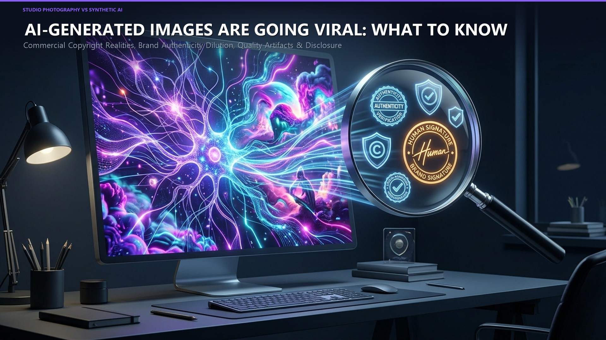
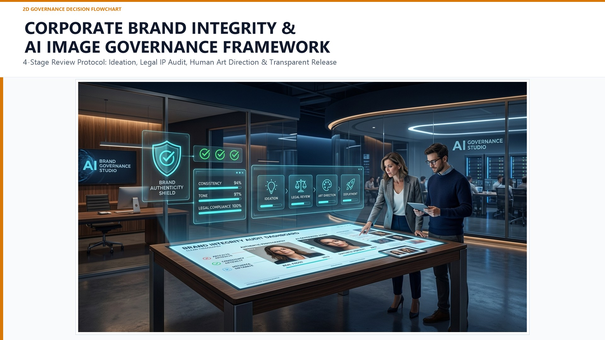

# Metadata Header

**Meta Title:** AI-Generated Images Are Going Viral: Marketer Guide
**Meta Description:** A strategic guide for marketers on viral AI-generated images: navigate brand authenticity, intellectual property copyright risks, and visual quality governance.
**Primary Keyword:** AI-Generated Images
**Secondary Keywords:** viral AI images for marketers, ethical AI image marketing, AI image copyright for brands, brand authenticity AI visuals, generative AI digital campaigns

---

# AI-Generated Images Are Going Viral: What Should Marketers Know Before Using Them?

AI-generated images are going viral across social media feeds, offering digital marketers unprecedented creative agility, rapid visual prototyping, and novel visual storytelling formats. However, analyzing viral AI images for marketers requires carefully balancing eye-catching visual novelty against legal copyright uncertainties, brand authenticity erosion, and potential consumer backlash.

Deploying synthetic visuals effectively demands establishing ethical AI image marketing standards rather than publishing unvetted imagery impulsively. Within our [digital marketing visual media portal](https://www.kanavu.org/digital/), we examine how modern creative departments integrate synthetic image generation tools while rigorously safeguarding brand reputation and intellectual property compliance.

*Figure 1: Commercial Copyright Realities, Brand Authenticity Dilution, Quality Artifacts & Ethical Disclosure.*
*Alt Text: Split-screen comparison illustrating AI-generated images viral trends for marketers.*

## Strategic Risk Analysis: 4 Realities Behind the Viral Hype

Evaluating generative media governed by recognized standards requires examining four critical operational dimensions:

1. **Brand Authenticity Erosion:** Overusing synthetic imagery risks customer trust, particularly in physical manufacturing, hospitality, and fashion, where consumers demand authentic photography.
2. **Zero Commercial Copyright Protection:** Navigating complex AI image copyright for brands reveals that pure machine-generated artwork lacking substantial human input cannot receive copyright protection, leaving assets vulnerable to competitor duplication.
3. **The Uncanny Valley and Visual Artifacts:** Anatomical distortions and unnatural digital textures signal cut-rate production values that undermine premium brand perception.
4. **Mandatory Ethical Disclosure:** Failing to disclose synthetic generation in public campaigns damages customer relationships and sparks unnecessary public relations controversies.

> **Legal Intellectual Property Alert:** Visuals generated entirely by artificial intelligence without substantial human creative input cannot receive copyright protection under current international legal standards. Competitors can freely duplicate and repurpose unedited synthetic campaign imagery without legal penalty.

As explored in our technical breakdown of [modern digital asset and web production practices](https://www.kanavu.org/digital/how-modern-websites-are-built-inside-kanavu-startups-web-development-process/), incorporating generative AI digital campaigns into creative workflows allows rapid conceptual testing while preserving human studio photography for core commercial products.

*Figure 2: 4-Stage Review Protocol: Ideation, Legal IP Audit, Human Art Direction & Transparent Release.*
*Alt Text: Conceptual diagram illustrating corporate brand integrity & ai image governance framework.*

## Asset-Level Visual Policy: Where to Deploy AI vs Studio Photography

Establishing clear asset-level criteria protects brand authenticity AI visuals can compromise if deployed carelessly:

* **Conceptual Thought Leadership:** Custom styled AI illustrations cleanly explain abstract software architectures, predictive algorithms, and emerging industry workflows.
* **Physical Commercial Products:** Professional studio photography is strictly mandatory for tangible merchandise to preserve exact fabric weave, true color shades, and sizing trust.
* **Customer Case Studies:** Verifiable human client photography demonstrates authentic business relationships that synthetic faces completely undermine.

> **Corporate Visual Governance Gate:** Before any synthetic image appears in customer-facing marketing, conduct a mandatory four-point inspection: verify human anatomy for distortions, test brand color consistency, confirm copyright safety, and apply clear creator disclosures.

## Mastering Ethical Visual Strategy with Kanavu Digital Marketing

Balancing innovative creative technologies with authentic brand storytelling is essential for long-term customer loyalty. At [Kanavu Digital Marketing](https://www.kanavu.org/), we guide manufacturing businesses in Erode, regional commercial brands, and emerging digital companies in developing disciplined visual marketing guidelines. Through our comprehensive [creative digital media masterclasses](https://www.kanavu.org/academy/), we teach designers and marketing teams how to combine generative AI tools with human art direction, copyright verification, and brand consistency. We help your business produce captivating digital assets that engage modern audiences while preserving genuine commercial integrity.

## Frequently Asked Questions

### Can a business copyright an advertisement created entirely by AI image generators?

Current copyright offices generally deny protection for purely machine-generated visuals, requiring substantial human creative modification or arrangement to grant intellectual property rights.

### Do social media algorithms reduce organic reach for AI-generated visual posts?

Platforms do not actively suppress AI visuals, but audience drop-off and negative reactions toward unconvincing uncanny images can diminish overall algorithmic engagement.

### What is the best ethical practice when sharing AI-assisted campaign visuals?

Include transparent disclosures such as subtle watermarks or caption credits, ensuring audiences understand images are creative conceptual illustrations rather than literal documentary photographs.
