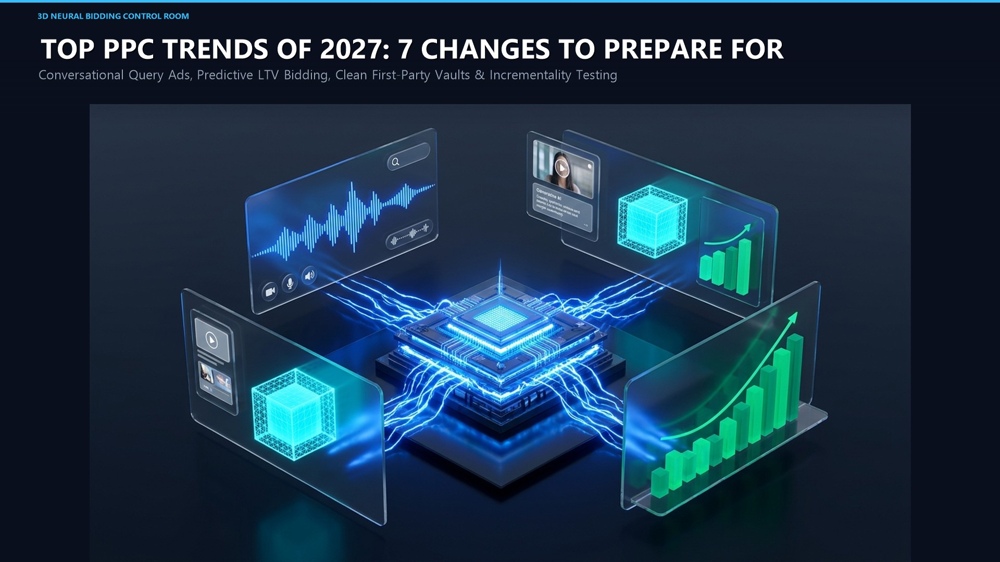
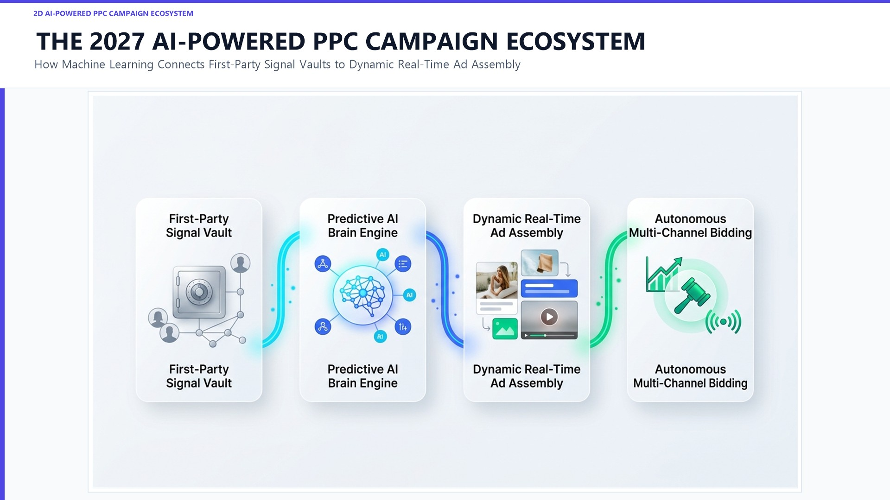

# Metadata Header

**Meta Title:** Top PPC Trends of 2027: 7 Changes to Prepare For
**Meta Description:** Prepare for the future of paid search: explore top PPC trends of 2027 including conversational query ads, predictive LTV bidding, and clean first-party data vaults.
**Primary Keyword:** PPC Trends of 2027
**Secondary Keywords:** future of PPC advertising 2027, AI-powered paid search trends, first-party data PPC, multimodal search advertising, Performance Max optimization 2027

---

# Top PPC Trends of 2027: 7 Changes Every Digital Marketer Should Prepare For

The top PPC trends of 2027 require digital marketers to transition from manual keyword bidding toward predictive machine-learning bidding models, first-party data architectures, and multimodal search advertising. As conversational AI answer engines reshape search results, consumer behavior is shifting from short queries toward complex dialogues.

Thriving in this evolving paid advertising ecosystem requires advertisers to understand emerging AI-powered paid search trends and feed high-quality business conversion signals into algorithmic ad networks. Within our [digital marketing intelligence database](https://www.kanavu.org/digital/), we analyze how performance marketers configure their acquisition systems to maintain high return on ad spend amid ongoing technological disruption.

*Figure 1: Conversational Query Ads, Predictive LTV Bidding, Clean First-Party Vaults & Incrementality Testing.*
*Alt Text: 3D illustration showing top PPC trends of 2027 neural bidding architecture.*

## Navigating the Future of PPC Advertising 2027

Preparing for the future of PPC advertising 2027 requires advertisers to structure campaigns across three fundamental pillars:

* **Pillar 1: Multimodal Search Advertising:** Promotional placements now appear contextually within generative AI chat syntheses, visual camera lookups, and voice search interfaces. Structuring campaigns around topical entities and verified customer problems ensures brands appear prominently within AI-generated conversational answers and real-time shopping recommendations.
* **Pillar 2: Predictive Customer Lifetime Value Bidding:** Algorithmic bidding models optimize media spend based on projected multi-year customer lifetime value rather than short-term acquisition costs, building defensible acquisition moats that compound commercial returns.
* **Pillar 3: Clean First-Party Signal Vaults:** With third-party cookies deprecated, establishing secure first-party data PPC architectures connecting CRM transaction data via server-side APIs maintains superior auction efficiency while equipping bidding models with proprietary conversion data.

> **2027 Search Auction Reality:** As artificial intelligence chat assistants summarize complex user queries directly, paid ads will appear inside conversational dialogue bubbles rather than blue link lists. Campaigns structured around broad customer problems and entity concepts will capture auction priority over legacy keyword phrases.

As discussed in our guide on [multi-channel digital reach methodologies](https://www.kanavu.org/digital/how-seo-and-digital-marketing-help-kanavu-startup-expand-its-online-reach/), combining verified customer signals with continuous Performance Max optimization 2027 workflows delivers superior conversion efficiency across competitive search auctions.

*Figure 2: How Machine Learning Connects First-Party Signal Vaults to Dynamic Real-Time Ad Assembly.*
*Alt Text: Conceptual diagram illustrating the 2027 ai-powered ppc campaign ecosystem.*

## Continuous Incrementality Testing Over Last-Click Attribution

Modern performance teams have replaced outdated last-click analytics models with automated geo-lift experimentation. Running structured matched-market tests establishes clear causal relationships between ad spend and incremental business revenue, eliminating wasted spend on organic brand cannibalization while safeguarding media investments across volatile auction cycles.

> **Capital Allocation Mandate:** Stop measuring advertising success through last-click metrics that artificially inflate branded search performance. Running controlled matched-market tests identifies genuine incremental revenue, ensuring media budgets expand into profitable customer acquisition queries.

## Building Future-Ready Paid Media with Kanavu Digital Marketing

Navigating the automated, predictive future of paid search advertising requires advanced technical setup, resilient tracking pipelines, and rigorous commercial analysis. At [Kanavu Digital Marketing](https://www.kanavu.org/), our performance media specialists help regional textile mills in Erode, growing retail networks across Tamil Nadu, and global enterprises maximize their advertising efficiency. Through our practical [performance advertising analytics training](https://www.kanavu.org/academy/), we assist growth teams in implementing server-side conversion tracking, structuring first-party CRM data feeds, and testing incremental revenue lift. We ensure your paid advertising budget delivers measurable, scalable business expansion.

## Frequently Asked Questions

### Will keywords become completely obsolete in PPC campaigns by 2027?

Keywords will not disappear entirely, but ad platforms will prioritize conversational search intent, audience entities, and contextual semantic signals over exact-match keyword strings.

### How can small businesses compete against giant ad budgets in automated PPC auctions?

Small businesses compete effectively by feeding highly accurate first-party customer conversion data and verified offline sales signals into algorithmic bidding engines.

### Why is incrementality testing replacing traditional last-click attribution?

Last-click attribution artificially credits branded search for conversions that would have happened organically, whereas incrementality testing measures true revenue lift caused directly by advertising.
