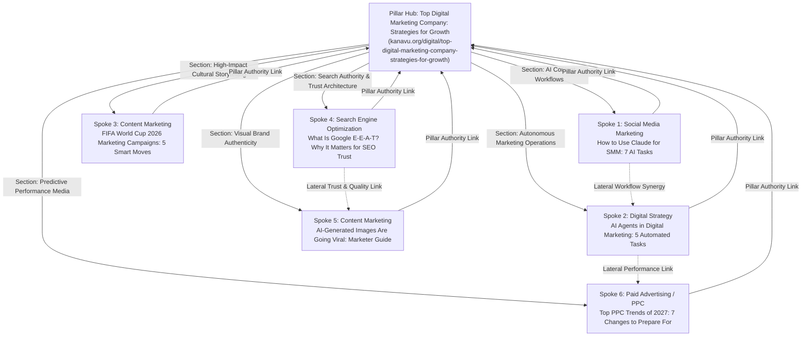

# Kanavu Digital Marketing — Master Topic Cluster Architecture

## Cluster Theme: *Top Digital Marketing Company: Strategies for Growth*
* **Date:** 2026-11-16
* **Brand / Client:** Kanavu Digital Marketing (`https://www.kanavu.org/digital/`)
* **Regional & Global Hub:** Erode, Western Tamil Nadu (Kongu Industrial Belt) & Global Enterprise Performance
* **Target Audience:** Business owners, marketing directors, e-commerce brands, textile manufacturers, and healthcare enterprises seeking measurable organic search and paid acquisition growth.

---

## 1. 4-Tier Semantic Topic Cluster Architecture

---

## 2. Topic Cluster Specifications

| Article ID | Type | Title | Primary Keyword | Word Count Target | Verified Hub / Spoke Target |
| :--- | :--- | :--- | :--- | :--- | :--- |
| **Pillar** | Core Hub | Top Digital Marketing Company: Strategies for Growth | `top digital marketing company` | 450–500 words | `https://www.kanavu.org/digital/` |
| **Blog 1** | Spoke | How to Use Claude for Social Media Marketing: 7 Tasks You Can Simplify with AI | `Claude for Social Media Marketing` | 450–500 words | `https://www.kanavu.org/digital/how-ai-powered-customer-support-tools-improve-response-time-and-user-experience/` |
| **Blog 2** | Spoke | AI Agents in Digital Marketing: 5 Tasks You Can Automate | `AI Agents in Digital Marketing` | 450–500 words | `https://www.kanavu.org/digital/emerging-technology-trends-that-will-shape-the-future-of-business-operations/` |
| **Blog 3** | Spoke | FIFA World Cup 2026 Marketing Campaigns: 5 Smart Moves Brands Made to Win Attention | `FIFA World Cup 2026 Marketing Campaigns` | 450–500 words | `https://www.kanavu.org/digital/why-user-experience-design-is-critical-for-technology-startup-success/` |
| **Blog 4** | Spoke | What Is Google E-E-A-T? Why It Matters for SEO and Website Trust | `Google E-E-A-T` | 450–500 words | `https://www.kanavu.org/digital/how-seo-and-digital-marketing-help-kanavu-startup-expand-its-online-reach/` |
| **Blog 5** | Spoke | AI-Generated Images Are Going Viral: What Should Marketers Know Before Using Them? | `AI-Generated Images` | 450–500 words | `https://www.kanavu.org/digital/how-modern-websites-are-built-inside-kanavu-startups-web-development-process/` |
| **Blog 6** | Spoke | Top PPC Trends of 2027: 7 Changes Every Digital Marketer Should Prepare For | `PPC Trends of 2027` | 450–500 words | `https://www.kanavu.org/digital/how-seo-and-digital-marketing-help-kanavu-startup-expand-its-online-reach/` |

---

## 3. Strict Compliance Guardrails (Engine V7)
1. **Word Count:** Main body text strictly 450–500 words per article.
2. **Introductions:** Two distinct paragraphs (Answer-first hook, then Pillar Hub context).
3. **FAQs:** Exactly 3 FAQs, strictly 15–25 words per answer.
4. **Internal Linking:** 100% verified live HTTP 200 URLs from `kanavu.org` sitemap and REST endpoints.
5. **Brand Integration:** Explicit narrative connecting Kanavu Digital Marketing with transparent analytics and regional industrial relevance.
6. **Visual Suite:** Two 16:9 widescreen illustrations (`1920x1080`) per blog with bold on-canvas typography and question marks on question titles.

