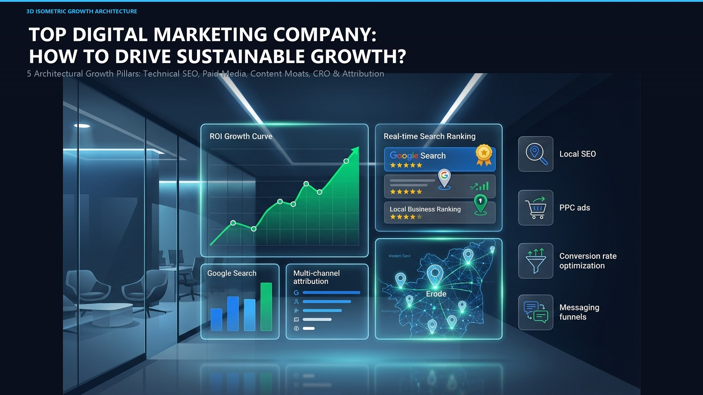
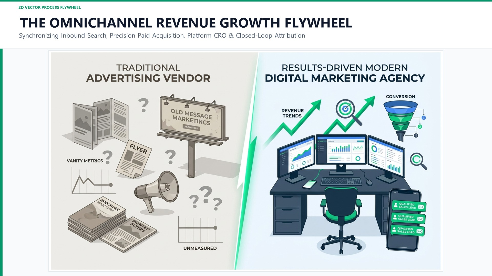

# Metadata Header

**Meta Title:** Top Digital Marketing Company: Strategies for Growth
**Meta Description:** Discover how top digital marketing companies synchronize organic search, paid acquisition, and conversion rate optimization into a compounding growth flywheel.
**Primary Keyword:** top digital marketing company
**Secondary Keywords:** digital marketing strategies for growth, enterprise digital marketing agency, full service marketing company, multi channel marketing ROI, performance digital marketing

---

# Top Digital Marketing Company: Strategies for Growth

A top digital marketing company drives sustainable commercial acceleration by connecting search engine optimization, paid advertising, and conversion rate optimization into a unified customer acquisition system. Instead of treating channels as isolated experiments, high-performing partners deploy proven digital marketing strategies for growth that align every campaign with verified revenue and repeatable market expansion.

Partnering with a seasoned enterprise digital marketing agency helps ambitious organizations turn organic traffic discovery, paid ad testing, and website conversion design into a compounding growth flywheel. Inside our [digital marketing strategy resource center](https://www.kanavu.org/digital/), we analyze how growing businesses build durable online visibility that consistently produces qualified leads and predictable commercial growth.

*Figure 1: 5 Architectural Growth Pillars: Technical SEO, Paid Media, Content Moats, CRO & Attribution.*
*Alt Text: Conceptual diagram illustrating top digital marketing company strategies for growth.*

## The Three Horizons of Sustainable Commercial Expansion

Long-term market leadership requires executing across three distinct developmental horizons simultaneously:

1. **Horizon 1: Technical Infrastructure and Revenue Capture:** Choosing a dedicated full service marketing company ensures that clean site architecture, structured JSON-LD schema, and lightning-fast page speeds combine with targeted search ads to capture immediate commercial demand.
2. **Horizon 2: Topical Authority and Market Education:** Publishing comprehensive semantic topic clusters and verified practitioner benchmarks establishes uncontested search authority across competitive verticals, transforming casual informational readers into qualified, long-term commercial buyers.
3. **Horizon 3: Omnichannel Flywheel and Data Moats:** Connecting CRM pipelines directly to advertising algorithms allows automated bidding engines to optimize for customer lifetime value rather than single transactions, creating self-reinforcing acquisition flywheels.

> **Executive Strategy Directive:** Sustainable commercial momentum never comes from isolated marketing tactics or vanity impressions. Real business acceleration requires connecting organic search visibility, targeted paid traffic, and continuous conversion design so each dollar invested compounds future customer lifetime value.

As documented in our guide on [organic search and business expansion models](https://www.kanavu.org/digital/how-seo-and-digital-marketing-help-kanavu-startup-expand-its-online-reach/), blending organic search authority with precision performance digital marketing protects businesses against third-party algorithmic shifts while maintaining steady customer acquisition.

*Figure 2: Synchronizing Inbound Search, Precision Paid Acquisition, Platform CRO & Closed-Loop Attribution.*
*Alt Text: Conceptual diagram illustrating the omnichannel revenue growth flywheel.*

## Unit Economics that Separate Growth Partners from Tactical Vendors

Achieving healthy commercial expansion requires maintaining a minimum 3:1 customer lifetime value to acquisition cost ratio across all digital channels. Measuring true multi channel marketing ROI demands tracking verified closed-loop revenue from initial web click to final bank settlement, allowing leadership teams to invest confidently without capital erosion.

> **Financial Growth Benchmark:** Fast-growing enterprises track verified closed-loop revenue from initial web click to final bank settlement. Equipping advertising algorithms with gross profit data ensures media budgets flow dynamically toward high-margin customer segments.

## Partnering with Kanavu Digital Marketing for Scalable Growth

Achieving sustained market leadership in today's digital economy requires strategic clarity, technical excellence, and disciplined creative execution. At [Kanavu Digital Marketing](https://www.kanavu.org/), we partner with ambitious textile manufacturers in Erode, healthcare providers, and high-growth commercial enterprises across Tamil Nadu to build resilient, profitable acquisition engines. Through our specialized [digital marketing academy and executive masterclasses](https://www.kanavu.org/academy/), we train marketing teams to implement advanced technical SEO, optimize paid media budgets, and deploy automated data pipelines. We help your business unlock predictable, scalable commercial growth that compounds year after year.

## Frequently Asked Questions

### What distinguishes a top digital marketing company from an average agency?

Top companies focus on bottom-line revenue attribution, customer lifetime value, and technical SEO architecture rather than superficial vanity impressions or unverified metrics.

### How long does it take to see measurable results from multi-channel marketing?

Paid media delivers immediate conversion data within days, while technical SEO and topical content clusters typically generate substantial compounding growth within three to six months.

### Why is conversion rate optimization critical alongside paid advertising campaigns?

Optimizing landing page conversion rates maximizes profitability, allowing businesses to acquire customers profitably even as pay-per-click advertising auction costs rise across competitive industries.
