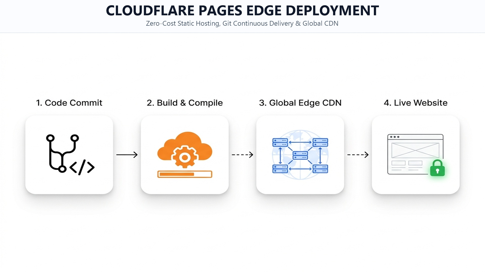
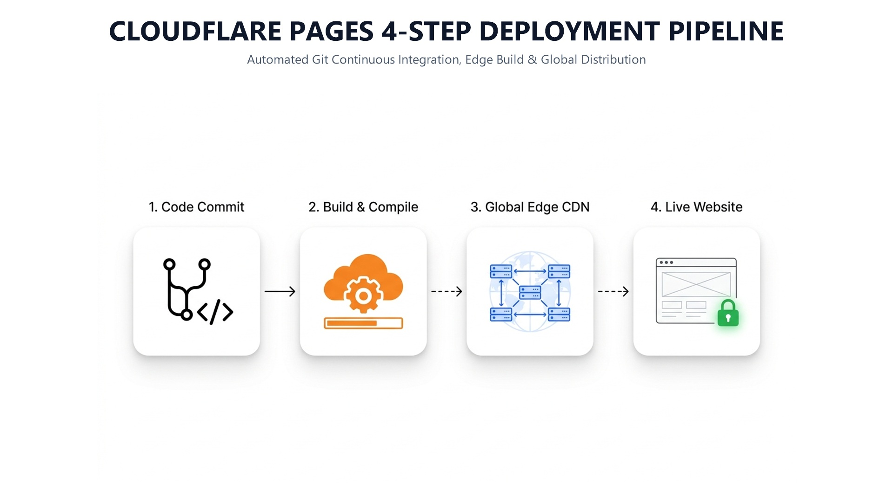

# Metadata Header
**Meta Title:** How to Host a Website for Free on Cloudflare Pages
**Primary Keyword:** How to Host a Website for Free
**Secondary Keywords:** Cloudflare Pages Hosting, Cloudflare Free Hosting, Static Website Hosting, Cloudflare Pages Tutorial, Static Web Deployment
**Meta Description:** Learn how to host a website for free using Cloudflare Pages. Follow this step-by-step tutorial to deploy static sites with free SSL and unlimited bandwidth.

---

# How to Host a Website for Free Using Cloudflare Pages

You can learn **how to host a website for free** by connecting your code repository to Cloudflare Pages, which builds, deploys, and serves static web pages on a global edge network at zero cost. Unlike traditional hosting providers that charge recurring monthly fees, enforce strict bandwidth caps, or mandate manual cPanel updates, **Cloudflare Pages hosting** includes unlimited monthly traffic, automated SSL security certificates, and fast global delivery without requiring a credit card.

Whether you are launching a personal portfolio, business landing page, or documentation site, this modern workflow replaces legacy shared servers with continuous Git deployment.

---

## The 4-Step Cloudflare Pages Tutorial

**Figure 1: Cloudflare Pages Edge Deployment Flow**

Deploying a modern website takes less than five minutes when your code repository is configured:

### 1. Store Your Project Code on GitHub or GitLab
Create a Git repository containing your website assets. You can push plain HTML, CSS, and client-side JavaScript, or use modern static site generators like Astro, Hugo, Next.js, or Vite. Every time you push an update to your main production branch, Cloudflare automatically triggers a fresh deployment.

### 2. Connect Your Repository to Cloudflare Pages
Sign in to the Cloudflare dashboard, navigate to **Compute (Workers & Pages)**, and select **Create application**. Under the Pages tab, click **Connect to Git** and grant permission for your repository. Cloudflare automatically detects changes whenever new code is merged.

### 3. Configure Build Settings and Environment Variables
If your website uses static HTML, leave the build command blank and set the build output directory to `/`. For frontend frameworks, select the corresponding preset so Cloudflare runs `npm run build` with the correct output directory (such as `dist` or `out`). You can also configure environment variables for staging keys.

### 4. Deploy and Attach Your Custom Domain
Click **Save and Deploy**. Cloudflare pulls your repository, runs your build scripts, deploys assets across hundreds of edge data centers, and assigns a live `*.pages.dev` subdomain. Under the custom domains tab, add your registered apex domain or subdomain to activate automatic HTTPS encryption and DNS routing.

According to the [official Cloudflare Pages documentation](https://developers.cloudflare.com/pages/), your content is automatically mirrored across edge servers worldwide for minimal latency. This edge architecture mirrors the acceleration principles detailed in our companion guide on [What Is a CDN and How Does It Make Your Website Faster?](https://tech.kanavu.org/blog/what-is-a-cdn).

**Figure 2: 4-Step Git Push to Edge Delivery Pipeline**

---

## Comparison: Traditional Shared Hosting vs Cloudflare Pages

The table below contrasts conventional shared web hosting with **Cloudflare free hosting**:

| Feature / Metric | Traditional Shared Hosting ($5–$15/mo) | Cloudflare Pages Free Tier ($0/mo) |
| :--- | :--- | :--- |
| **Monthly Cost** | Paid subscription + renewal hikes | **100% Free** (No credit card required) |
| **Bandwidth Allowance** | Capped at 50GB – 100GB/mo | **Unlimited Bandwidth** |
| **SSL / HTTPS Security** | Manual setup, often paid add-on | **Automatic Free SSL Encryption** |
| **Deployment Speed** | Slow manual FTP / cPanel uploads | **Automated Git Push Deployments** |
| **Global Edge Caching** | Single origin server (High latency) | **300+ Edge Data Centers Worldwide** |

---

## Scaling Your Digital Infrastructure

Learning **how to host a website for free** is the foundational step toward understanding the broader digital evolution outlined in our master architectural guide on [Latest Technology Trends: How They Are Changing Websites, Apps and Businesses](https://tech.kanavu.org/blog/latest-technology-trends). For growing organizations that require dynamic database integration, custom enterprise portals, or mobile APIs, partnering with seasoned engineers ensures clean architecture.

Explore how Kanavu Technologies helps modern businesses transition to scalable cloud platforms through our [modern web development and cloud deployment](https://tech.kanavu.org/services/web-development) services.

---

## Frequently Asked Questions (FAQs)

### 1. Is Cloudflare Pages genuinely free with no hidden charges?
Yes. The free tier includes unlimited bandwidth, unlimited requests, and 500 monthly builds without requiring credit card details.

### 2. Can I connect my own custom domain on the free plan?
Yes. You can attach any registered domain name and receive automatic SSL certificates at no cost.

### 3. Can I run a traditional WordPress site on Cloudflare Pages?
No. Cloudflare Pages only hosts static and Jamstack files. WordPress requires a PHP server and a MySQL database backend.
