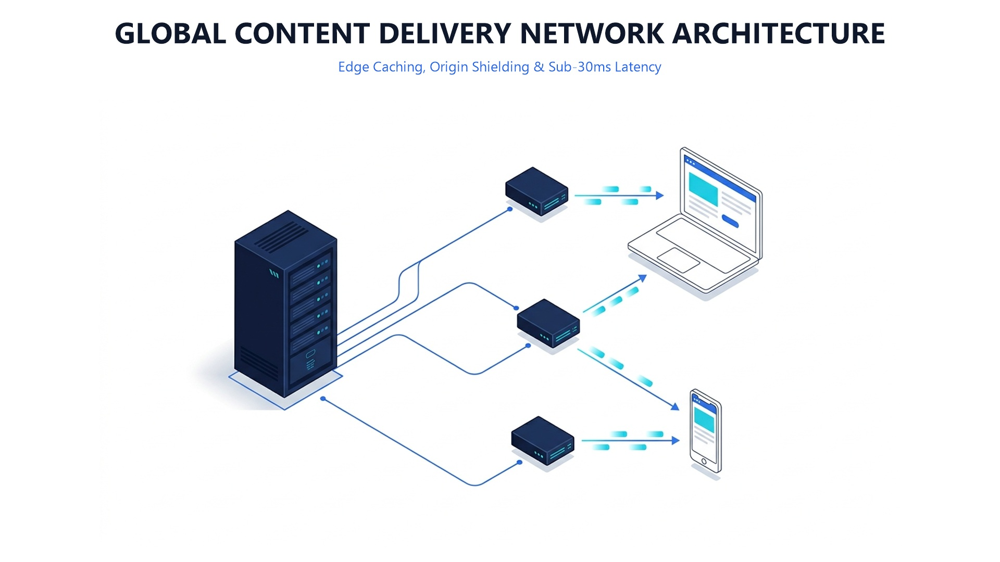

# Metadata Header
**Meta Title:** What Is a CDN? How It Speeds Up Your Website
**Primary Keyword:** What Is a CDN
**Secondary Keywords:** Content Delivery Network, CDN for Website, How CDN Works, CDN Benefits, Website Speed Optimization
**Meta Description:** Learn what a CDN is and how global edge servers cache content close to visitors to slash latency and deliver rapid website speed optimization.

---

# What Is a CDN and How Does It Make Your Website Faster?

A **Content Delivery Network** (CDN) is a worldwide network of distributed servers that stores copies of your website files so visitors can load them from the nearest physical location. When someone accesses your site from London while your primary hosting server sits in Mumbai, requests cross thousands of miles of submarine fiber-optic cables. A **CDN for website** performance caches copies of images, stylesheets, and scripts in London, delivering pages in milliseconds rather than seconds.

Understanding **what is a CDN** explains why geographic distance slows down websites. Physical distance introduces network latency, causing delays that increase bounce rates.

---

## How CDN Works: The Origin Server vs Edge Caching

**Figure 1: Global Edge Caching Network vs Direct Origin Server Flow**

To understand **how CDN works**, think of a central warehouse partnering with local distribution outlets. Your primary host is the origin server holding application code and databases. The CDN operates hundreds of edge Points of Presence (PoPs) stationed across major cities globally.

When a visitor clicks a link on your site, the request does not travel to your origin server if an edge node can fulfill it:

* **Cache Hit:** The edge server closest to the visitor already holds a copy of your logo, font, and CSS file. It delivers them immediately without pinging your origin host.
* **Cache Miss:** If the edge node lacks the file, it fetches a fresh copy from your origin once, serves the user, and caches it locally for future visitors.

According to the [MDN Web Docs glossary on Content Delivery Networks](https://developer.mozilla.org/en-US/docs/Glossary/CDN), keeping files physically near clients eliminates multiple round-trip transmission delays across the internet backbone. Developers deploying edge-native static platforms get this global caching built in automatically, as demonstrated in our companion walkthrough on [How to Host a Website for Free Using Cloudflare Pages](https://tech.kanavu.org/blog/how-to-host-a-website-for-free).

---

## Performance Comparison: Direct Origin Hosting vs CDN Architecture

The table below contrasts how your website performs with and without edge network acceleration:

| Performance Metric | Direct Origin Hosting Only | Origin Server + Global CDN |
| :--- | :--- | :--- |
| **Global Latency (Ping)** | 180ms – 350ms across continents | **10ms – 30ms via nearest edge PoP** |
| **Time to First Byte (TTFB)** | Slowed by geographic round-trips | **Near-instantaneous static response** |
| **Origin Server CPU Load** | 100% of requests hit origin hardware | **Reduced by 60% – 85% via caching** |
| **Traffic Spike Resilience** | High crash risk during viral spikes | **Absorbed effortlessly across edge nodes** |
| **DDoS Attack Defense** | Origin IP is exposed to attackers | **Malicious traffic filtered at network edge** |

---

## The Core CDN Benefits for Business Websites

Speed matters, but the true **CDN benefits** reach much deeper than raw milliseconds:

1. **Slashing Server Load:** Offloading static media to edge servers cuts bandwidth consumption on your main hosting plan by over 60%.
2. **Preventing Sudden Traffic Crashes:** When marketing promotions spike traffic, edge nodes absorb the wave so origin databases stay online.
3. **Built-in Edge Security:** Modern networks filter out malicious bots and automated DDoS attacks before bad requests touch your server.

A CDN does not replace your web host. It works alongside it to deliver comprehensive **website speed optimization**.

---

## Engineering Faster Web Experiences

Setting up a CDN is a foundational component of the broader architectural transformation detailed in our master guide on [Latest Technology Trends: How They Are Changing Websites, Apps and Businesses](https://tech.kanavu.org/blog/latest-technology-trends). Whether you operate an e-commerce storefront or an enterprise portal, pairing clean application code with a properly configured CDN delivers rapid, reliable browsing for every user.

At Kanavu Technologies, our engineers integrate edge networks into cloud systems. Explore our [custom web development services](https://tech.kanavu.org/services/web-development) to build resilient, high-speed platforms.

---

## Frequently Asked Questions (FAQs)

### 1. Does a CDN replace my web hosting provider?
No. A CDN works in front of your hosting server to cache static files, while your host manages databases and application logic.

### 2. Can a CDN speed up dynamic database content?
A CDN primarily caches static files like images and CSS. Dynamic account data still requires fast origin server queries or edge computing.

### 3. Is a CDN difficult to configure on an existing website?
Not at all. Most modern websites can connect to a global CDN within an hour through simple DNS record updates.
