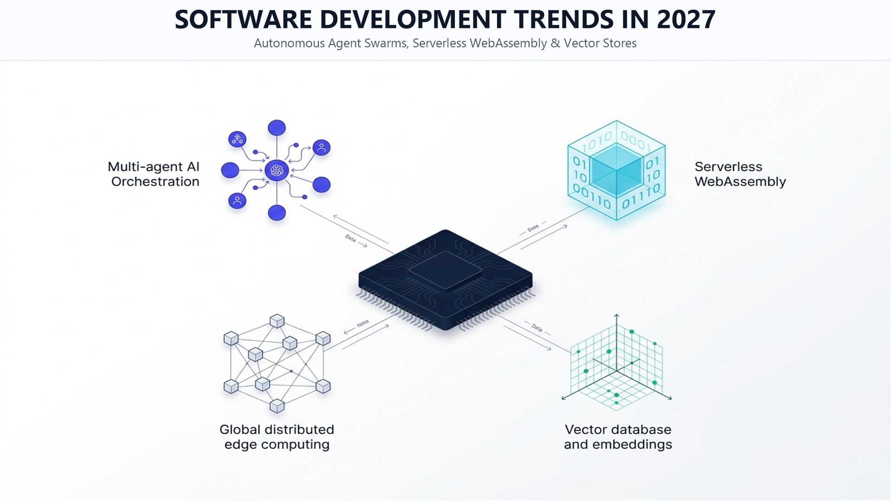

# Metadata Header
**Meta Title:** Technology Trends in 2027: Future of Software Development
**Primary Keyword:** Technology Trends in 2027
**Secondary Keywords:** Emerging Technologies 2027, Software Development Trends, AI Technology Trends, Future of Web Development, Cloud Computing Trends
**Meta Description:** Explore major technology trends in 2027. Discover how autonomous agent swarms, WebAssembly micro-VMs, and edge runtimes are reshaping software engineering.

---

# New Technology Trends in 2027: What's Changing in Software Development?

The dominant **technology trends in 2027** center on autonomous agentic coding pipelines, server-side WebAssembly micro-runtimes, and edge-native architectures replacing centralized monolithic servers. Software teams no longer treat artificial intelligence simply as a conversational prompt or syntax autocomplete utility. Instead, engineering organizations deploy specialized AI agents that proactively audit pull requests, enforce accessibility standards, and verify production deployments before human review.

Understanding these **emerging technologies 2027** helps businesses invest in modern, decoupled codebases that adapt as engineering standards advance over the next product cycle.

---

## Four Foundational Software Development Trends

**Figure 1: Core Architectural Pillars Transforming Enterprise Software in 2027**

The transition from legacy paradigms to decentralized, intelligent software relies on four distinct technical pillars:

### 1. Multi-Agent Development Workflows
The biggest shift in **AI technology trends** is the move from single chat prompts to collaborative multi-agent swarms. In modern pipelines, one specialized agent audits database schemas, a second checks security vulnerabilities, and a third runs regression benchmarks, reducing delivery cycles from weeks to hours. To understand the control mechanisms powering these systems, explore our practical guide on [What Is an AI Agent and How Does It Work?](https://tech.kanavu.org/blog/what-is-an-ai-agent).

### 2. WebAssembly (Wasm) Outside the Browser
WebAssembly has expanded far beyond client-side canvas rendering. Backed by the [W3C official WebAssembly core standards](https://www.w3.org/Wasm/), teams compile high-performance Rust, Go, and C++ modules into portable Wasm binaries that run inside secure serverless micro-runtimes without the heavy cold-start overhead of traditional Docker containers.

### 3. Edge-First Microservices
Centralized cloud data centers are no longer the default deployment destination. Modern **cloud computing trends** prioritize edge runtimes that execute application logic within 20 milliseconds of global users, eliminating cross-continental routing delays and origin bottlenecks.

### 4. Vector-First Data Architectures
Relational databases remain vital for transactions, but semantic search, product recommendations, and automated customer workflows now query native vector stores that understand intent rather than exact keyword matches.

---

## Architectural Comparison: Legacy Systems vs 2027 Intelligent Stack

The table below contrasts the engineering approaches of the previous decade against modern 2027 production standards:

| Architectural Layer | Legacy Paradigm (2020–2024) | 2027 Modern Intelligent Stack |
| :--- | :--- | :--- |
| **Development QA** | Manual pull request reviews & tests | **Autonomous multi-agent auditing swarms** |
| **Server Runtime** | Heavy Docker containers (Cold starts) | **Serverless WebAssembly (Microsecond launch)** |
| **Compute Placement** | Monolithic regional cloud data centers | **Edge-native globally distributed runtimes** |
| **Database Retrieval** | Rigid SQL keyword & regex queries | **Hybrid vector embeddings + semantic search** |
| **Security Response** | Scheduled weekly vulnerability scans | **Continuous automated agent remediation** |

---

## Business Impact: Why Architecture Matters Now

These shifts define the **future of web development**. Companies continuing to build tightly coupled monolithic applications face rising hosting bills and slower product updates. Modern teams adopting modular architectures achieve rapid page loads, automated quality testing, and lower infrastructure maintenance overhead.

Adopting these 2027 development practices does not require rewriting an entire enterprise codebase from scratch. Forward-thinking engineering leaders begin by wrapping high-traffic endpoints in lightweight edge functions, deploying vector indices for internal search, and letting autonomous testing agents monitor pull requests. This incremental modernization strategy lowers operational risks while delivering immediate performance gains.

This technological evolution connects directly to the broader strategic patterns outlined in our master report on [Latest Technology Trends: How They Are Changing Websites, Apps and Businesses](https://tech.kanavu.org/blog/latest-technology-trends).

At Kanavu Technologies, our engineering teams build scalable digital systems and cloud-native solutions. Discover our [enterprise custom software development](https://tech.kanavu.org/services/custom-software) capabilities to prepare your technology infrastructure for the next generation.

---

## Frequently Asked Questions (FAQs)

### 1. Will AI agents replace human software developers by 2027?
No. AI agents automate repetitive testing, syntax drafting, and boilerplate tasks, allowing human developers to focus on architecture, product logic, and system security.

### 2. Why is WebAssembly becoming so popular in backend cloud computing?
WebAssembly modules start in microseconds, consume minimal memory, and provide isolated memory security without the heavy overhead of container virtualization.

### 3. How should small businesses prepare for 2027 technology shifts?
Start by refactoring monolithic applications into modular APIs, adopting modern cloud edge networks, and cleaning business data for future AI search compatibility.
