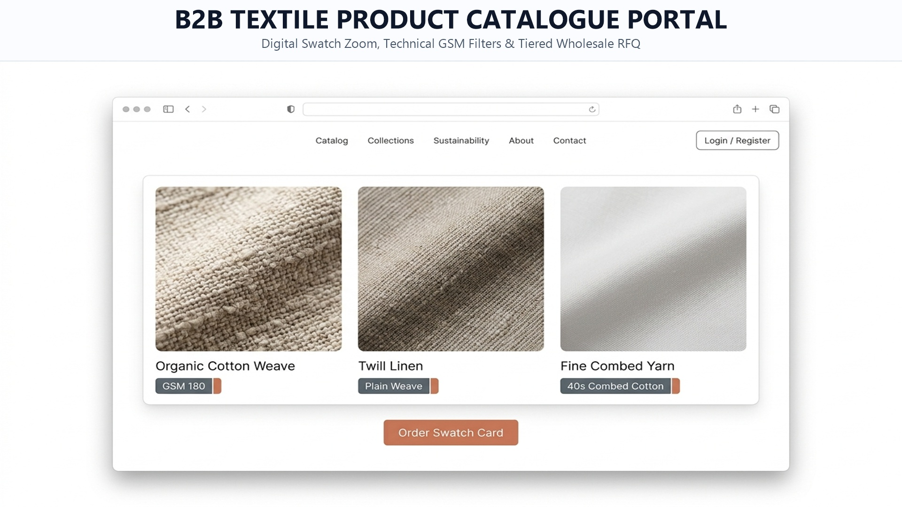
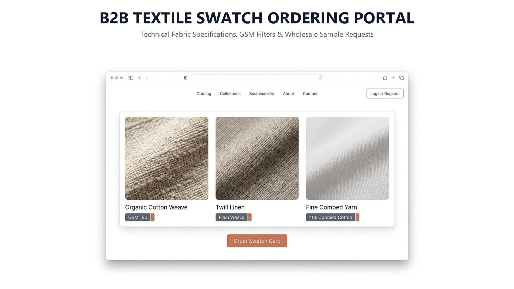

# Metadata Header
**Meta Title:** Website Development for Textile Industry: Essential B2B Features
**Primary Keyword:** Website Development for Textile Industry
**Secondary Keywords:** Textile Website Development, Textile Business Website, Textile E-commerce Website, B2B Textile Website Development, Textile Product Catalogue Website
**Meta Description:** Discover key features for website development in the textile industry. Build B2B fabric portals with digital swatches, GSM filters, and wholesale RFQ engines.

---

# Website Development for Textile Industry: Features Every Textile Business Needs

High-converting **website development for textile industry** manufacturers requires interactive fabric swatch catalogs, minimum order quantity (MOQ) calculators, multi-tier dealer pricing portals, and real-time ERP inventory synchronization. Traditional textile businesses often rely on printed brochures or static PDF files that quickly become outdated. A dedicated **textile business website** transforms physical showroom collections into global digital showrooms where international buyers inspect weave structures, verify technical specifications, and request physical samples in seconds.

Whether your mill produces woven grey fabric, organic knitted cotton, or home furnishings, upgrading to modern **B2B textile website development** streamlines wholesale deals.

---

## Essential Features for a Textile Product Catalogue Website

**Figure 1: Digital B2B Fabric Catalog Interface with Multi-Angle Swatch Zoom**

Building an enterprise-ready **textile e-commerce website** requires specialized industry functionality:

### 1. High-Resolution Swatch Zoom and Texture Inspection
Textile buyers judge quality by touch and weave density. Your portal must feature micro-zoom capabilities that show yarn texture, twill ridges, and surface finishes down to thread-level detail without slowing page load speeds. Deploying static image assets across global edge networks ensures rapid rendering, as detailed in our guide on [How to Host a Website for Free Using Cloudflare Pages](https://tech.kanavu.org/blog/how-to-host-a-website-for-free).

### 2. Technical Parameter Filtering (GSM, Yarn Count, Weave)
B2B purchasers search by technical specifications rather than generic retail colors. Enable faceted search filters for GSM (grams per square meter), yarn count (such as 30s, 40s, or 60s combed cotton), fabric weave (plain, twill, satin, dobby), and eco-certifications aligned with trade standards published by the [Ministry of Textiles, Government of India official portal](https://texmin.nic.in).

### 3. One-Click Physical Swatch Request System
Bulk container orders rarely happen online immediately. Make it effortless for apparel merchandisers to request physical swatch cards by selecting multiple fabrics and submitting courier delivery details in a single form.

### 4. Gated Dealer Pricing and Tiered RFQ Engine
Protect trade margins by allowing verified wholesale partners to view volume-discounted price tiers (such as 500 meters versus 5,000 meters) while displaying general inquiry buttons to retail visitors.

**Figure 2: Technical Fabric Parameter Filtering & Wholesale Order Portal**

---

## Architecture Comparison: Retail E-Commerce vs B2B Textile Portal

The table below contrasts standard retail e-commerce stores with purpose-built **textile product catalogue website** systems:

| Platform Feature | Standard Consumer E-Commerce | Enterprise B2B Textile Portal |
| :--- | :--- | :--- |
| **Catalog Search** | Color, size, brand filters | **GSM, Yarn Count, Weave Pattern, Eco-Certs** |
| **Pricing Display** | Fixed retail price per single piece | **Tiered wholesale volume pricing + Gated dealer logins** |
| **Ordering Model** | Instant credit card shopping cart | **Request for Quote (RFQ) & Bulk Sample Dispatch** |
| **Minimum Order Quantity (MOQ)** | Single unit (MOQ: 1) | **Enforced bulk meterage / weight limits (MOQ: 500m+)** |
| **ERP Inventory Sync** | Single warehouse stock tracking | **Mill loom roll tracking via Tally / SAP API integration** |

Connecting your digital portal directly to production ERP systems eliminates manual data entry errors. When a wholesale client requests five thousand meters of dyed poplin, the system verifies available greige yarn stocks, checks active loom scheduling, and calculates estimated production timelines in real time. This operational transparency builds lasting confidence with high-volume international garment merchandisers.

---

## Modernizing Textile Operations in South India

Modern **textile website development** bridges the gap between traditional powerloom production and worldwide apparel brands. This digital transition aligns with the broader shifts analyzed in our master report on [Latest Technology Trends: How They Are Changing Websites, Apps and Businesses](https://tech.kanavu.org/blog/latest-technology-trends).

Located near major textile hubs, Kanavu Technologies builds modern digital solutions tailored to manufacturing workflows. We understand local mill operations, Texvalley wholesale dynamics, and export compliance. Discover our [custom B2B portal and CMS development](https://tech.kanavu.org/services/cms-development) services to transform your fabric catalog into an active 24/7 sales engine.

---

## Frequently Asked Questions (FAQs)

### 1. How is a B2B textile website different from a standard retail store?
B2B textile websites prioritize fabric specifications, wholesale tiered pricing, minimum order quantities (MOQs), and physical sample requests rather than single-item consumer checkouts.

### 2. Can our website connect directly to our mill's Tally or SAP inventory?
Yes. Custom API integration automatically updates available fabric yardage and yarn stock from your internal ERP to the digital catalog.

### 3. How do international buyers inspect fabric texture through a website?
Ultra-high-definition multi-angle photography, 8x fabric zoom, and certified technical spec sheets provide accurate assessment before ordering physical sample swatches.
