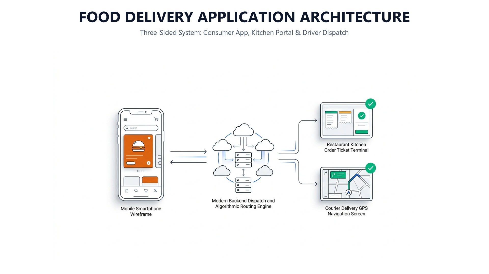

# Metadata Header
**Meta Title:** Food Delivery App Development: Features, Cost & Process Guide
**Primary Keyword:** Food Delivery App Development
**Secondary Keywords:** How to Build a Food Delivery App, Food Delivery App Features, Food Delivery App Development Cost, Online Food Ordering App, Restaurant Delivery App Development
**Meta Description:** Learn how to build a food delivery app. Explore core features, development cost breakdowns, and the technical process for restaurant and cloud kitchen apps.

---

# How to Build a Food Delivery App: Features, Cost and Development Process

Successful **food delivery app development** requires building three synchronized digital applications: a customer ordering app, a kitchen merchant terminal, and a driver dispatch app connected to a central cloud backend. Restaurant chains and cloud kitchen operators increasingly invest in custom platforms to retain direct customer relationships, control customer data, and avoid paying 25% to 30% aggregator commissions on every order.

Understanding **how to build a food delivery app** begins by identifying the core architectural workflows that make order fulfillment fast, accurate, and scalable across peak meal hours.

---

## The Three-Sided Delivery Platform Architecture

**Figure 1: Three-Sided Food Delivery Architecture: Customer, Kitchen, and Driver Dispatch**

Building an **online food ordering app** involves three distinct interfaces synchronized through real-time WebSockets:

### 1. The Customer Interface
Customers need fast menu browsing, customization options (such as spice levels or toppings), secure payment gateways, and live GPS delivery tracking. By building on cross-platform frameworks referenced in the [official React Native mobile framework documentation](https://reactnative.dev/docs/getting-started), teams deploy native iOS and Android apps from a single codebase to cut engineering costs and accelerate time to market.

### 2. The Restaurant Kitchen Dashboard
Kitchen staff require a tablet-friendly interface to accept orders, update preparation times, toggle out-of-stock items, and manage incoming delivery partners without slowing dining room service. Incoming tickets route directly to thermal kitchen order printers to prevent manual order re-entry errors during rush periods.

### 3. The Driver Partner Application
Delivery drivers need turn-by-turn route navigation, instant trip assignment alerts, in-app customer calling, and an automated daily earnings wallet with direct bank deposit integrations. Background battery optimization ensures continuous GPS geofencing without draining mobile hardware.

---

## Cost & Architectural Tier Breakdown

Evaluating **food delivery app development cost** depends on whether you are launching a single-location restaurant app or a multi-vendor on-demand marketplace:

| Project Tier | Target Business Type | Estimated Cost Range | Core Architectural Features |
| :--- | :--- | :--- | :--- |
| **Tier 1: Single-Brand MVP** | Independent Restaurant / Bakery Chain | **$8,000 – $14,000** (₹6.5L – ₹11.5L) | Customer app, web ordering, kitchen tablet dashboard, integrated payment gateway |
| **Tier 2: Multi-Branch Chain** | Regional Restaurant Franchise | **$15,000 – $24,000** (₹12L – ₹20L) | Multi-outlet inventory routing, POS billing synchronization, custom driver fleet tracking |
| **Tier 3: On-Demand Marketplace** | Cloud Kitchen Network / Hyperlocal Delivery | **$25,000 – $40,000+** (₹21L – ₹33L+) | Dynamic driver dispatch algorithms, surge pricing, split escrow payments, live GPS routing |

Throttling location coordinates based on driver velocity cuts third-party mapping API fees by up to 50%. Furthermore, distributed backends handle sudden order spikes through event-driven microservices and edge logic, patterns explored in our overview of [New Technology Trends in 2027: What's Changing in Software Development?](https://tech.kanavu.org/blog/technology-trends-2027).

---

## Engineering Custom Delivery Solutions

Specialized **restaurant delivery app development** allows food brands to take full ownership of their customer relationships, menu pricing, and digital brand loyalty. This architectural shift mirrors the enterprise transformations detailed in our master analysis on [Latest Technology Trends: How They Are Changing Websites, Apps and Businesses](https://tech.kanavu.org/blog/latest-technology-trends).

At Kanavu Technologies, our mobile engineers build secure, high-performance applications designed for high transaction volumes. Whether you want to launch a local food delivery network or integrate online ordering with existing POS terminals, explore our [custom mobile app development](https://tech.kanavu.org/services/mobile-app-development) services to build scalable software tailored to your kitchen operations.

---

## Frequently Asked Questions (FAQs)

### 1. How long does it take to develop a custom food delivery app?
A standard production MVP takes approximately 10 to 14 weeks from initial UI/UX wireframing through full testing and app store deployment.

### 2. Can our delivery app connect to our existing kitchen POS billing machine?
Yes. Custom backend APIs synchronize incoming mobile orders directly with popular restaurant point-of-sale systems and kitchen order printers.

### 3. Why build a custom delivery app instead of relying entirely on aggregators?
Direct apps eliminate 30% platform commissions, provide full customer database ownership, and build repeat order loyalty through direct discount coupons.
