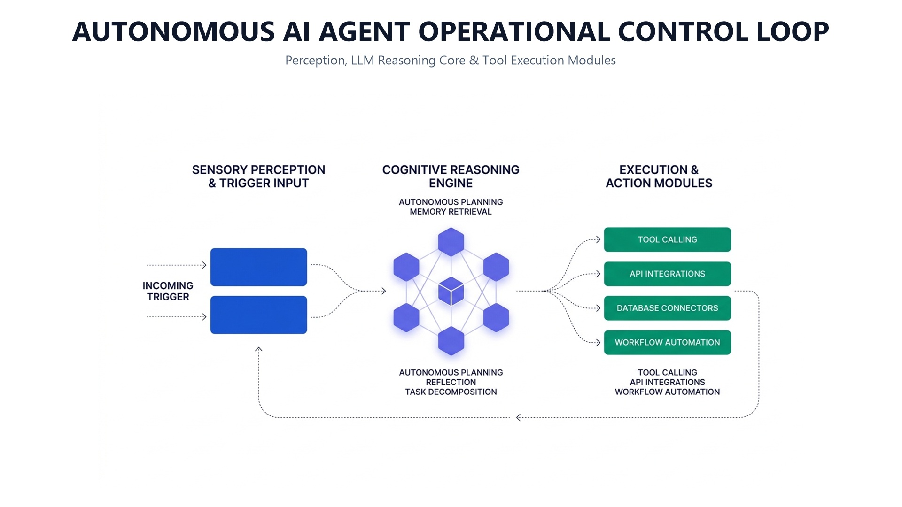
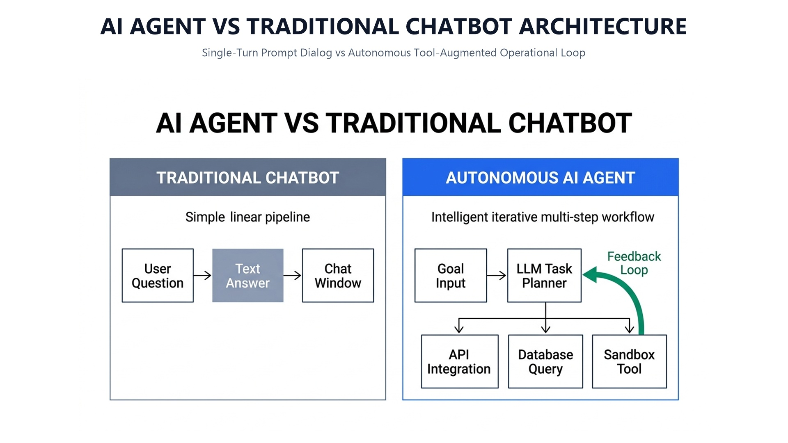

# Metadata Header
**Meta Title:** What Is an AI Agent and How Does It Work? Guide
**Primary Keyword:** AI Agent
**Secondary Keywords:** What Is an AI Agent, AI Agent Examples, AI Agents in Business, AI Agent vs Chatbot, AI Agent Automation, Agentic AI
**Meta Description:** Learn what an AI agent is and how agentic AI works. Discover the perception-action loop, AI agent vs chatbot differences, and real business use cases.

---

# What Is an AI Agent and How Does It Work?

An **AI agent** is an autonomous software program that perceives its digital environment, evaluates options against a specific objective, and uses external tools to execute tasks without continuous human oversight. While conventional software follows predetermined scripts and hardcoded rules, modern **agentic AI** couples large language models with memory, task planning, and API integrations to resolve complex multi-step workflows independently.

Whether handling customer refunds, cross-referencing supplier inventories, or triaging code repositories, autonomous agents represent the shift from reactive text generation to proactive execution.

---

## How an AI Agent Operates: The Sense-Plan-Act Loop

**Figure 1: Autonomous AI Agent Perception, Reasoning, and Tool Execution Loop**

To resolve complex goals without manual prompting at every turn, an autonomous agent runs a four-stage execution cycle:

1. **Perception and Context Ingestion:** The agent receives a user prompt, webhook, or environment trigger. It retrieves relevant background documents, past context, and system instructions from vector storage.
2. **Decomposition and Planning:** Rather than guessing an immediate response, the model breaks the primary objective into chronological subtasks. Foundational methods behind these multi-step planning loops are guided by [Google DeepMind research on autonomous agent systems](https://deepmind.google/discover/blog/).
3. **Tool Execution and Schema Validation:** Using defined APIs, web scrapers, or database drivers, the agent queries external software systems, modifies records, or dispatches notifications. Strict parameter validation ensures commands stay within safety guardrails.
4. **Observation and Self-Correction:** The agent evaluates tool outputs. If an API returns an error or unexpected status code, it inspects the response, adjusts parameters, and retries alternative paths until achieving the target outcome.

---

## AI Agent vs Chatbot: Key Differences

**Figure 2: Architectural Execution Model: Single-Turn Dialog vs Autonomous Tool-Augmented Agent**

The difference between a conversational bot and an autonomous agent centers on authority and execution capability:

| Feature Dimension | Traditional AI Chatbot | Autonomous AI Agent |
| :--- | :--- | :--- |
| **Primary Function** | Answers questions in text format | **Executes multi-step workflows to completion** |
| **Tool Usage** | Restricted to dialogue interface | **Connects to external APIs, databases, and software tools** |
| **Autonomy Level** | Waits for prompt after each turn | **Iterates through goal-directed planning loops independently** |
| **Error Handling** | Apologizes when an answer fails | **Evaluates failure codes and retries alternative paths** |

This operational leap aligns directly with wider shifts toward multi-agent collaboration, as explored in our guide on [New Technology Trends in 2027: What's Changing in Software Development?](https://tech.kanavu.org/blog/technology-trends-2027).

---

## Practical AI Agent Examples in Business

Forward-thinking organizations deploy **AI agents in business** across three high-impact operational areas:

* **Customer Operations:** Agents authenticate account holders, inspect live logistics databases, process warranty refunds through payment gateways, and send confirmation emails automatically.
* **Supply Chain Management:** Monitoring real-time inventory balances across distributed warehouses, agents predict replenishment timelines and generate purchase orders directly in enterprise ERP systems.
* **Automated Code Refactoring:** Development teams run agentic pipelines that detect failing test suites, write unit tests, verify fixes against sandbox builds, and open pull requests.

Enterprise adoption of autonomous agents requires robust sandboxing and human-in-the-loop escalation protocols. When an agent encounters sensitive tasks like large financial transfers or external data deletion, it drafts the proposal and requests human sign-off before proceeding.

This architectural shift connects directly to the broader industry patterns analyzed in our master report on [Latest Technology Trends: How They Are Changing Websites, Apps and Businesses](https://tech.kanavu.org/blog/latest-technology-trends). At Kanavu Technologies, our software engineers build custom intelligent automation platforms. Explore our [custom software development services](https://tech.kanavu.org/services/custom-software) to deploy secure, tool-augmented systems.

---

## Frequently Asked Questions (FAQs)

### 1. What is an AI agent in simple terms?
An AI agent is software that takes a high-level goal, plans the necessary steps, and uses external digital tools to finish work automatically.

### 2. What is the primary difference between an AI agent and a chatbot?
A chatbot only answers questions with text, whereas an AI agent connects to external software tools and databases to complete tasks independently.

### 3. How do companies maintain security when deploying AI agents?
Organizations maintain security by enforcing strict API permission scopes, credential sandboxing, encrypted audit logs, and mandatory human approval gates for critical financial transactions.
