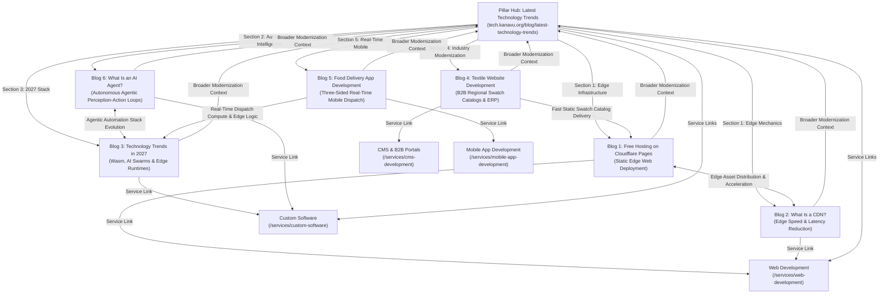

# Kanavu Technologies — Master Cluster Internal Linking Report

* **Date:** 2026-11-13
* **Brand / Client:** Kanavu Technologies (`tech.kanavu.org`)
* **Pillar Hub Title:** *Latest Technology Trends: How They Are Changing Websites, Apps and Businesses*
* **Pillar Canonical Route (Planned):** `https://tech.kanavu.org/blog/latest-technology-trends`
* **Cluster Scope:** 1 Pillar Hub + 6 Specialized Spokes

---

## 1. Topic Cluster Visual Architecture

---

## 2. Master 4-Tier Smart Linking Verification Matrix

Every article in the cluster adheres strictly to **meaning-based placement** (zero links in the opening hook; zero links after FAQs; zero end-of-post link clustering):

| Article | Tier A: Pillar Hub Link | Tier B: Related Spoke Link | Tier C: Verified Service Link | External Authority Reference |
| :--- | :--- | :--- | :--- | :--- |
| **Pillar: Latest Tech Trends** | *N/A (Central Hub)* | Connects to **all 6 Spokes** in dedicated thematic sections | `/services/web-development` `/services/custom-software` | MDN, DeepMind, W3C, Ministry of Textiles, React Native |
| **Blog 1: Cloudflare Pages** | `[Latest Technology Trends: How They Are Changing Websites, Apps and Businesses]` | `[What Is a CDN and How Does It Make Your Website Faster?]` | `/services/web-development` (*modern web development and cloud deployment*) | `developers.cloudflare.com/pages/` (*official Cloudflare documentation*) |
| **Blog 2: What Is a CDN** | `[Latest Technology Trends: How They Are Changing Websites, Apps and Businesses]` | `[How to Host a Website for Free Using Cloudflare Pages]` | `/services/web-development` (*high-performance custom web development*) | `developer.mozilla.org/en-US/docs/Glossary/CDN` (*MDN Web Docs CDN glossary*) |
| **Blog 3: Tech Trends 2027** | `[Latest Technology Trends: How They Are Changing Websites, Apps and Businesses]` | `[What Is an AI Agent and How Does It Work?]` | `/services/custom-software` (*enterprise custom software development*) | `w3.org/Wasm/` (*W3C WebAssembly core standards*) |
| **Blog 4: Textile Website** | `[Latest Technology Trends: How They Are Changing Websites, Apps and Businesses]` | `[How to Host a Website for Free Using Cloudflare Pages]` | `/services/cms-development` (*custom B2B portal and CMS development*) | `texmin.nic.in` (*Ministry of Textiles official portal*) |
| **Blog 5: Food Delivery App** | `[Latest Technology Trends: How They Are Changing Websites, Apps and Businesses]` | `[New Technology Trends in 2027: What's Changing in Software Development?]` | `/services/mobile-app-development` (*custom mobile app development services*) | `reactnative.dev/docs/getting-started` (*React Native mobile framework*) |
| **Blog 6: What Is an AI Agent** | `[Latest Technology Trends: How They Are Changing Websites, Apps and Businesses]` | `[New Technology Trends in 2027: What's Changing in Software Development?]` | `/services/custom-software` (*custom software development services*) | `deepmind.google/discover/blog/` (*Google DeepMind autonomous agents*) |

---

## 3. Link Verification & Staging Protocol
* **Verified Live Services:**
  - `https://tech.kanavu.org/services/web-development`
  - `https://tech.kanavu.org/services/mobile-app-development`
  - `https://tech.kanavu.org/services/custom-software`
  - `https://tech.kanavu.org/services/cms-development`
* **Planned Blog Cluster URLs (Staged):**
  - Pillar: `https://tech.kanavu.org/blog/latest-technology-trends`
  - Spoke 1: `https://tech.kanavu.org/blog/how-to-host-a-website-for-free`
  - Spoke 2: `https://tech.kanavu.org/blog/what-is-a-cdn`
  - Spoke 3: `https://tech.kanavu.org/blog/technology-trends-2027`
  - Spoke 4: `https://tech.kanavu.org/blog/website-development-for-textile-industry`
  - Spoke 5: `https://tech.kanavu.org/blog/how-to-build-a-food-delivery-app`
  - Spoke 6: `https://tech.kanavu.org/blog/what-is-an-ai-agent`
