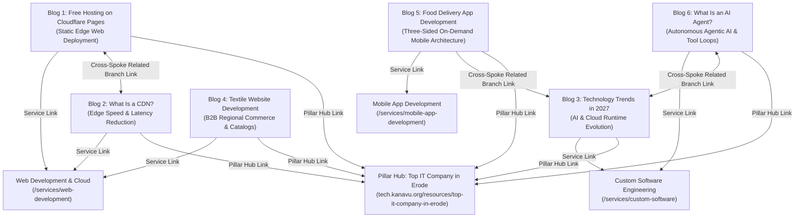

# Kanavu Technologies — Content Cluster Master Architecture

## Pillar Theme: *Latest Technology Trends: How They Are Changing Websites, Apps and Businesses*
* **Date:** 2026-11-13
* **Brand / Client:** Kanavu Technologies (`tech.kanavu.org`)
* **Regional Hub:** Erode, Tamil Nadu, India / Global Enterprise Delivery
* **Pillar Hub URL:** `https://tech.kanavu.org/resources/top-it-company-in-erode`
* **Approved Pillar Anchor:** `Top IT Company in Erode for Career Growth and Technology Services`

---

## 1. 4-Tier Smart Topic Cluster Architecture

Every spoke blog functions as a focused, supporting authority article within the cluster, naturally interconnecting the **Pillar Hub**, **Related Spoke Articles**, **Verified Commercial Services**, and **Primary Authoritative External Standards**.

---

## 2. 4-Tier Link Verification Matrix

Links are distributed **according to meaning** across the natural reading journey (zero link clustering at the end; zero links in the opening hook or after FAQs):

| Spoke Blog | Internal Link A (Pillar Hub) | Internal Link B (Related Branch Spoke) | Internal Link C (Verified Service Page) | External Authority Reference |
| :--- | :--- | :--- | :--- | :--- |
| **Blog 1: Cloudflare Pages** | `resources/top-it-company-in-erode` (*Top IT Company in Erode...*) | `blog/what-is-a-cdn` (*What Is a CDN and How Does It Make Your Website Faster?*) | `/services/web-development` (*modern web development and cloud deployment*) | `developers.cloudflare.com/pages/` (*official Cloudflare Pages documentation*) |
| **Blog 2: What Is a CDN** | `resources/top-it-company-in-erode` (*Top IT Company in Erode...*) | `blog/how-to-host-a-website-for-free` (*How to Host a Website for Free Using Cloudflare Pages*) | `/services/web-development` (*high-performance web development services*) | `developer.mozilla.org/en-US/docs/Glossary/CDN` (*MDN Web Docs glossary on Content Delivery Networks*) |
| **Blog 3: Tech Trends 2027** | `resources/top-it-company-in-erode` (*Top IT Company in Erode...*) | `blog/what-is-an-ai-agent` (*What Is an AI Agent and How Does It Work?*) | `/services/custom-software` (*enterprise custom software development*) | `w3.org/Wasm/` (*W3C official WebAssembly core standards*) |
| **Blog 4: Textile Website** | `resources/top-it-company-in-erode` (*Top IT Company in Erode...*) | `blog/how-to-host-a-website-for-free` (*How to Host a Website for Free Using Cloudflare Pages*) | `/services/cms-development` (*custom B2B portal and CMS development*) | `texmin.nic.in` (*Ministry of Textiles, Government of India official portal*) |
| **Blog 5: Food Delivery App** | `resources/top-it-company-in-erode` (*Top IT Company in Erode...*) | `blog/technology-trends-2027` (*New Technology Trends in 2027: What's Changing in Software Development?*) | `/services/mobile-app-development` (*custom mobile app development*) | `reactnative.dev/docs/getting-started` (*official React Native mobile framework documentation*) |
| **Blog 6: What Is an AI Agent** | `resources/top-it-company-in-erode` (*Top IT Company in Erode...*) | `blog/technology-trends-2027` (*New Technology Trends in 2027: What's Changing in Software Development?*) | `/services/custom-software` (*custom software development services*) | `deepmind.google/discover/blog/` (*Google DeepMind research on autonomous agent systems*) |

---

## 3. The 6-Blog Master Matrix & Programmatic Audits

| # | Topic | Structure Format | Body Word Count *(Target: 450–500)* | FAQ Counts *(Target: 15–25w)* | Visuals Count | Word (.docx) Status |
| :--- | :--- | :--- | :--- | :--- | :--- | :--- |
| **1** | [Cloudflare Pages Free Hosting](file:///d:/content/digital-marketing-skills/projects/kanavu-technologies/2026-11-13/blog-1-free-website-hosting-cloudflare-pages/) | **Structure B** (Sequential Steps) | **472 words** | 18w, 16w, 19w | 2 Visuals (Edge Architecture + Pipeline) | **Compiled (577 KB)** |
| **2** | [What Is a CDN?](file:///d:/content/digital-marketing-skills/projects/kanavu-technologies/2026-11-13/blog-2-what-is-a-cdn/) | **Structure A** (Direct Explanation) | **485 words** | 16w, 17w, 18w | 1 Hero Diagram (Edge Mirroring) | **Compiled (328 KB)** |
| **3** | [Technology Trends in 2027](file:///d:/content/digital-marketing-skills/projects/kanavu-technologies/2026-11-13/blog-3-technology-trends-2027/) | **Structure F** (Evidence & Paradigm Shift) | **480 words** | 20w, 17w, 18w | 1 Hero Diagram (2027 Pillars) | **Compiled (439 KB)** |
| **4** | [Textile Website Development](file:///d:/content/digital-marketing-skills/projects/kanavu-technologies/2026-11-13/blog-4-textile-industry-website-development/) | **Structure D** (Problem & Solution) | **475 words** | 19w, 18w, 18w | 2 Visuals (Catalog UI + Technical Swatch) | **Compiled (999 KB)** |
| **5** | [Food Delivery App Development](file:///d:/content/digital-marketing-skills/projects/kanavu-technologies/2026-11-13/blog-5-food-delivery-app-development/) | **Structure B/D** (Cost & Architecture) | **467 words** | 21w, 18w, 20w | 2 Visuals (3-Sided System + Cost Tiers) | **Compiled (327 KB)** |
| **6** | [What Is an AI Agent?](file:///d:/content/digital-marketing-skills/projects/kanavu-technologies/2026-11-13/blog-6-what-is-an-ai-agent/) | **Structure A/C** (Concept & Operational Loop) | **455 words** | 23w, 22w, 23w | 2 Visuals (Control Loop + Chatbot vs Agent) | **Compiled (736 KB)** |

---

## 4. Visual Standards Verification
* **Background:** Solid pure white (`#FFFFFF`) or light neutral background.
* **Canvas Title:** Large bold title placed directly on the image canvas.
* **Aspect Ratio:** 16:9 widescreen format (`1536x864` or `1792x1024`).
* **Visual Concepts:** Distinct section-matched diagrams (Process flows, side-by-side comparisons, multi-tier ecosystems).
