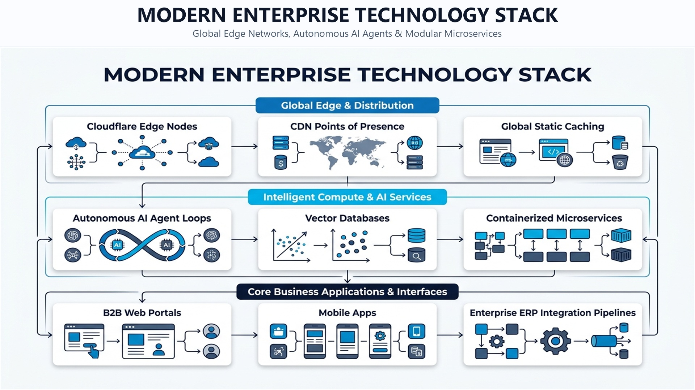
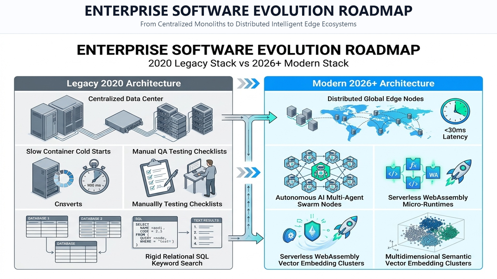

# Metadata Header
**Meta Title:** Latest Technology Trends: How They Change Websites, Apps & Business
**Primary Keyword:** Latest Technology Trends
**Secondary Keywords:** Technology Trends in Business, Modern Web Development Trends, AI in Business, Cloud Technology Trends, Future of Apps
**Meta Description:** Discover the latest technology trends transforming websites, mobile apps, and enterprise operations. Learn how edge computing, AI agents, and modular runtimes drive growth.

---

# Latest Technology Trends: How They Are Changing Websites, Apps and Businesses

The **latest technology trends** are defined by three major engineering shifts: distributed edge computing replacing centralized origin servers, autonomous agentic intelligence succeeding passive chatbots, and ultra-fast micro-runtimes streamlining modern application architecture. For decades, organizations relied on monolithic web stacks, scheduled batch jobs, and human-driven technical workflows. Today, digital platforms run logic milliseconds away from global users, process semantic meaning through high-dimensional vectors, and coordinate autonomous tasks without constant human intervention.

Understanding these foundational shifts in **technology trends in business** helps leadership teams modernize legacy systems, cut hosting overhead, and build digital experiences that scale reliably.

---

## 1. Edge-Native Infrastructure: Why Centralized Cloud Servers Are Fading

For the past fifteen years, web hosting followed a predictable model. Businesses rented virtual servers in centralized regional data centers (like AWS us-east-1 or Mumbai ap-south-1). When a customer accessed a website or mobile application from Singapore, London, or Sydney, every HTTP request traversed thousands of miles of submarine fiber-optic cables to reach that central server.

This centralized model introduced severe geographic latency. Even on high-speed fiber connections, physical distance adds roughly 15 to 25 milliseconds of round-trip network lag for every 1,000 miles traveled. Furthermore, a sudden viral traffic spike or coordinated denial-of-service attack could easily overwhelm the origin hardware, knocking the entire digital business offline.

**Figure 1: Global Edge Infrastructure Transforming Enterprise Web Delivery**


Modern **cloud technology trends** solve this physical bottleneck by shifting static assets and compute execution directly to the edge of the internet. Rather than routing all traffic to a single data center, modern applications deploy across distributed networks composed of hundreds of Points of Presence (PoPs) located in major metropolitan areas worldwide.

To understand the core mechanics of edge caching and latency reduction, explore our deep dive on [What Is a CDN and How Does It Make Your Website Faster?](https://tech.kanavu.org/blog/what-is-a-cdn). As detailed in the [MDN Web Docs glossary on Content Delivery Networks](https://developer.mozilla.org/en-US/docs/Glossary/CDN), edge servers store cached copies of static files, stylesheets, and media assets within dozens of miles of end users, slashing Time to First Byte (TTFB) and reducing origin bandwidth loads by over 70%.

For modern web teams, startups, and content platforms, edge architecture has also eliminated the traditional hosting bill. By pairing static site generators with global edge distribution, developers deploy ultra-fast websites with zero server maintenance costs. Learn the practical deployment steps in our comprehensive guide on [How to Host a Website for Free Using Cloudflare Pages](https://tech.kanavu.org/blog/how-to-host-a-website-for-free).

---

## 2. From Passive Chatbots to Autonomous Agentic AI

The conversation surrounding artificial intelligence has shifted dramatically. In 2023 and 2024, businesses experimented with generative text models primarily through conversational chat windows. While helpful for drafting emails and answering simple queries, traditional chatbots remained fundamentally passive: they waited for human prompts, generated text based on statistical probabilities, and possessed zero capability to interact with external business tools or take action in the real world.

The modern paradigm shift in **AI in business** centers on autonomous agentic systems. An agentic system pairs a large language model with long-term memory, planning logic, and external tool execution APIs. Instead of merely suggesting a solution in a chat box, an AI agent perceives its environment, formulates a multi-step execution plan, invokes external APIs, evaluates the output, and iteratively corrects its own mistakes until the objective is accomplished.

```
+-------------------------------------------------------------------------+
|                  THE AUTONOMOUS AGENTIC EXECUTION LOOP                  |
|                                                                         |
|   1. PERCEPTION         2. REASONING          3. ACTION EXECUTION       |
|  [Ingest Event/Data] -> [Formulate Multi-Step] -> [Call External APIs,  |
|                         [Plan via Core LLM]       Database, Webhook]    |
|                                                          |              |
|                               4. VERIFICATION            v              |
|                             [Inspect System Result] <----+              |
|                                      |                                  |
|                                      v                                  |
|                    +-----------------------------------+                |
|                    | Goal Achieved?                    |                |
|                    | Yes -> Deliver Final Output       |                |
|                    | No  -> Self-Correct & Re-execute  |                |
|                    +-----------------------------------+                |
+-------------------------------------------------------------------------+
```

To examine this architecture in detail, read our practitioner guide on [What Is an AI Agent and How Does It Work?](https://tech.kanavu.org/blog/what-is-an-ai-agent). Groundbreaking research from the [Google DeepMind research on autonomous agents](https://deepmind.google/discover/blog/) demonstrates that multi-agent architectures—where specialized autonomous models collaborate on distinct tasks such as database validation, security scanning, and unit testing—vastly outperform monolithic single-prompt configurations.

In modern engineering pipelines, agent swarms now actively review code pull requests, identify security vulnerabilities, update deprecated software dependencies, and trigger automated staging rollouts without requiring manual engineering tickets.

---

## 3. The 2027 Engineering Frontier: WebAssembly and Vector-First Data

As we look toward the horizon of software development, monolithic application runtimes and rigid relational keyword queries are giving way to lightweight, polyglot execution environments and semantic vector retrieval.

Two technical innovations represent the leading edge of **modern web development trends**:

### Server-Side WebAssembly (Wasm) Micro-Runtimes
While WebAssembly was initially engineered to execute high-performance code inside desktop web browsers, it has rapidly emerged as a dominant server-side compute runtime. Standardized by the [W3C official WebAssembly core standards](https://www.w3.org/Wasm/), Wasm binaries compile code written in Rust, Go, or C++ into sandboxed bytecode that starts in microseconds. Unlike traditional Docker containers that require megabytes of base operating system overhead and take seconds to boot, serverless WebAssembly runtimes launch instantaneously with negligible memory footprints, making them ideal for high-throughput edge microservices.

### Native Semantic Vector Stores
Traditional relational databases rely on exact string matches, foreign key joins, and regular expressions. While essential for financial ledgers and transactional records, relational queries struggle with unstructured human language, contextual product discovery, and recommendation systems. Modern architectures increasingly embed semantic vector databases alongside SQL storage, converting catalog items, user queries, and customer interactions into mathematical embeddings that capture conceptual intent rather than literal keywords.

For a forward-looking analysis of these upcoming shifts, inspect our complete report on [New Technology Trends in 2027: What's Changing in Software Development?](https://tech.kanavu.org/blog/technology-trends-2027).

**Figure 2: Architectural Comparison: Legacy Monolith vs Modern Distributed Stack**


| Architectural Dimension | Legacy Centralized Stack (2015–2022) | Modern Distributed Stack (2025–2027) |
| :--- | :--- | :--- |
| **Compute Location** | Single regional cloud data center | **Global edge Points of Presence (PoPs)** |
| **Runtime Virtualization** | Heavy Linux containers & virtual machines | **Serverless WebAssembly (Wasm) micro-VMs** |
| **Intelligence Layer** | Scripted rule engines & passive chatbots | **Autonomous multi-agent execution loops** |
| **Information Retrieval** | Exact SQL string matching & keyword search | **Hybrid vector embeddings + semantic retrieval** |
| **Asset Delivery** | Direct origin server bandwidth pipelines | **Distributed multi-tier CDN caching layers** |
| **Deployment Model** | Manual release cycles & rigid monoliths | **Continuous Git-triggered edge builds** |

---

## 4. Vertical Industry Transformation: B2B Textile Digital Ecosystems

The impact of modern technology extends far beyond Silicon Valley software products. Traditional manufacturing and regional industrial hubs are undergoing rapid digital modernization to meet international buyer expectations.

A prime example is the textile manufacturing sector. Traditionally, textile mills and wholesale garment exporters operated through physical trade fairs, printed fabric swatch books, and phone calls. When global buyers needed to inspect weave textures, evaluate yarn counts, or check loom availability, the process took weeks of courier shipments and manual negotiations.

Modern digital engineering is transforming this process into high-converting digital showrooms. Through purpose-built web portals, mills provide 8x high-definition fabric zoom, interactive GSM calculators, wholesale tiered pricing engines, and real-time ERP inventory synchronization.

To examine the specific technical requirements for fabric portals, review our dedicated guide on [Website Development for Textile Industry: Features Every Textile Business Needs](https://tech.kanavu.org/blog/website-development-for-textile-industry). Following compliance guidelines and trade standards published by the [Ministry of Textiles, Government of India official portal](https://texmin.nic.in), modern B2B fabric portals bridge regional manufacturing hubs with international apparel brands, turning physical showrooms into 24/7 global sales pipelines.

---

## 5. The Real-Time On-Demand Economy: Complex Multi-Sided Platforms

In the consumer market, user expectations for speed, responsiveness, and reliability have reached historic peaks. Nowhere is this more evident than in on-demand mobile platforms, such as food delivery, ride-hailing, and instant grocery logistics.

Developing an on-demand application is not simply a matter of building a mobile shopping cart. It requires engineering three independent, synchronized applications operating in continuous real-time coordination:

1. **The Consumer Application:** Handles dynamic restaurant catalogs, personalized search, order tracking, and payment processing.
2. **The Courier Application:** Manages geospatial GPS navigation, dynamic batch route optimization, and payout calculations.
3. **The Restaurant Kitchen Portal:** Processes incoming order tickets, inventory availability, and prep-time dispatch scheduling.

Behind these user interfaces sits a complex distributed backend: geospatial microservices calculate delivery radiuses within milliseconds, WebSockets maintain persistent two-way communication between drivers and diners, and distributed state machines ensure transaction integrity even under unstable mobile network conditions.

To explore architecture patterns, tech stacks, and budgeting breakdowns for on-demand systems, see our complete guide on [How to Build a Food Delivery App: Features, Cost and Development Process](https://tech.kanavu.org/blog/how-to-build-a-food-delivery-app). Utilizing modern cross-platform engineering frameworks like the [official React Native documentation](https://reactnative.dev/docs/getting-started), engineering teams deploy consistent, high-performance mobile experiences across Android and iOS from a single unified codebase.

---

## 6. Strategic Implementation: Engineering Systems for the Next Decade

Navigating the **future of apps** and web architecture does not require discarding your existing codebase overnight. The most successful organizations modernize incrementally: wrapping legacy databases in modern API layers, moving static asset delivery to global CDNs, deploying autonomous agent workers for maintenance tasks, and adopting cross-platform mobile frameworks for customer touchpoints.

At Kanavu Technologies, our software engineering teams design, build, and scale resilient digital infrastructure for growing enterprises and ambitious startups. Whether you are transitioning to edge-native cloud systems, integrating intelligent workflow automation, or building a bespoke industry platform, explore our [custom web development services](https://tech.kanavu.org/services/web-development) and [enterprise custom software development](https://tech.kanavu.org/services/custom-software) capabilities to engineer scalable, future-ready software.

---

## Frequently Asked Questions (FAQs)

### 1. What is the most significant technology trend transforming modern websites today?
Global edge computing and serverless runtimes are the most impactful trends, delivering website assets and logic within milliseconds of visitors worldwide.

### 2. How do autonomous AI agents differ from traditional customer chatbots?
Unlike passive chatbots that only generate conversational text, autonomous AI agents perceive data, make multi-step decisions, and execute external business actions independently.

### 3. Can small businesses benefit from modern edge and cloud architectures?
Yes. Modern edge platforms provide free or low-cost hosting tiers, enterprise-grade security, and global speed without expensive dedicated server maintenance overhead.
