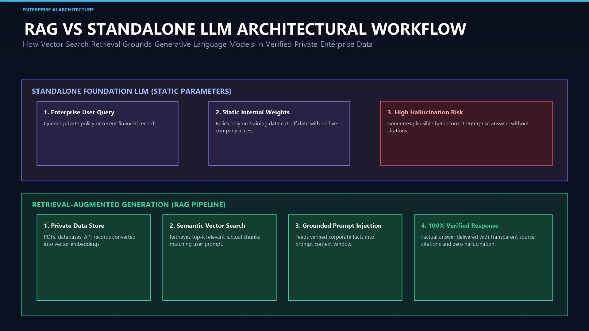
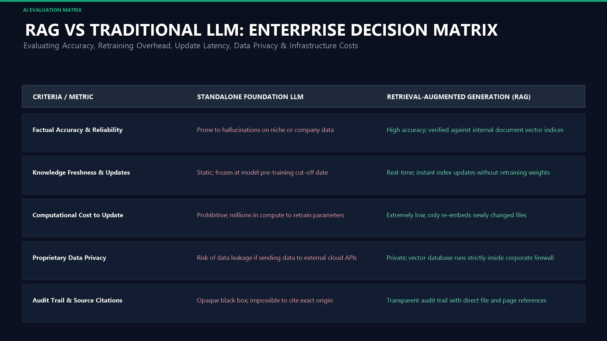

# RAG vs LLM: Key Differences, Benefits and Real-World Use Cases

**Meta Title:** RAG vs LLM: Key Differences, Benefits and Real-World Use Cases | Kanavu Technologies
**Meta Description:** Explore RAG vs LLM, their key differences, benefits and real-world use cases. Learn which approach is better for your business AI applications.
**Primary Keyword:** RAG vs LLM
**Secondary Keywords:** Retrieval-Augmented Generation, Large Language Models, RAG vs Traditional LLM, RAG Use Cases

---

The fundamental distinction in RAG vs LLM centers on whether an artificial intelligence system generates responses solely from static internal memory or dynamically retrieves verified external enterprise records before producing an answer. Standard foundational models rely exclusively on training weights established during initial creation, which can produce confident yet completely inaccurate statements when queried about proprietary corporate information. Grounding model generation with verified vector databases ensures factual accuracy and provides transparent audit trails for enterprise compliance.

### RAG Architecture Compared to Standalone LLM Inference

*Figure 1: Architectural diagram showing vector database document retrieval combined with model generation.*

*Alt Text: Workflow comparing vector database query retrieval against standalone model parameter inference*

## Architectural Differences in Information Processing

Understanding Retrieval-Augmented Generation requires looking at how enterprise documents convert into high-dimensional vector embeddings stored within specialized search indices. When an employee asks a complex technical question, the retrieval engine queries private documentation, extracts relevant context paragraphs, and feeds those verified facts directly into the prompt window.

A production-ready retrieval pipeline executes across four sequential stages:

1. Document Chunking and Embedding: Parsing private manuals, spreadsheets, and databases into semantic vectors stored inside high-speed indices.
2. Contextual Similarity Search: Matching inbound user queries against indexed document chunks using cosine similarity algorithms.
3. Prompt Augmentation: Injecting verified reference text directly into model context windows alongside explicit citation instructions.
4. Grounded Output Synthesis: Generating concise answers that cite source document chapters and page numbers transparently.

> **Architectural Decision Rule:** Never rely on static foundation parameters for confidential corporate policies. Decoupling information storage into vector databases allows real-time knowledge updates without spending millions on model retraining.

In contrast, standalone Large Language Models operate without real-time awareness of confidential internal knowledge bases. When evaluating RAG vs Traditional LLM deployments, engineering leaders find that standalone models frequently generate convincing hallucinations because their static parameter weights lack timely updates. Technical research published by [IBM Research](https://research.ibm.com/blog/retrieval-augmented-generation-RAG) confirms that external retrieval mechanisms reduce factual error rates by more than seventy percent across mission-critical enterprise environments.

### Decision Matrix for Enterprise Knowledge Systems

*Figure 2: Comparative matrix evaluating cost, accuracy, update frequency, and hallucination risk across model architectures.*

*Alt Text: Comparison table displaying latency, accuracy, and operational expenses for RAG versus foundational LLMs*

## High Value Business Applications and Industry Deployment

Real-world RAG use cases span regulatory compliance verification, automated legal discovery, customer support automation, and internal engineering documentation search. Financial analysts query decades of balance sheets with cited page references, while customer support specialists resolve complex billing inquiries without manually searching through siloed ticketing systems.

The following decision matrix outlines key technical trade-offs between architectural approaches:

| Evaluation Metric | Standalone Foundation LLM | Retrieval-Augmented Generation |
| Factual Precision | Susceptible to hallucinations | Verified against internal documents |
| Update Frequency | Frozen at training cutoff date | Real-time vector index synchronization |
| Data Governance | Cloud API exposure risk | Runs securely behind corporate firewalls |

As highlighted in our analysis of [emerging technologies and IT developments](https://tech.kanavu.org/resources/emerging-technologies-and-it-developments), combining real-time retrieval with modern natural language understanding forms the backbone of intelligent digital operations. Organizations exploring compact model architectures should also examine [SLM vs LLM performance trade-offs](https://tech.kanavu.org/resources/slm-vs-llm-2027) to minimize cloud inference latency.

## Implementing Intelligent Enterprise Knowledge Platforms

Kanavu Technologies designs high-throughput vector search infrastructure, automated embedding pipelines, and private corporate intelligence tools tailored to proprietary business data. Companies planning to deploy secure search assistants or automated compliance monitors can leverage our team through [custom software engineering services](https://tech.kanavu.org/services/custom-software) to build scalable, production-ready AI applications.

## Frequently Asked Questions

### What is the main advantage of RAG over a traditional LLM?
RAG retrieves verified company data before answering questions, preventing hallucinations and providing transparent source citations without requiring expensive model retraining.

### Does RAG require fine-tuning the underlying foundation model?
No, RAG injects retrieved context directly into the prompt at runtime, allowing businesses to use standard models without modifying neural parameters.

### How frequently can internal documents be updated in a RAG system?
Documents can be re-indexed instantly within the vector database, giving the system access to newly updated enterprise records immediately.

