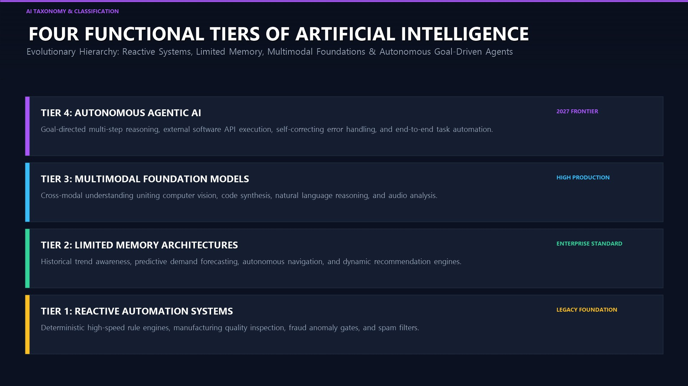
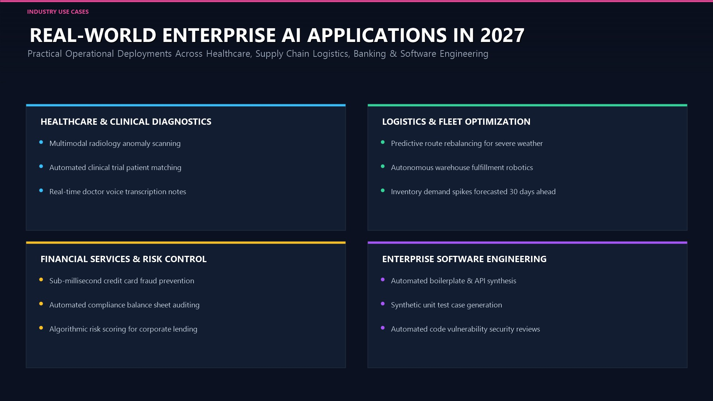

# Types of AI in 2027: Uses and Real-World Examples

**Meta Title:** Types of AI in 2027: Uses and Real-World Examples | Kanavu Technologies
**Meta Description:** Discover the types of artificial intelligence in 2027, with practical examples, real-world applications and how different AI systems work.
**Primary Keyword:** Types of AI in 2027
**Secondary Keywords:** Types of AI, Artificial Intelligence Examples, AI Applications in 2027, Real-World AI Use Cases

---

The core types of AI in 2027 span four functional tiers comprising reactive systems, limited memory architectures, multimodal generative models, and autonomous goal-driven agents capable of executing complex business workflows without human intervention. While early enterprise software relied strictly on predetermined rule tables, contemporary systems combine continuous machine learning with distributed sensory feeds to adapt dynamically to volatile operating environments. Understanding where each tier delivers genuine return on investment prevents businesses from overpaying for unnecessary algorithmic complexity.

### Four Functional Tiers of Modern Artificial Intelligence

*Figure 1: Conceptual hierarchy illustrating reactive systems, limited memory models, multimodal foundations, and autonomous agents.*

*Alt Text: Diagram classifying artificial intelligence into reactive systems, limited memory, multimodal foundation models, and autonomous agents*

## Categorizing Modern Artificial Intelligence Capabilities

Evaluating the fundamental types of AI helps enterprise leaders match specific operational challenges with appropriate algorithmic tools. Reactive systems excel at high-speed rule enforcement, such as detecting credit card anomalies or calculating manufacturing tolerances on high-speed assembly lines. Limited memory architectures expand this baseline by retaining historical data snapshots, enabling autonomous navigation systems and predictive demand forecasting to anticipate shifts in customer behavior.

Compelling artificial intelligence examples now include multimodal vision language networks that diagnose medical imaging and flag anomalies alongside certified radiologists. Industry research documented by the [Stanford HAI AI Index](https://hai.stanford.edu/ai-index-report) highlights that combining contextual computer vision with natural language reasoning yields substantial diagnostic accuracy improvements over isolated diagnostic software models.

Furthermore, emerging cognitive frameworks incorporate memory consolidation modules that allow autonomous assistants to retain conversational context across multi-month client engagements without exceeding memory budgets.

### Cross Industry Autonomous AI Applications

*Figure 2: Operational mapping of intelligent automation across logistics, healthcare diagnostics, algorithmic finance, and automated software.*

*Alt Text: Isometric illustration showcasing artificial intelligence deployments across healthcare, logistics, banking, and software engineering*

## Practical Deployments Across Commercial Operations

Transformative AI applications in 2027 are most visible in customer self-service, supply chain route rebalancing, and automated code synthesis. Instead of static chatbots that frustrate consumers, autonomous multi-step agents handle complex refund authorizations across disparate back-office databases. As explored in our guide on [AI in custom web application development](https://tech.kanavu.org/resources/ai-custom-web-application-development), intelligent automation accelerates product delivery by generating unit tests and validating security protocols.

Documenting real-world AI use cases proves that business gains come from workflow orchestration rather than theoretical benchmark scores. Warehousing networks utilize vision-guided robotics to fulfill orders during peak shopping seasons, while commercial banks automate fraud mitigation pipelines. Connecting these capabilities through our strategic overview on [emerging technologies and IT developments](https://tech.kanavu.org/resources/emerging-technologies-and-it-developments) allows leadership teams to build cohesive digital roadmaps.

When deployed thoughtfully, these algorithmic systems dramatically compress transaction cycle times while eliminating costly manual errors across high-volume administrative departments.

Modern engineering teams also establish comprehensive telemetry dashboards that monitor inference drift, latency outliers, and accuracy degradation across active production environments. Proactive observability ensures that automated machine intelligence maintains consistent performance standards without requiring tedious manual debugging cycles. By pairing automated alerting with periodic human evaluations, organizations protect brand trust while expanding autonomous system responsibilities across sensitive enterprise divisions.

## Engineering Scalable Intelligent Systems

Kanavu Technologies builds production-grade artificial intelligence workflows, predictive models, and cloud infrastructure engineered for long term enterprise reliability. Organizations ready to streamline manual operations or integrate autonomous workflow agents can engage our engineering specialists through [custom software engineering services](https://tech.kanavu.org/services/custom-software) to build scalable, high-impact intelligent applications.

## Frequently Asked Questions

### What are the main categories of artificial intelligence used by businesses?
Enterprises primarily deploy reactive automation systems, limited memory predictive analytics, multimodal generative foundation models, and autonomous goal-directed software agents.

### How does an autonomous AI agent differ from a standard chatbot?
Autonomous agents can break down complex objectives, call external software APIs, query corporate databases, and complete multi-step tasks independently without human guidance.

### Which business sector experiences the fastest return on AI adoption?
Customer support, supply chain logistics, and software development teams experience rapid financial returns through automated ticketing, predictive routing, and accelerated testing.

