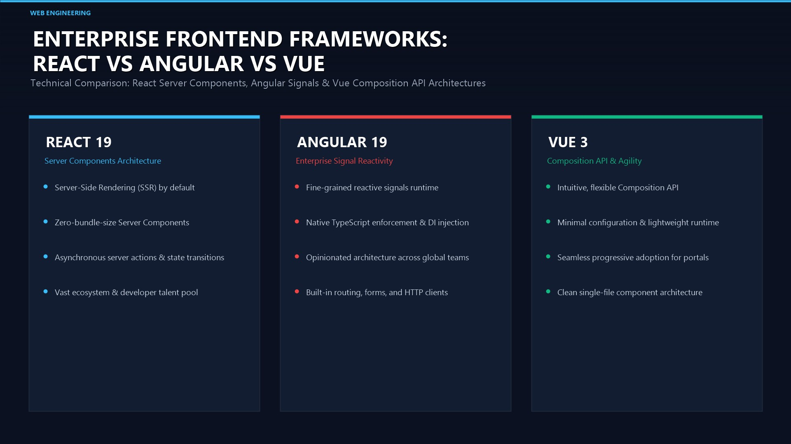

# Best Frontend Frameworks for Enterprise Web Development in 2027

**Meta Title:** Best Frontend Frameworks for Enterprise Web Development in 2027 | Kanavu Technologies
**Meta Description:** Explore the best frontend frameworks for enterprise web development in 2027. Compare React, Angular and Vue based on features, scalability and use cases.
**Primary Keyword:** Best Frontend Frameworks
**Secondary Keywords:** Frontend Frameworks for Web Development, Enterprise Web Development, React vs Angular vs Vue, JavaScript Frameworks

---

Determining the best frontend frameworks for enterprise platforms requires evaluating runtime rendering performance, reactivity models, long term library maintainability, and developer talent availability across distributed software engineering teams. As web applications evolve into complex distributed portals serving millions of concurrent global users, architectural decisions made during initial scaffolding dictate corporate agility for years to come. Modern organizations must choose frameworks that balance rapid feature delivery with rigorous type safety and minimal client side bundle overhead.

### Architecture Comparison of Modern Frontend Frameworks

*Figure 1: Technical diagram contrasting React Server Components, Angular Signals, and Vue Composition API structures.*

*Alt Text: Architectural comparison illustrating rendering flows, reactivity engines, and state management for React, Angular, and Vue*

## Evaluating the Dominant Enterprise Web Frameworks

Selecting robust frontend frameworks for web development demands an objective understanding of differing design philosophies. React continues to command widespread industry adoption through React 19 Server Components, which offload intensive computational rendering to server environments. This architecture decreases client bundle sizes and dramatically improves initial page load times for data heavy corporate applications.

Conversely, enterprise web development teams seeking opinionated conventions often favor Angular for its built-in dependency injection, native TypeScript tooling, and modern reactive signals. When evaluating React vs Angular vs Vue, development managers appreciate that Angular provides standardized project scaffolding that enforces architectural consistency across global engineering teams. Detailed implementation benchmarks documented on [React Official Documentation](https://react.dev) illustrate how asynchronous server actions eliminate complex client state orchestration in high-concurrency enterprise applications.

By enforcing strict compilation boundaries, engineering leads ensure that large teams can contribute to shared repositories without introducing silent state corruption or unpredictable memory leaks.

### Enterprise Selection Matrix for Web Application Stacks

*Figure 2: Evaluation matrix ranking bundle optimization, corporate governance, learning curve, and rendering speed.*

*Alt Text: Decision matrix comparing developer talent availability, build performance, and long term maintenance costs across frameworks*

## Reactivity, Developer Velocity and Long Term Maintenance

Vue represents an exceptionally agile alternative among modern JavaScript frameworks, offering its intuitive Composition API and minimal boilerplate overhead. Growing companies appreciate Vue for rapid prototyping and seamless progressive adoption within existing multi-page corporate portals. However, selecting a frontend ecosystem also depends heavily on how smoothly it integrates with backend automation workflows.

As discussed in our analysis of [AI in custom web application development](https://tech.kanavu.org/resources/ai-custom-web-application-development), choosing frameworks with widespread AI tooling support accelerates test generation and refactoring cycles. Connecting these development standards to our overarching roadmap on [emerging technologies and IT developments](https://tech.kanavu.org/resources/emerging-technologies-and-it-developments) ensures that enterprise user interfaces remain responsive, accessible, and easily maintainable.

Ultimately, standardizing on frameworks with deep community backing ensures dependable third-party library stability and straightforward onboarding for new software hires.

Investing in automated component testing libraries and end-to-end integration runners ensures that large software teams can refactor shared user interface modules without introducing unexpected regressions. Establishing consistent design tokens and shared layout primitives accelerates engineering velocity across multi-brand enterprise platforms. This structured governance model prevents front-end fragmentation and ensures uniform accessibility compliance throughout evolving product lifecycles. Adopting shared component systems minimizes redundant styling overhead and enforces enterprise brand consistency across all customer-facing applications.

## Delivering High Performance Enterprise Web Applications

Kanavu Technologies crafts scalable web portals, responsive consumer applications, and high-concurrency digital platforms utilizing modern frontend frameworks and robust cloud architectures. Organizations planning to modernize legacy interfaces or build secure customer portals can collaborate with our team through [enterprise web development services](https://tech.kanavu.org/services/web-development) to engineer fast, resilient digital products.

## Frequently Asked Questions

### Which frontend framework offers the best performance for enterprise applications?
React 19 Server Components and Angular with reactive signals both deliver exceptional enterprise performance by minimizing client side JavaScript rendering loads.

### Why do large corporations frequently standardize on Angular?
Angular provides strict architectural conventions, native TypeScript enforcement, and built-in dependency injection, ensuring uniform code quality across large distributed engineering teams.

### How does Vue compare to React for building enterprise portals?
Vue provides faster onboarding and less boilerplate through its Composition API, making it ideal for teams wanting rapid development without complex configurations.

