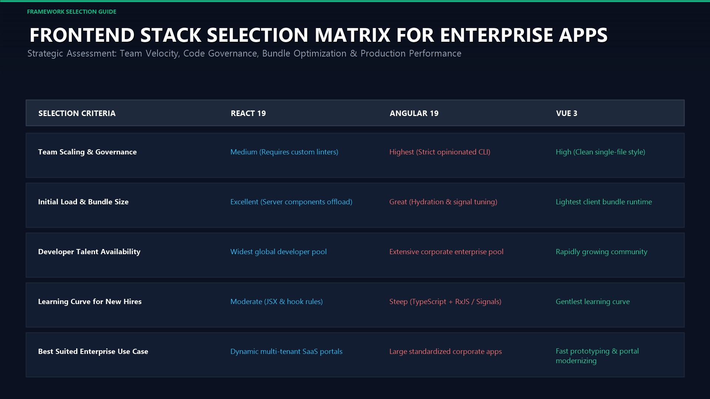

# Best Frontend Frameworks for Enterprise Web Development in 2027

**Meta Title:** Best Frontend Frameworks for Enterprise Web Development in 2027 | Kanavu Technologies
**Meta Description:** Explore the best frontend frameworks for enterprise web development in 2027. Compare React, Angular and Vue based on features, scalability and use cases.
**Primary Keyword:** Best Frontend Frameworks
**Secondary Keywords:** Frontend Frameworks for Web Development, Enterprise Web Development, React vs Angular vs Vue, JavaScript Frameworks

---

Determining the best frontend frameworks for enterprise platforms requires evaluating runtime rendering performance, reactivity models, long term library maintainability, and developer talent availability across distributed software engineering teams. As web applications evolve into complex distributed portals serving millions of concurrent global users, architectural decisions made during initial scaffolding dictate corporate agility for years to come. Modern organizations must choose frameworks that balance rapid feature delivery with rigorous type safety and minimal client side bundle overhead.

### Architecture Comparison of Modern Frontend Frameworks

*Figure 1: Technical diagram contrasting React Server Components, Angular Signals, and Vue Composition API structures.*

*Alt Text: Architectural comparison illustrating rendering flows, reactivity engines, and state management for React, Angular, and Vue*

## Evaluating the Dominant Enterprise Web Frameworks

Selecting robust frontend frameworks for web development demands an objective understanding of differing design philosophies.

Enterprise engineering teams prioritize three dominant architectural models:

1. React 19 Ecosystem: Utilizes Server Components to execute computational logic on backend servers, keeping client bundle sizes exceptionally light.
2. Angular 19 Platform: Incorporates native reactive signals, strict TypeScript tooling, and standard dependency injection across large corporate teams.
3. Vue 3 Framework: Delivers progressive flexibility through its Composition API, providing gentle learning curves and rapid portal prototyping.

> **Engineering Leadership Directive:** Standardize frontend tooling early across large engineering groups. Consistent TypeScript enforcement and shared component libraries prevent codebase fragmentation and reduce long term maintenance overhead.

Conversely, enterprise web development teams seeking opinionated conventions often favor Angular for its built-in dependency injection, native TypeScript tooling, and modern reactive signals. When evaluating React vs Angular vs Vue, development managers appreciate that Angular provides standardized project scaffolding that enforces architectural consistency across global engineering teams. Detailed implementation benchmarks documented on [React Official Documentation](https://react.dev) illustrate how asynchronous server actions eliminate complex client state orchestration in high-concurrency enterprise applications.

### Enterprise Selection Matrix for Web Application Stacks

*Figure 2: Evaluation matrix ranking bundle optimization, corporate governance, learning curve, and rendering speed.*

*Alt Text: Decision matrix comparing developer talent availability, build performance, and long term maintenance costs across frameworks*

## Reactivity, Developer Velocity and Long Term Maintenance

Vue represents an exceptionally agile alternative among modern JavaScript frameworks, offering its intuitive Composition API and minimal boilerplate overhead. Growing companies appreciate Vue for rapid prototyping and seamless progressive adoption within existing multi-page corporate portals. Adopting unified component primitives minimizes redundant styling and enforces consistent brand governance across all customer interfaces.

The decision matrix below compares operational capabilities across modern enterprise frameworks:

| Evaluation Dimension | React 19 Architecture | Angular 19 Platform | Vue 3 Framework |
| Architectural Model | Flexible component ecosystem | Opinionated enterprise structure | Progressive component framework |
| Reactivity Engine | Asynchronous server actions | Native fine-grained signals | Composition API reactive state |
| Team Governance | Requires custom lint rules | Built-in strict CLI standards | Clean single-file conventions |

As discussed in our analysis of [AI in custom web application development](https://tech.kanavu.org/resources/ai-custom-web-application-development), choosing frameworks with widespread AI tooling support accelerates test generation and refactoring cycles. Connecting these development standards to our overarching roadmap on [emerging technologies and IT developments](https://tech.kanavu.org/resources/emerging-technologies-and-it-developments) ensures that enterprise user interfaces remain responsive, accessible, and easily maintainable.

## Delivering High Performance Enterprise Web Applications

Kanavu Technologies crafts scalable web portals, responsive consumer applications, and high-concurrency digital platforms utilizing modern frontend frameworks and robust cloud architectures. Organizations planning to modernize legacy interfaces or build secure customer portals can collaborate with our team through [enterprise web development services](https://tech.kanavu.org/services/web-development) to engineer fast, resilient digital products.

## Frequently Asked Questions

### Which frontend framework offers the best performance for enterprise applications?
React 19 Server Components and Angular with reactive signals both deliver exceptional enterprise performance by minimizing client side JavaScript rendering loads.

### Why do large corporations frequently standardize on Angular?
Angular provides strict architectural conventions, native TypeScript enforcement, and built-in dependency injection, ensuring uniform code quality across large distributed engineering teams.

### How does Vue compare to React for building enterprise portals?
Vue provides faster onboarding and less boilerplate through its Composition API, making it ideal for teams wanting rapid development without complex configurations.

