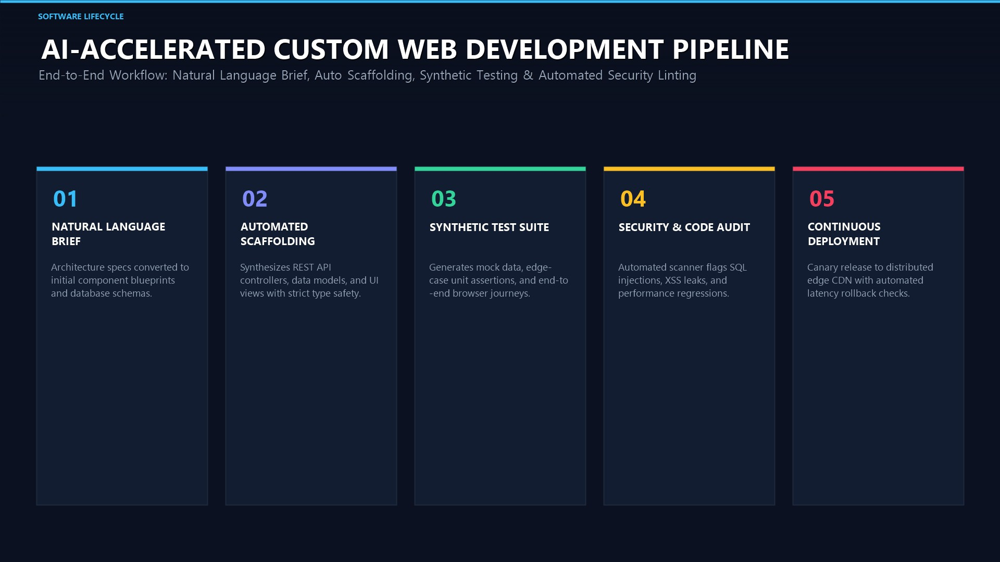
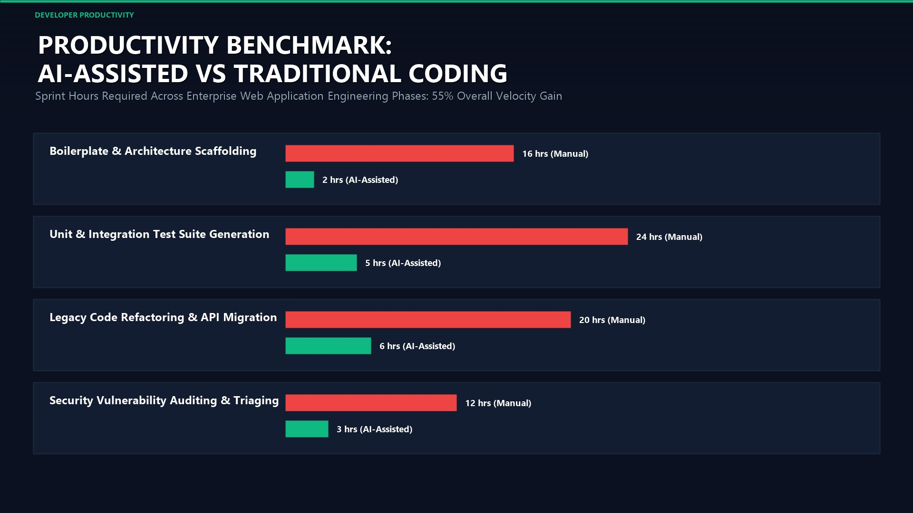

# How AI Is Making Custom Web Application Development Faster

**Meta Title:** How AI Is Making Custom Web Application Development Faster | Kanavu Technologies
**Meta Description:** Learn how AI is making custom web application development faster through automated coding, testing and modern AI-assisted development workflows.
**Primary Keyword:** AI in Custom Web Application Development
**Secondary Keywords:** AI-Powered Web Development, Custom Web Application Development, AI-Assisted Software Development, AI-Led Development

---

Integrating AI in custom web application development accelerates software production cycles by automating repetitive boilerplate scaffolding, generating comprehensive test suites, and resolving code vulnerabilities prior to production deployment. Engineering organizations no longer view machine intelligence as an experimental novelty, but as a core multiplier that shortens release sprints from weeks into days. By systematically offloading mundane syntax tasks to intelligent coding assistants, senior software architects can dedicate their focus to complex domain logic, security auditing, and customer user experience.

### AI Accelerated Software Engineering Workflow

*Figure 1: End-to-end development pipeline demonstrating automated scaffolding, synthetic testing, code review, and deployment.*

*Alt Text: Visual workflow illustrating artificial intelligence automating coding, unit test generation, code security audits, and continuous deployment*

## Accelerating Engineering Velocity with Intelligent Tools

The adoption of AI-powered web development fundamentally transforms how engineering teams build, test, and maintain enterprise software. Automated coding assistants analyze context across entire repositories, synthesizing database schemas, API controllers, and frontend interface components from natural language architectural briefs.

High-velocity engineering teams integrate machine intelligence across four essential development stages:

1. Architectural Scaffolding: Generating database schemas, ORM models, and REST endpoints directly from specification briefs.
2. Synthetic Test Synthesis: Creating end-to-end user journey tests and mock API responses to validate application behavior.
3. Automated Security Audits: Detecting SQL injection vulnerabilities and cross-site scripting risks during automated code reviews.
4. Refactoring and Performance Tuning: Identifying slow queries and unoptimized background workers before deployment.

> **Software Engineering Benchmark:** Assisted coding workflows yield dramatic velocity improvements, but senior architectural oversight remains essential. Human review ensures business logic alignment, data privacy governance, and flawless system stability.

When executing custom web application development, maintaining code quality and security standards remains paramount. Modern intelligent assistants inspect pull requests for edge-case boundary errors, SQL injection vulnerabilities, and cross-site scripting risks before human peers conduct architectural reviews. Comprehensive developer productivity data collected in the [GitHub Octoverse Report](https://github.blog/news-insights/octoverse/) demonstrates that engineering teams utilizing assisted development workflows complete routine coding tasks fifty-five percent faster than non-assisted peers.

### Productivity and Time Savings Across Development Stages

*Figure 2: Comparative benchmark showing sprint velocity improvements in boilerplate generation, test coverage, and debugging.*

*Alt Text: Bar chart and matrix comparing delivery timelines for traditional manual software coding against modern AI-assisted engineering*

## Synthetic Testing and Continuous Quality Assurance

Embracing AI-assisted software development yields remarkable efficiencies during the quality assurance and automated testing phases. Rather than writing manual unit test assertions line by line, developers generate comprehensive mock data and end-to-end user journey tests with single prompts.

The quantitative comparison below highlights typical hours required per development sprint:

| Development Sprint Phase | Traditional Manual Engineering | AI-Assisted Engineering Stack | Measured Velocity Gain |
| Boilerplate Scaffolding | 16 hours per module | 2 hours with automated generation | 87% time reduction |
| Unit Test Suite Coverage | 24 hours per feature | 5 hours with synthetic fixtures | 79% time reduction |
| Security Review Audits | 12 hours per release | 3 hours with automated scanning | 75% time reduction |

Pioneering technology leaders are also transitioning toward AI-led development paradigms where intelligent agents orchestrate multi-step refactoring migrations across legacy codebases. As documented in our comparison of the [best frontend frameworks](https://tech.kanavu.org/resources/best-frontend-frameworks-2027), modern frameworks integrate seamlessly with these automated toolchains. Exploring our broader roadmap on [emerging technologies and IT developments](https://tech.kanavu.org/resources/emerging-technologies-and-it-developments) reveals how automated software delivery safeguards enterprise agility.

## Building Resilient Custom Software Platforms

Kanavu Technologies combines seasoned software engineering discipline with advanced automated development workflows to deliver secure, high-concurrency web applications on schedule. Organizations looking to accelerate product development cycles or modernize enterprise portals can consult our engineering group through [custom web application services](https://tech.kanavu.org/services/web-development) to build scalable, battle-tested digital platforms.

## Frequently Asked Questions

### How does artificial intelligence speed up custom web application development?
AI automates repetitive boilerplate generation, synthesizes comprehensive unit test suites, and detects code vulnerabilities early, allowing engineers to focus on business logic.

### Does AI-assisted development replace the need for senior software engineers?
No, human architects remain essential for system architecture, security validation, business requirements interpretation, and high-level code review governance.

### How does automated testing improve software quality in AI workflows?
Intelligent testing tools generate synthetic edge-case scenarios and validate application flows automatically, catching potential regressions before code reaches production servers.

