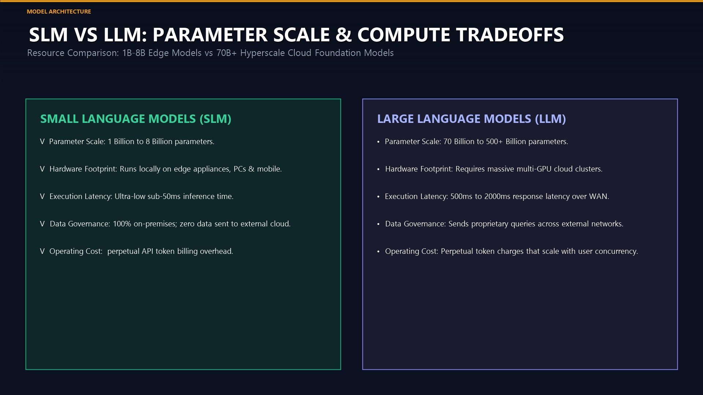
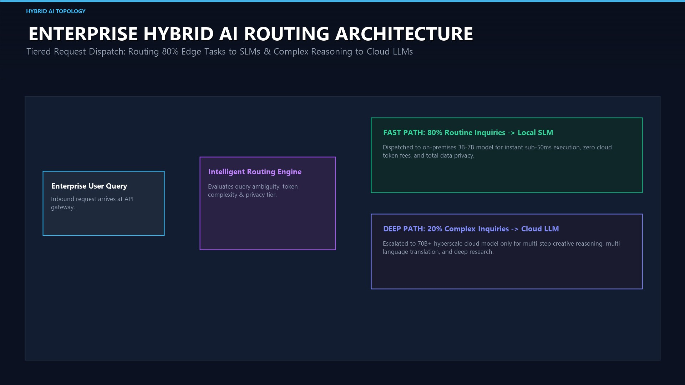

# SLM vs LLM in 2027: Key Differences, Benefits and Use Cases

**Meta Title:** SLM vs LLM in 2027: Key Differences, Benefits and Use Cases | Kanavu Technologies
**Meta Description:** Compare SLM vs LLM in 2027, including key differences, benefits, costs and real-world use cases to understand which AI model fits your needs.
**Primary Keyword:** SLM vs LLM
**Secondary Keywords:** Small Language Models, Large Language Models, SLM vs LLM Comparison, Small Language Model Use Cases

---

The practical evaluation of SLM vs LLM in 2027 hinges on balancing raw parameter capacity and broad generalization against computational cost, execution latency, and strict data privacy requirements. While multi-hundred-billion parameter foundational networks capture public attention with versatile conversational prowess, enterprise engineering teams increasingly discover that smaller, specialized networks deliver superior operational precision for targeted corporate workflows. Navigating this architectural decision empowers businesses to minimize cloud inference bills while keeping sensitive intellectual property safely within perimeter firewalls.

### Parameter Scale and Infrastructure Resource Trade-offs

*Figure 1: Architectural diagram comparing memory footprint, latency, and cloud costs between SLMs and massive LLMs.*

*Alt Text: Comparison diagram illustrating parameter scale, GPU memory requirements, and inference cost for small versus large language models*

## Analyzing Parameter Scale and Infrastructure Overhead

Deploying Small Language Models ranging from one billion to eight billion parameters provides distinct operational advantages across enterprise environments. These lightweight networks run efficiently on consumer-grade hardware, local workstations, and edge appliances without incurring perpetual cloud token subscription expenses. Because these compact models require drastically lower memory, they achieve lightning fast inference latencies suitable for real-time mobile interactions.

In comparison, massive Large Language Models excel at complex cross-domain reasoning, multi-language synthesis, and broad creative problem solving. However, performing an objective SLM vs LLM comparison reveals that cloud-hosted foundational models introduce significant latency spikes and ongoing operational costs that scale aggressively with user concurrency. Technical research on the [Hugging Face Open LLM Hub](https://huggingface.co/blog) demonstrates that fine-tuning a compact model on curated domain datasets consistently rivals or outperforms general-purpose foundation models on specialized classification tasks.

Model quantization techniques such as four-bit integer precision further compress footprint sizes, allowing powerful models to operate on standard enterprise servers without dedicated supercomputing clusters.

### Hybrid Enterprise AI Routing Architecture

*Figure 2: Intelligent request routing directing routine edge tasks to compact SLMs and deep reasoning to cloud LLMs.*

*Alt Text: Workflow diagram showing user prompt classification routing domain tasks to local models and complex queries to cloud foundations*

## Strategic Deployment Patterns and Enterprise Routing

Compelling small language model use cases include on-device smartphone processing, private healthcare document indexing, automated invoice extraction, and embedded automotive voice assistants. By keeping data processing strictly on-premises, regulated enterprises eliminate the compliance hazards associated with sending proprietary customer records to third-party public cloud endpoints. When coupled with [RAG vs LLM vector search architectures](https://tech.kanavu.org/resources/rag-vs-llm), specialized models achieve exceptional factual accuracy.

Modern enterprises increasingly adopt hybrid topologies where a local compact model handles eighty percent of high-volume customer inquiries, escalating only ambiguous queries to hyperscale cloud foundation models. As highlighted in our strategic analysis of [emerging technologies and IT developments](https://tech.kanavu.org/resources/emerging-technologies-and-it-developments), deploying balanced model architectures prevents costly compute over-provisioning.

This tiered dispatch mechanism guarantees responsive client interactions while capping external API operational costs at predictable monthly levels.

Software engineering teams utilizing modern quantization frameworks can deploy compact models directly within containerized microservices without specialized acceleration hardware. This architectural flexibility enables growing enterprises to run private machine intelligence workflows cost-effectively across standard internal infrastructure. Developing targeted evaluation testbeds ensures that lightweight models maintain required analytical depth without incurring unnecessary cloud operational expenses.

## Designing Tailored Enterprise AI Architectures

Kanavu Technologies develops private machine learning deployments, model quantization pipelines, and on-premises AI solutions that optimize corporate compute investments. Enterprises seeking to deploy private compact models or optimize cloud inference expenditures can collaborate with our engineers through [custom software engineering services](https://tech.kanavu.org/services/custom-software) to build high-performance AI solutions.

## Frequently Asked Questions

### What is the primary difference between an SLM and an LLM?
SLMs have smaller parameter sizes allowing local on-device execution, whereas LLMs possess hundreds of billions of parameters requiring expensive cloud data centers.

### Can a Small Language Model match the accuracy of a Large Language Model?
Yes, when fine-tuned on curated industry data or paired with retrieval pipelines, SLMs frequently outperform general LLMs on specialized corporate tasks.

### Why are regulated industries choosing Small Language Models?
Regulated industries deploy SLMs locally on private internal servers, ensuring confidential financial and healthcare data never leaves corporate firewalls.

