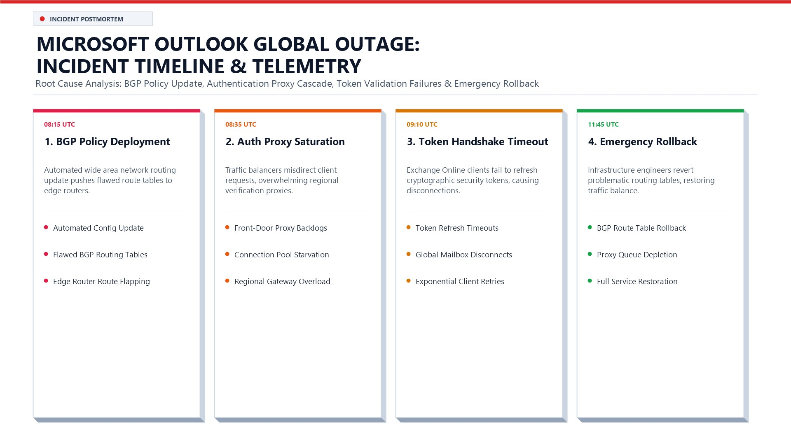
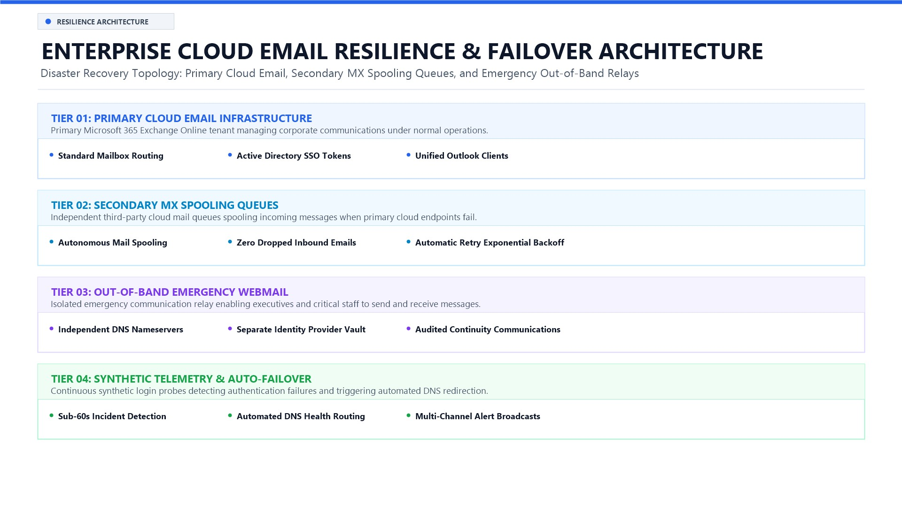

# Why Did Microsoft Outlook Go Down? The Global Outage Explained

**Meta Title:** Why Did Microsoft Outlook Go Down? The Global Outage Explained | Kanavu Technologies
**Meta Description:** Discover why the Microsoft Outlook outage happened in November 2026, what caused the global Microsoft 365 disruption and how services were restored.
**Primary Keyword:** why did microsoft outlook go down
**Secondary Keywords:** Microsoft 365 Outage, Microsoft Outlook Down, Microsoft Outlook Global Outage, Microsoft 365 Service Disruption, Microsoft Outlook Outage Cause

---

When asking why did Microsoft Outlook go down, enterprise telemetry reveals that an unexpected wide area networking routing misconfiguration cascaded across front door authentication proxies, preventing Exchange Online clients from validating security credentials. Rather than mailbox database corruption or a cyber assault, the disruption stemmed from a flawed software change that overwhelmed regional traffic balancers. Understanding cloud outage root causes equips IT directors with the architectural knowledge needed to build resilient failovers.

### Exchange Online Outage Incident Timeline and Routing Cascades

*Figure 1: Telemetry timeline illustrating wide area network routing failures cascading into authentication proxy saturation.*

*Alt Text: Incident chronology diagram tracking the Microsoft Outlook outage from initial configuration change to full service restoration*

## Unpacking the Root Cause of the Service Disruption

The widespread Microsoft 365 outage triggered global disruption when automated routing updates saturated edge networking infrastructure across multiple continents. As enterprise workers attempted morning logins, authentication requests repeatedly timed out, causing email clients to register as disconnected. Because Microsoft Outlook down alerts multiplied exponentially across public monitoring forums, IT help desks faced thousands of unresolved connectivity tickets.

Technical telemetry traces the global disruption across four cascading phases:

1. BGP Policy Update: An automated network configuration change misrouted international border gateway traffic tables.
2. Authentication Proxy Saturation: Front-door verification proxies experienced request backlogs exceeding safe operating limits.
3. Identity Token Validation Failures: Disconnected email clients failed to refresh cryptographic access tokens.
4. Emergency Network Rollback: Infrastructure engineers isolated flawed routing directives and initiated failover rollbacks.

> **Disaster Recovery Imperative:** Single-vendor cloud reliance creates severe operational exposure. Enterprise resilience requires secondary MX record spooling and independent communication channels to maintain business continuity during upstream outages.

Post-incident postmortems confirmed that the Microsoft Outlook global outage was precipitated by a routine border gateway protocol policy deployment. The configuration error prevented traffic balancers from successfully handing off validation tokens to distributed directory servers. Real-time infrastructure telemetry published on the official [Azure Status History Portal](https://azure.status.microsoft.com/en-us/status/history/) confirmed that reverting the problematic routing tables restored baseline connectivity across affected regional clusters within several hours.

### Enterprise Business Continuity Architecture for Cloud Email

*Figure 2: Resilient multi-tenant failover topology featuring secondary MX spooling and independent email relay backups.*

*Alt Text: Enterprise disaster recovery architectural diagram showing redundant DNS routing, secondary MX servers, and emergency webmail access*

## Lessons in Enterprise Resilience and Redundant Architecture

Analyzing this Microsoft 365 service disruption underscores the critical hazard of relying solely on single-vendor cloud platforms for mission-critical enterprise communications. When corporate email goes offline unexpectedly, productivity halts unless organizations maintain secondary emergency channels. Isolating the precise Microsoft Outlook outage cause allows forward-thinking systems architects to implement secondary MX record spooling and independent backup relays.

The continuity matrix below contrasts standard cloud reliance with multi-vendor disaster recovery architectures:

| Resilience Capability | Standard Cloud Dependence | Fault-Tolerant Enterprise Architecture |
| Inbound Message Flow | Messages bounce during outage | Secondary MX queues spool inbound mail |
| Out-of-Band Access | Total communications blackout | Standby out-of-band webmail relay active |
| Telemetry Monitoring | Manual vendor status checking | Automated real-time synthetic login probes |

As demonstrated in our analysis of [AI in custom web application development](https://tech.kanavu.org/resources/ai-custom-web-application-development), automated monitoring and automated traffic redirection safeguard digital operations during unforeseen upstream failures. Connecting cloud resilience planning with our overarching blueprint on [emerging technologies and IT developments](https://tech.kanavu.org/resources/emerging-technologies-and-it-developments) ensures that modern businesses remain operational through unexpected cloud incidents.

## Building Resilient Cloud Infrastructure Platforms

Kanavu Technologies architects fault-tolerant cloud environments, multi-region failover systems, and enterprise disaster recovery workflows designed for zero unexpected downtime. Organizations seeking to audit cloud redundancy or design resilient communications infrastructure can partner with our engineering teams through [cloud web development services](https://tech.kanavu.org/services/web-development) to build reliable enterprise software systems.

## Frequently Asked Questions

### What was the root cause of the Microsoft Outlook outage?
The outage was caused by a wide area network routing update that misdirected traffic and overwhelmed authentication proxies across regional edge servers.

### Was the Microsoft Outlook disruption caused by a cybersecurity breach?
No, official post-incident reports confirmed the disruption was entirely an internal networking routing configuration issue, not a malicious external cyber attack.

### How can enterprises maintain communication during major cloud email outages?
Organizations should implement secondary MX record spooling, independent backup webmail services, and out-of-band communication channels to maintain operational continuity during outages.

