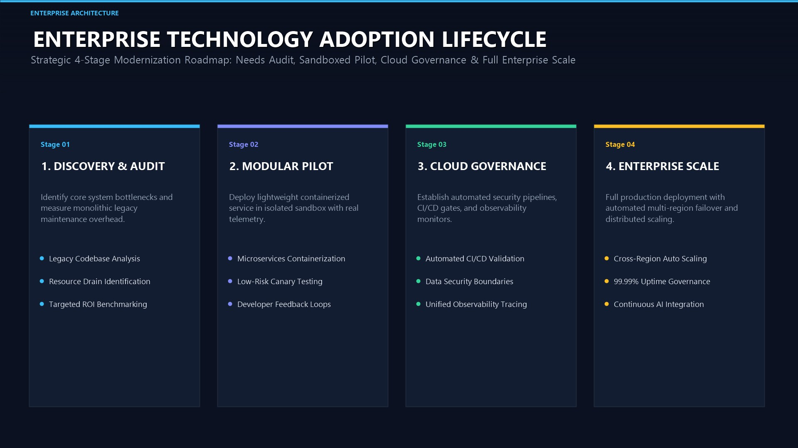
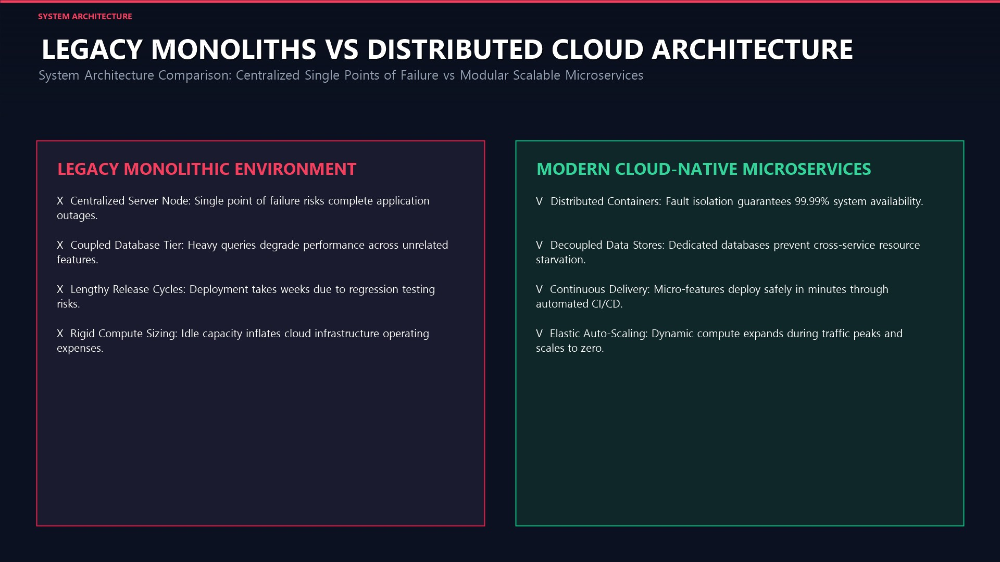

# Emerging Technologies and IT Developments: What Businesses Need to Know

**Meta Title:** Emerging Technologies and IT Developments: What Businesses Need to Know | Kanavu Technologies
**Meta Description:** Discover emerging technologies and IT developments shaping modern enterprise operations. Learn how cloud, AI and modern architecture drive business growth.
**Primary Keyword:** Emerging Technologies and IT Developments
**Secondary Keywords:** IT Developments for Business, Enterprise Emerging Tech, Business Technology Trends, Adopting Modern IT Solutions

---

Emerging technologies and IT developments represent the rapid convergence of cloud computing, intelligent automation, and distributed software architecture designed to accelerate operational efficiency across modern commercial enterprises. Organizations navigating this transformation must align digital investments directly with measurable business outcomes rather than pursuing technological novelties for temporary excitement. Establishing architectural resilience, robust cybersecurity foundations, and unified data pipelines guarantees that modern organizations maintain operational continuity while competitors struggle with legacy complexity.

### Enterprise Technology Adoption Lifecycle

*Figure 1: Strategic evaluation stages connecting legacy infrastructure to modern cloud and AI systems.*

*Alt Text: Diagram showing enterprise technology adoption stages from discovery to production governance*

## Strategic Shifts in Enterprise Software Architecture

Navigating modern IT developments for business requires leadership teams to reevaluate monolithic systems that constrain scalability and inflate infrastructure expenses. Forward-looking enterprises are decomposing brittle server environments into distributed microservices and containerized workflows orchestrated through scalable platforms. This architectural modernization allows teams to deploy critical features in minutes rather than waiting through month-long release cycles.

Adopting enterprise emerging tech demands disciplined governance across cloud environments and internal data repositories. Organizations that integrate containerized microservices achieve greater uptime by isolating system faults before regional disruptions affect customer interactions. Automated load distribution and stateless compute instances prevent cascading outages during traffic surges. Detailed architectural studies published by the [Stanford HAI AI Index](https://hai.stanford.edu/ai-index-report) confirm that enterprises combining automated deployment pipelines with modular software frameworks experience significantly lower operational failure rates.

Furthermore, continuous security scanning and automated dependency audits ensure that software delivery cycles remain protected against unexpected cyber vulnerabilities. Modern technical leadership prioritizes automated observability platforms that trace latency anomalies across distributed network edges before enterprise users notice performance degradation.

### Legacy Monoliths Compared to Distributed Cloud Architecture

*Figure 2: Architecture comparison contrasting centralized monoliths with modular cloud native microservices.*

*Alt Text: System architecture comparison between centralized monolithic servers and distributed microservices*

## Translating Technology Innovations into Measurable Value

Analyzing recent business technology trends shows that true digital leadership originates from connecting intelligent automation directly to core workflow bottlenecks. High-performing engineering teams deploy specialized language models, automated testing routines, and distributed caching to cut overhead across mission-critical systems. For instance, teams assessing advanced retrieval pipelines benefit from exploring [RAG vs LLM architectures](https://tech.kanavu.org/resources/rag-vs-llm) to enhance enterprise knowledge systems.

Selecting targeted frameworks also accelerates internal execution. Technology directors comparing [modern frontend frameworks](https://tech.kanavu.org/resources/best-frontend-frameworks-2027) consistently discover that component modularity minimizes code duplication and shortens customer onboarding timeframes. Adopting modern IT solutions systematically safeguards intellectual capital while reducing long term maintenance expenses across diverse corporate divisions.

Standardizing integration contracts through lightweight APIs prevents vendor lock-in and grants engineering departments the freedom to swap infrastructure providers as pricing structures evolve. This deliberate agility transforms internal IT departments from cost centers into rapid engines of commercial expansion.

Engineering leaders who institute continuous architectural reviews discover that small, deliberate enhancements produce far greater operational stability than abrupt, disruptive system overhauls. Cultivating internal engineering competency alongside agile vendor partnerships ensures that enterprise organizations sustain rapid technological velocity across evolving industry cycles.

## Building Future Ready Enterprise Solutions

Kanavu Technologies engineers resilient software platforms and cloud ecosystems that empower growing companies to scale without technical debt. Organizations seeking to modernize legacy portals or deploy custom intelligent agents can partner with our engineering teams through [custom software engineering services](https://tech.kanavu.org/services/custom-software) to build scalable, high-performance web systems.

## Frequently Asked Questions

### What is the fastest way for businesses to adopt emerging technologies?
Enterprises should audit core operational bottlenecks, implement small modular pilots, and modernize critical cloud data pipelines before attempting complex full-scale migrations.

### How do modern cloud architectures reduce software maintenance costs?
Distributed cloud architectures isolate system services, automate continuous integration routines, and dynamically scale compute resources to eliminate unnecessary idle server overhead expenses.

### Why should legacy monolithic software be updated to microservices?
Microservices allow software engineering teams to deploy independent updates without risking global application downtime, accelerating new feature releases and improving system stability.

