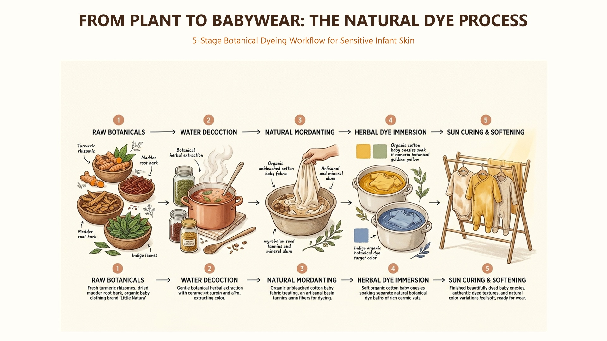
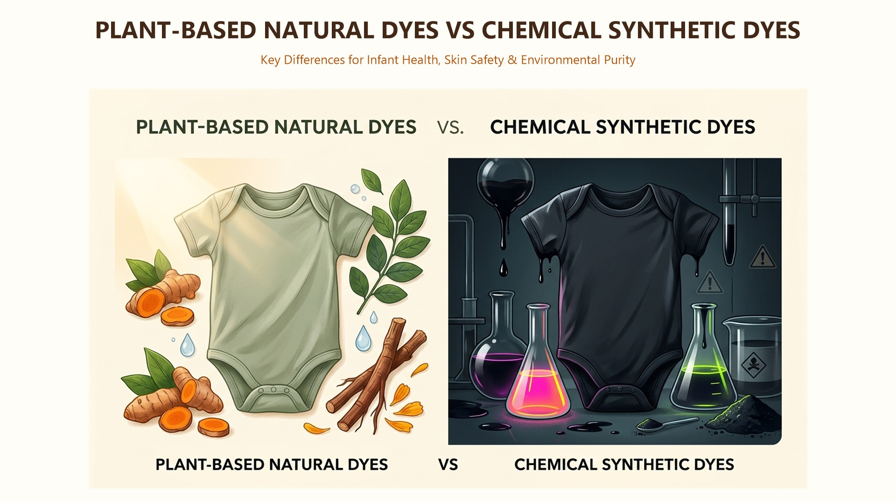

# Metadata Header
**Meta Title:** How Natural-Dyed Baby Clothes Are Made | Little Natura
**Primary Keyword:** Natural-Dyed Baby Clothes
**Secondary Keywords:** Plant-based dyes for babywear, Organic baby clothes, Ayurvedic herbal dyed baby clothing, Non-toxic baby clothes, Chemical-free infant apparel
**Meta Description:** Discover how natural-dyed baby clothes are crafted from organic cotton and medicinal plants like turmeric and indigo to protect delicate infant skin safely.

---

# From Plant to Babywear: How Natural-Dyed Baby Clothes Are Made?

Natural-dyed baby clothes are made by extracting color pigments from botanical sources, binding them to organic cotton using mineral mordants, and curing the fibers naturally without synthetic processing chemicals. Instead of petrochemical compounds, traditional artisans harvest raw botanicals to produce gentle, skin-friendly infant apparel:

* **Turmeric Rhizomes (*Curcuma longa*):** Produce warm, golden yellow tones long valued in traditional textile dyeing.
* **Fermented Indigo Leaves (*Indigofera tinctoria*):** Develop classic, soothing blue shades through natural vat fermentation.
* **Madder Roots (*Rubia cordifolia*):** Supply earthy terracotta and muted blush pink hues.
* **Pomegranate Rinds (*Punica granatum*):** Deliver warm golden-khaki tones naturally rich in protective vegetable tannins.

Every piece begins with unbleached organic fibers detailed in our [organic baby clothing guide](https://littlenatura.com/blogs/journal/organic-baby-clothing-guide), guaranteeing base yarn free from pesticide residues or harsh chemical scouring.

---

## The 4-Stage Botanical Dyeing Workflow

**Figure 1: 5-Stage Botanical Dyeing Workflow for Sensitive Infant Skin**

Artisans bond herbal pigments into durable babywear through four controlled processing stages:

1. **Non-Toxic Mineral Mordanting:** Cotton naturally resists raw plant dyes. Rather than using harsh chemical fixatives, artisans soak yarn in myrobalan seed tannins and food-grade alum. Unlike colorants restricted under [Global Organic Textile Standard criteria](https://global-standard.org/), this process leaves zero toxic residues.
2. **Temperature-Regulated Decoction:** Botanical vats simmer at 60°C–80°C. Controlled heating extracts plant pigments steadily without scorching delicate organic cotton fibers.
3. **Layered Immersion and Air Oxidation:** Dipping, stirring, and aerating the damp cotton allows atmospheric oxygen to lock pigments into the cellulose cores.
4. **Sun-Curing and Gentle Washing:** Fabric dries naturally under morning shade before receiving a final rinse with wild reetha soapnuts.

Because plant pigments bond to fiber protein rather than synthetic plastic coatings, reviewing [how to care for natural-dyed baby clothes](https://littlenatura.com/blogs/journal/how-to-care-for-natural-dyed-baby-clothes) with pH-neutral soaps preserves vibrant tones across routine laundry cycles.

---

## Plant-Based Natural Dyes vs Chemical Synthetic Dyes

**Figure 2: Key Differences for Infant Health, Skin Safety & Environmental Purity**

Understanding the practical differences between botanical colors and conventional textile processing helps parents make informed wardrobe decisions:

| Feature Dimension | Plant-Based Natural Dyes | Conventional Synthetic Dyes |
| :--- | :--- | :--- |
| **Primary Sourcing** | Botanical roots, leaves, barks, and seeds | Petrochemical crudes and coal-tar derivatives |
| **Fixatives & Mordants** | Food-grade alum and natural plant tannins | Heavy metal salts and formaldehyde resins |
| **Fabric Comfort** | **Breathable, gentle, and soft against skin** | Coated finishes prone to trapping sweat and heat |
| **Environmental Profile** | Biodegradable bath with zero toxic effluent | Chemical wastewater requiring heavy treatment |

---

## Fabric Breathability and Sensitive Newborn Skin

A newborn's epidermal barrier is roughly 30% thinner than adult skin, making infants more susceptible to friction and topical irritants. Conventional textile processing often leaves traces of synthetic resins and chemical softeners that can aggravate heat rashes and delicate skin folds.

Natural-dyed organic baby clothes provide a soft, breathable alternative. Because pure organic cotton dyed with botanical extracts contains no synthetic plasticizers, it allows natural airflow, minimizes chafing during movement, and provides comfortable everyday wear.

At Little Natura, every garment in our [Little Natura natural-dyed baby collection](https://littlenatura.com/collections/natural-dyed-baby-clothes) is crafted with GOTS-certified organic cotton and botanical dyes, giving your baby breathable, chemical-free comfort from head to toe.

---

## Frequently Asked Questions (FAQs)

### 1. What plant materials are used to dye natural baby clothes?
Artisans use dried botanical sources such as turmeric rhizomes, fermented indigo leaves, madder roots, pomegranate rinds, and marigold petals for color.

### 2. Do natural-dyed baby clothes bleed or fade quickly?
When mordanted with plant tannins and food-grade alum, botanical garments retain color well when washed in cold water with mild soaps.

### 3. Are natural-dyed clothes suitable for everyday babywear?
Yes, natural-dyed organic cotton clothes offer breathable, gentle comfort for daily naps and play without stiff synthetic chemical coatings.
