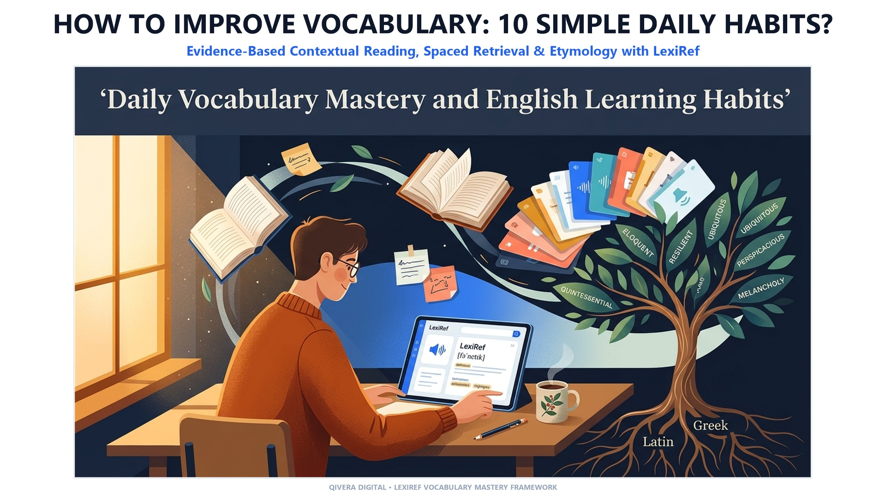
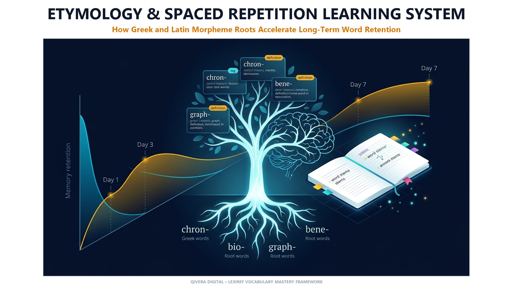

# Metadata Header
**Meta Title:** How to Improve Vocabulary: 10 Simple Daily Habits That Work
**Meta Description:** Discover how to improve your vocabulary with 10 simple daily habits, contextual reading routines, and active recall methods that make words stick permanently.
**Primary Keyword:** how to improve vocabulary
**Secondary Keywords:** daily vocabulary habits, improve English vocabulary, LexiRef dictionary app, word power habits, etymology vocabulary learning
---

# How to Improve Vocabulary: 10 Simple Daily Habits That Actually Work

Improving your vocabulary requires consistent daily exposure, contextual reading, and active retrieval habits rather than memorizing isolated word lists from a dictionary. When learners encounter new words inside meaningful stories or professional discussions, their brains create durable semantic connections.

Expanding your lexicon enhances communication clarity, boosts career confidence, and enriches critical thinking skills. As explored in our [Word of the Day natural vocabulary guide](https://qiveradigital.com/blog/how-a-word-of-the-day-app-helps-build-vocabulary-naturally), sustainable language growth happens when small, enjoyable routines replace stressful academic cramming.

*Figure 1: 10 daily habits to expand your active English vocabulary.*
*Alt Text: Infographic illustrating 10 simple daily habits for vocabulary improvement.*

## 10 Practical Habits for Lifelong Word Mastery

Building an expansive vocabulary is an incremental practice. Integrating these practical daily habits transforms passive recognition into active speech:

* **Read Diverse Non-Fiction and Literature:** Spend fifteen minutes daily exploring challenging essays, history books, or quality novels containing unfamiliar terminology.
* **Maintain a Personal Sentence Journal:** Write down newly discovered words surrounded by their complete original sentence rather than copying bare definitions.
* **Deconstruct Greek and Latin Roots:** Study basic morphological building blocks through our [offline dictionary reading guide](https://qiveradigital.com/blog/how-does-lexiref-work-as-an-offline-dictionary-app-without-the-internet) to decode dozens of related English words simultaneously.
* **Engage in Intentional Daily Conversations:** Challenge yourself to naturally integrate at least one newly acquired word into daily workplace discussions or casual chats.
* **Play Stimulating Lexical Word Games:** Solve daily crossword puzzles, word association challenges, or anagrams to exercise your mental lexicon.
* **Implement Spaced Interval Retrieval:** Review previously logged words using [spaced repetition memory intervals](https://en.wikipedia.org/wiki/Spaced_repetition) to interrupt the natural forgetting curve.
* **Substitute Generic Vague Words:** Replace overused adjectives like "nice" or "bad" with precise synonyms like "gracious," "austere," or "detrimental."
* **Listen to Thought-Provoking Podcasts:** Tune into linguistic, science, or cultural broadcasts where articulate speakers use varied, expressive phrasing.
* **Summarize Articles Aloud:** Read a news story and deliver a two-minute spoken recap using three target vocabulary terms.
* **Review Word Notes Before Bedtime:** Spend two quiet minutes glancing over your newest vocabulary entries right before sleeping to reinforce memory consolidation.

## Daily Vocabulary Learning Habits Comparison

| Habit Category | High-Impact Routine | Typical Time | Primary Retention Benefit |
| :--- | :--- | :--- | :--- |
| **Contextual Exposure** | Reading diverse essays & novels | 15 mins daily | Natural understanding of nuance and tone |
| **Structural Analysis** | Decoding Greek & Latin root words | 5 mins daily | Ability to infer meanings of unfamiliar words |
| **Active Production** | Writing personal sentence journals | 5 mins daily | Transitions words from passive to active speech |
| **Memory Reinforcement** | Spaced review before sleep | 2 mins daily | Long-term memory consolidation in the brain |

*Figure 2: The 4-stage vocabulary retention loop for language learners.*
*Alt Text: Workflow diagram showing the 4 stages of vocabulary acquisition.*

## Building Your Daily Routine with Qivera Digital and LexiRef

Sustaining daily vocabulary habits becomes intuitive and achievable when you have reliable, distraction-free reference tools readily accessible. Developed by [Qivera Digital](https://qiveradigital.com/), a mobile app studio dedicated to crafting thoughtful, privacy-conscious utilities, the [LexiRef offline dictionary app](https://qiveradigital.com/apps/lexiref) empowers learners to instantly look up definitions, explore comprehensive thesaurus trees, inspect root etymologies, and save custom study lists wherever they read. Because Qivera Digital engineered LexiRef to function entirely offline without intrusive advertisements or data tracking algorithms, it serves as the ideal everyday linguistic companion for students, writers, and curious minds. Begin by choosing just two habits today to steadily unlock greater expressive power.

## Frequently Asked Questions

### How many new words should I learn every day?
Focusing on learning three to five new words daily with contextual sentences ensures durable long-term retention without causing cognitive overload.

### Why do I forget new words shortly after memorizing them?
Words fade quickly when memorized in isolation without active conversational usage, writing practice, or spaced repetition to reinforce neural pathways.

### Does reading fiction really expand adult vocabulary effectively?
Yes, reading fiction exposes you to descriptive adjectives, figurative metaphors, and varied conversational dialogue rarely found in standard business writing.
