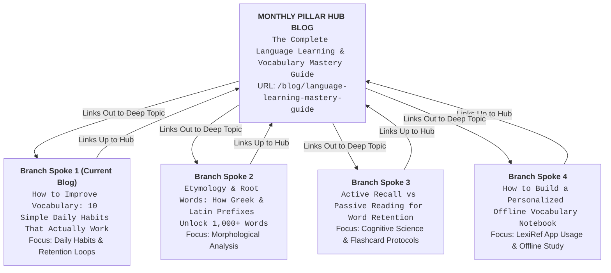

# Monthly Topic Cluster Architecture: Language Mastery (Qivera Digital)

## 1. Pillar Hub & Branch Spoke Hierarchy

---

## 2. Cluster Cross-Linking Strategy
* Branch Spoke 1 links up to the Pillar Hub (`/blog/language-learning-mastery-guide`) and cross-links to Branch Spoke 2 (`/blog/etymology-root-words-vocabulary-growth`).
* Product Connection: Links naturally to LexiRef (`/apps/lexiref`) as an offline dictionary companion.

