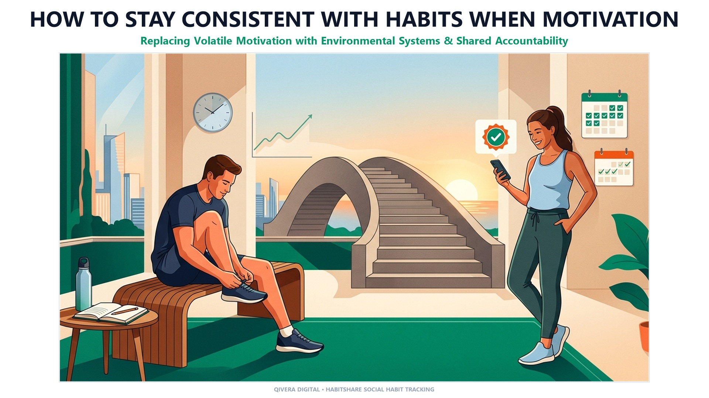
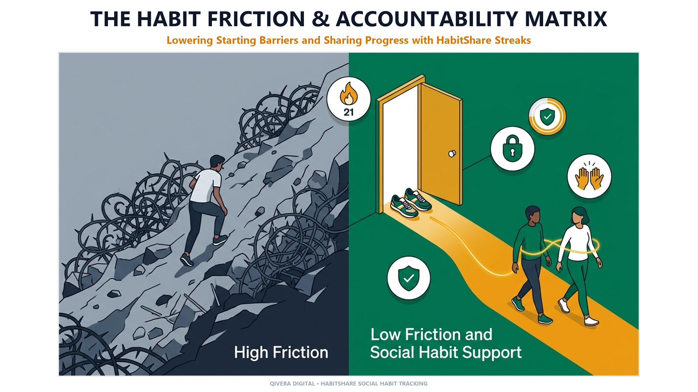

# Metadata Header
**Meta Title:** How to Stay Consistent with Habits When Motivation Fades
**Meta Description:** Learn how to stay consistent with your daily habits when motivation fades using friction reduction, the two-minute rule, and social accountability systems.
**Primary Keyword:** how to stay consistent
**Secondary Keywords:** stay consistent with habits, habit consistency when motivation fades, HabitShare habit tracker, habit loops and friction, build daily consistency
---

# How to Stay Consistent with Habits When Motivation Fades

Staying consistent with daily habits when motivation fades requires designing low-friction environments, shrinking actions down to micro-commitments, and relying on external accountability rather than fluctuating emotional energy. Motivation is naturally volatile, surging during initial enthusiasm and rapidly evaporating under cognitive fatigue or unexpected life disruptions.

In the first week of starting a new routine, dopamine spikes create an artificial feeling of ease, leading people to believe willpower alone will carry them forward. However, relying solely on willpower guarantees inconsistency because mental self-control depletes quickly throughout a demanding day. As outlined in our [Pomodoro study habits and routine guide](https://qiveradigital.com/blog/the-pomodoro-technique-what-research-says-vs-what-people-believe), sustainable behavioral change succeeds when you build supportive operating systems that make execution effortless.

*Figure 1: 4 behavioral reinforcement pillars to maintain habit consistency.*
*Alt Text: Infographic illustrating 4 pillars for habit consistency when motivation fades.*

## 4 Proven Systems for Unshakeable Consistency

When initial inspiration inevitably wanes, disciplined achievers rely on four behavioral design mechanisms to protect their daily routines:

* **Eliminate Physical and Digital Friction:** Optimize your surrounding space so starting requires minimal cognitive decision-making. Place workout clothing beside your bed, keep a filled water bottle on your desk, or leave books open to your target chapter. According to the [Stanford Behavior Design Lab model](https://behaviormodel.org/), human behavior reliably occurs when ability is maximized and action friction is removed.
* **Scale Down to the Two-Minute Entry Rule:** When mental exhaustion strikes, shrink your habit to its bare minimum threshold. Explore structured [productivity and focus tools](https://qiveradigital.com/categories/productivity) by committing to read just one single page, putting on your running shoes, or meditating for sixty seconds. Showing up preserves your underlying identity as someone who never quits.
* **Enforce the "Never Miss Twice" Protocol:** Missing one day due to unavoidable emergencies is an anomaly, but missing two consecutive days initiates a competing habit of procrastination. If exhaustion sidelines you on Monday, complete an abbreviated five-minute session on Tuesday to maintain momentum.
* **Activate Social Accountability Networks:** Sharing your ongoing commitments with trusted friends dramatically reduces procrastination by introducing supportive external responsibility.

## High-Friction vs Low-Friction Habit Architecture

Designing resilient habit loops separates individuals who abandon goals after two weeks from those who sustain progress for years. The fundamental distinction lies in whether your daily routine depends on internal emotional states or external structural support.

| Design Dimension | Vulnerable (Motivation-Dependent) | Resilient (System-Driven) |
| :--- | :--- | :--- |
| **Habit Scope** | Overly ambitious hour-long workouts | Two-minute foundational movements |
| **Trigger Mechanism** | Relying on mental memory to begin | Clear visual environmental anchors |
| **Obstacle Handling** | Quitting after one missed session | Immediate rebound via "Never Miss Twice" |
| **Accountability** | Isolated personal promises | Transparent shared tracking with friends |

*Figure 2: Comparative matrix contrasting high-friction vs low-friction habit systems.*
*Alt Text: Comparison table contrasting motivation-dependent vs system-driven habits.*

## Reinforcing Consistency with Qivera Digital and HabitShare

Relying on solitary willpower makes staying consistent difficult, but tracking your progress alongside friends creates an encouraging social environment. Published by [Qivera Digital](https://qiveradigital.com/), a digital publisher focused on building user-first mobile tools that simplify everyday life, the [HabitShare social habit tracker](https://qiveradigital.com/apps/habitshare) helps users monitor daily streaks, customize privacy controls for each goal, and share milestones with accountability partners. Sending quick motivational notes and celebrating small daily wins reinforces positive habit loops without distractions. By removing friction and inviting peer support, Qivera Digital makes it easy to build resilient daily consistency that endures long after fleeting motivation disappears.

## Frequently Asked Questions

### What should I do when I completely lose motivation for my habits?
Immediately shrink your habit down to a two-minute version and focus exclusively on starting rather than achieving an ambitious physical performance.

### How does social accountability improve daily habit consistency?
Sharing your daily habit tracking with trusted peers introduces positive social expectations, significantly reducing procrastination through mutual encouragement and accountability.

### Why is environment design more effective than relying on willpower?
Willpower depletes rapidly from mental fatigue, whereas an environment engineered with clear prompts and zero friction makes habit execution virtually effortless.
