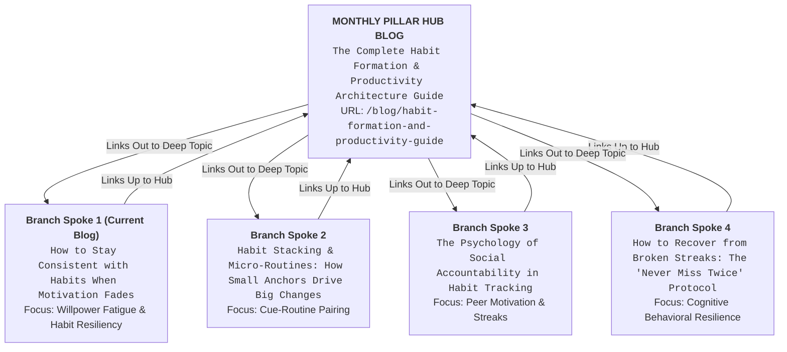

# Monthly Topic Cluster Architecture: Habit Mastery & Consistency (Qivera Digital)

## 1. Pillar Hub & Branch Spoke Hierarchy

---

## 2. Cluster Linking Plan
* Branch Spoke 1 links up to the Pillar Hub (`/blog/habit-formation-and-productivity-guide`) and links across to Branch Spoke 2 (`/blog/habit-stacking-and-micro-routines`).
* Product Connection: Naturally connects to HabitShare (`/apps/habitshare`) for shared accountability.

