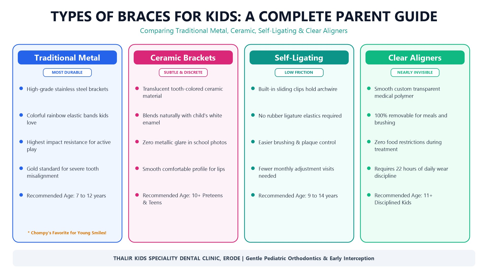
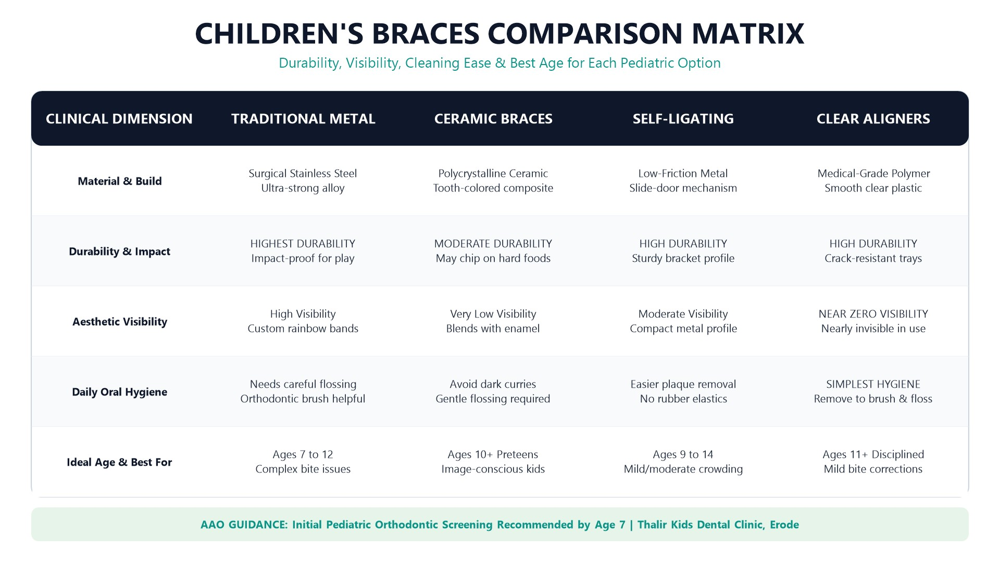

# Metadata Header
**Meta Title:** Types of Braces for Kids: Which Is Right for Your Child?
**Primary Keyword:** Types of Braces for Kids
**Secondary Keywords:** Best Braces for Children, Metal Braces for Kids, Ceramic Braces for Children, Clear Aligners for Kids, Early Orthodontics for Kids Erode, Pediatric Braces Options
**Meta Description:** Compare metal, ceramic, self-ligating braces, and clear aligners for children. Learn the best age, durability, and features to choose the right braces for kids.

---

# Types of Braces for Kids: Which Is Right for Your Child?

The right type of braces for your child depends on their age, bite severity, hygiene habits, and daily activity level, with traditional metal braces, subtle ceramic brackets, self-ligating systems, and clear aligners offering distinct clinical benefits. Modern pediatric orthodontics provides gentle solutions for crooked teeth (*Vankal Pal*) and protruding front teeth (*Ethu Pal*):

* **Traditional Metal Braces:** High-grade stainless steel brackets paired with colorful elastic bands; the most durable and cost-effective choice for younger kids.
* **Tooth-Colored Ceramic Braces:** Blend naturally with enamel shades; ideal for self-conscious preteens who want discrete correction without metal glare.
* **Self-Ligating Braces:** Specialized slide clips hold the archwire instead of rubber elastics, reducing friction and simplifying daily tooth brushing.
* **Clear Removable Aligners:** Custom transparent plastic trays that remove easily for meals and brushing, designed specifically for disciplined older children.

According to the [American Association of Orthodontists early screening guidelines](https://aaoinfo.org/whats-trending/early-orthodontic-care-may-help-you-avoid-costly-treatments/), children should undergo their first orthodontic evaluation by age seven to catch skeletal imbalances before permanent teeth finish erupting. Early clinical evaluation allows pediatric dentists to guide jaw development, expand narrow arches, and simplify future alignment.

---

## Comparing Pediatric Braces: Clinical Feature Matrix

**Figure 1: Complete Parent Guide to Children's Braces Options**

Evaluating how each orthodontic appliance performs across everyday child activities helps parents choose the best fit:

| Braces Type | Primary Material | Durability Level | Best Suited For | Key Parent Consideration |
| :--- | :--- | :--- | :--- | :--- |
| **Traditional Metal** | Surgical stainless steel | **Highest (Impact-resistant)** | Ages 7–12, complex bites | Needs careful brushing around brackets |
| **Ceramic Brackets** | Polycrystalline ceramic | Moderate (Can chip on impact) | Preteens and teens | Requires avoiding dark curry stains |
| **Self-Ligating** | Metal or clear composite | High (Low-friction clips) | Mild to moderate crowding | Fewer adjustment visits required |
| **Clear Aligners** | Medical-grade polymer | High (Removable trays) | Disciplined teens (Ages 11+) | Requires 22 hours of daily wear |

When choosing between fixed brackets and removable trays, reviewing our guide on [braces vs clear aligners for children](https://thalirkidsdental.com/blog/braces-for-kids-vs-invisalign-what-every-parent-should-know) helps families balance aesthetic preferences with daily school routine compliance.

---

## 3 Key Factors When Selecting Your Child's Appliance

**Figure 2: Pediatric Braces Selection Criteria: Age, Durability, and Compliance**

Pediatric dentists evaluate three essential factors before recommending a specific orthodontic appliance:

1. **Child Maturity and Responsibility:** Clear aligners require strict discipline to wear twenty-two hours daily. If your child misplaces lunchboxes or school items, fixed metal braces eliminate lost-tray stress.
2. **Sports and Musical Instruments:** Children active in contact sports like cricket or martial arts benefit from smooth brackets paired with custom sports mouthguards.
3. **Oral Hygiene Commitment:** Routine check-ups focused on [comprehensive children's dental care](https://thalirkidsdental.com/blog/kids-dental-near-me-from-first-tooth-to-toothaches-treatments-and-healthy-smiles) ensure gums stay healthy, as fixed brackets demand diligent flossing with orthodontic brushes.

At Thalir Kids Speciality Dental Clinic in Erode, our friendly mascot Chompy and pediatric dental specialists help young patients build confident smiles in a comforting, anxiety-free environment. Scheduling a [pediatric orthodontic evaluation at Thalir Kids Dental Clinic](https://thalirkidsdental.com/) gives your child a personalized treatment plan designed for healthy, lasting results.

---

## Frequently Asked Questions (FAQs)

### 1. What is the ideal age for a child's first braces consultation?
The American Association of Orthodontists recommends every child receive an initial orthodontic screening by age seven to monitor jaw growth and erupting teeth.

### 2. Can children choose colorful bands on their braces?
Yes, traditional metal and self-ligating braces allow children to personalize their smile with bright rubber band colors at every routine adjustment visit.

### 3. Do braces hurt when first placed on a child's teeth?
Children feel mild pressure and soreness for three to five days after placement, which quickly subsides with soft foods and cold rinses.
